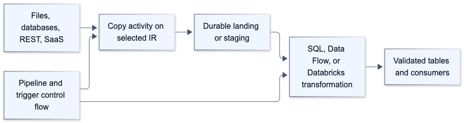
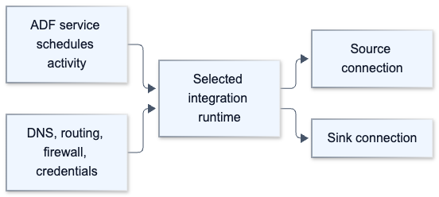
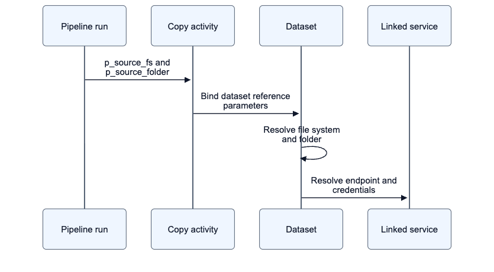
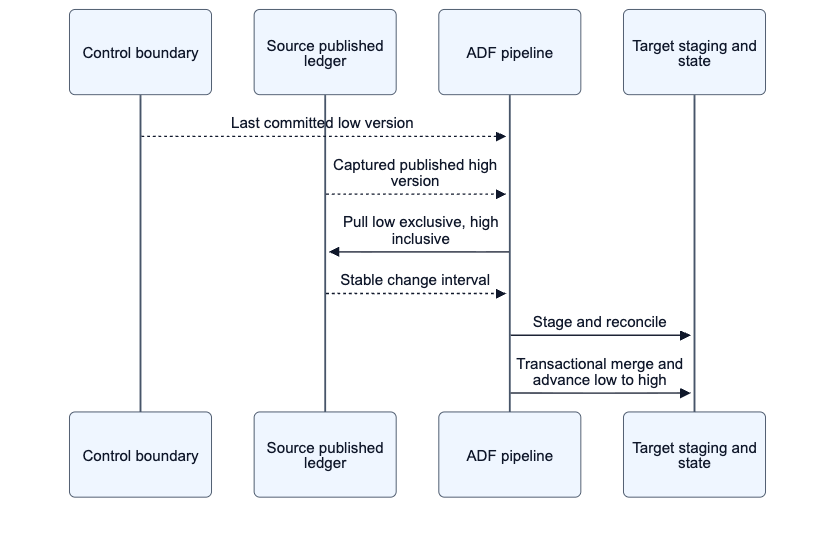
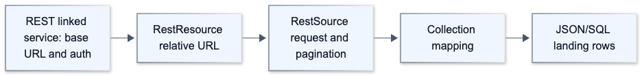
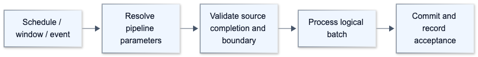
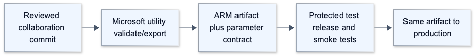
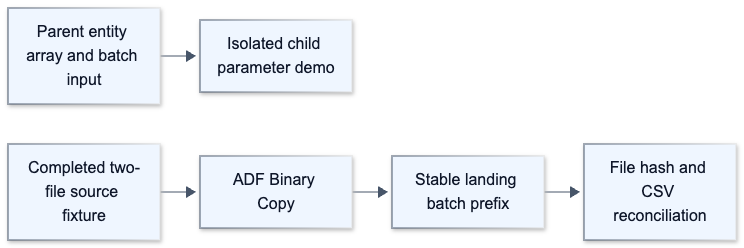
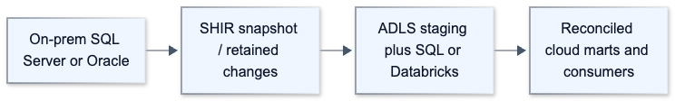
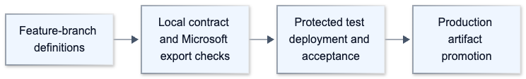

# Diagram gallery

All 58 editable diagrams are embedded in their chapters/scenarios and captured in [the manifest](diagram_manifest.json). Ten representative diagrams are exported below for readers without Mermaid rendering.

## 01-platform-map-1

[SVG](rendered/01-platform-map-1.svg)

## 03-integration-runtimes-1

[SVG](rendered/03-integration-runtimes-1.svg)

## 05-datasets-and-paths-1

[SVG](rendered/05-datasets-and-paths-1.svg)

## 11-watermarks-1

[SVG](rendered/11-watermarks-1.svg)

## 13-rest-copy-1

[SVG](rendered/13-rest-copy-1.svg)

## 18-triggers-windows-events-1

[SVG](rendered/18-triggers-windows-events-1.svg)

## 26-azure-devops-ci-1

[SVG](rendered/26-azure-devops-ci-1.svg)

## 30-worked-lab-1

[SVG](rendered/30-worked-lab-1.svg)

## 01-on-prem-migration-1

[SVG](rendered/01-on-prem-migration-1.svg)

## 12-release-maintenance-1

[SVG](rendered/12-release-maintenance-1.svg)
