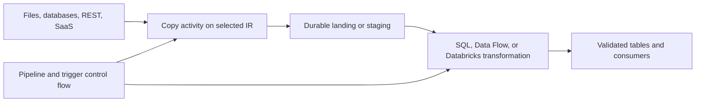

# 01. ADF platform map and the shared lab

Understand control flow, data movement, transformation compute, and environment boundaries.

## Data design

ADF orchestrates work and moves data through connectors. Ordinary pipelines are batch workflows. Mapping Data Flows use managed Spark, and external activities can run Databricks, SQL, functions, or other compute. A top-level ADF CDC resource is a distinct continuous mechanism; it is not evidence that Copy is a general Kafka stream processor.

| Component | Shared lab name | What it represents |
|---|---|---|
| Development factory | `adf-guide-dev` | Replace with globally unique real factory name |
| ADLS linked service | `ls_adls` | Account endpoint and factory managed identity |
| Binary dataset | `ds_adls_binary` | File-system/folder parameters; no row parsing |
| File-copy pipeline | `pl_copy_files` | Copy immutable completed files to stable batch prefix |
| Parameter parent/child | `pl_parallel_parent` / `pl_parameter_child` | Safe loop-to-child parameter passing |
| API example | `pl_rest_orders_example` | REST pagination illustration with fake endpoint |
| Daily trigger | `tr_daily_files_stopped` | Deliberately stopped until configured/tested |
| Container/file system | `lab` | Development data only |
| Source prefix | `incoming/orders/2026-10-12` | Two CSV fixtures, three order rows |
| Sink prefix | `landing/orders/batch=orders-20261012-001` | Stable logical batch destination |

The file-copy lab does not transform rows or claim exactly-once business ingestion. Binary Copy preserves files, and a separate reconciliation checks content. The parameter demo deliberately uses Wait rather than a paid/source-dependent transformation. REST hosts, resource IDs, account names, and subscription UUIDs in examples are illustrative and must be replaced.

## Buttons and entry points

Open the factory in Azure Portal and use **Launch studio**. Find **Author**, **Monitor**, and **Manage**. Author contains pipelines/datasets/data flows; Manage contains linked services/integration runtimes/Git configuration; Monitor contains published runs and runtime health. A dataset is not a stored dataset copy, and a linked service is not an orchestration pipeline.

## Governance and infrastructure automation

Use separate dev/test/prod factories. A factory's managed identity is different in each environment. Azure resource management permissions, source data permissions, Key Vault permissions, and network routes are separate. Creating an ADF resource does not authorize it to read an ADLS container.

## Code push automation and maintenance

Only development is Git-integrated in the recommended promotion model. Promote generated ARM artifacts to test/prod; do not assume committing a source JSON file deploys it. The source root is `examples/factory`. The active repository workflow validates/exports definitions and renders diagrams; deployment templates remain opt-in.

## Tests

Separate local definition/contract tests from live connector/runtime tests. Record the ADF run ID, Git SHA/build artifact, resolved parameters, source boundary, and reconciliation. No real Azure factory or live UI session was used to author this guide. This is ADF v2 guidance; Microsoft Fabric Data Factory is covered as a separate migration consideration.

## Official references

- [Introduction](https://learn.microsoft.com/en-us/azure/data-factory/introduction)
- [Concepts Pipelines Activities](https://learn.microsoft.com/en-us/azure/data-factory/concepts-pipelines-activities)
- [Concepts Integration Runtime](https://learn.microsoft.com/en-us/azure/data-factory/concepts-integration-runtime)
- [Concepts Change Data Capture](https://learn.microsoft.com/en-us/azure/data-factory/concepts-change-data-capture)

[Guide index](../../AZURE_DATA_FACTORY_GUIDE_INDEX.md)
