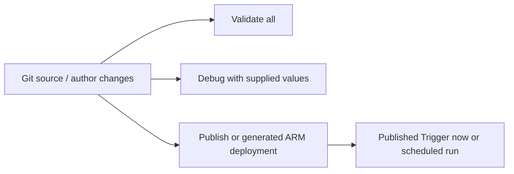

# 02. Create the factory and navigate authoring, debug, and publish

Set up the development surface and distinguish code validation from execution.

## Data design and buttons

In Azure Portal **Create a resource → Integration → Data Factory → Create**. Fill **Basics** with your Subscription, Resource group `rg-adf-guide-dev`, Region approved for your data/network design, globally unique Name, and Version V2. On Git configuration either configure the approved dev repository or defer it until chapter 25. Review networking settings and **Review + create → Create**. Open the resource and **Launch studio**.

| Field | Example | Decision |
|---|---|---|
| Factory name | Your unique `adf-guide-dev-<suffix>` | Names in examples are illustrative |
| Resource group | `rg-adf-guide-dev` | Lifecycle/ownership boundary |
| Region | Approved region near execution/data | Evaluate availability and network |
| Git repository | Dev only | Test/prod deployed from artifacts |
| Managed identity | System-assigned initially | Grant data access after creation |

In Studio **Author → + → Pipeline**. Name `pl_parameter_child`. Select the canvas background, **Parameters → New**, Name `p_entity`, Type String, Default `orders`. Add the remaining parameters/activities from chapter 16 or use its validated JSON through the code editor in the authoring pane. Save changes to your feature branch when Git-connected.

**Debug** runs the current authoring pipeline with supplied parameter values; its external activities can read/write real data. **Validate all** checks definitions but does not test every credential or source query. **Publish all** deploys collaboration-branch changes into the live development factory. **Trigger now** runs the published pipeline; an unpublished edit need not be reflected in that run.

Use **Output** below the authoring canvas for debug activity results. Use **Monitor → Pipeline runs** for published/triggered execution; inspect activity Inputs/Outputs and error details. Do not call a local JSON parser a successful pipeline run.

## Governance and infrastructure automation

Creating/managing factories requires Azure RBAC. Access to Studio does not grant SQL SELECT or storage data rights. Bootstrap factory, identity, network, diagnostic settings, and storage through the platform owner. Keep debug pointed at a disposable source/sink because it executes activities.

## Code push automation and maintenance

Use feature branches and PRs. Review definitions, generate ARM, deploy to test, run connector/data tests, then promote the same artifact. Do not use Publish all in production as an undocumented manual release mechanism. UI labels can vary with rollout/permission; this walkthrough follows linked Microsoft documentation rather than recorded live clicks.

## Tests

Check a required parameter, invalid default/type, missing dataset, and unknown activity reference. Compare Debug versus Trigger now after changing an unpublished default. Run a safe parameter-only demo before connecting external sources. Verify that factory resource creation and Git commit alone produce no data movement.

## Official references

- [Quickstart Create Data Factory Portal](https://learn.microsoft.com/en-us/azure/data-factory/quickstart-create-data-factory-portal)
- [Iterative Development Debugging](https://learn.microsoft.com/en-us/azure/data-factory/iterative-development-debugging)
- [Source Control](https://learn.microsoft.com/en-us/azure/data-factory/source-control)
- [Continuous Integration Deployment](https://learn.microsoft.com/en-us/azure/data-factory/continuous-integration-deployment)

[Guide index](../../AZURE_DATA_FACTORY_GUIDE_INDEX.md)
