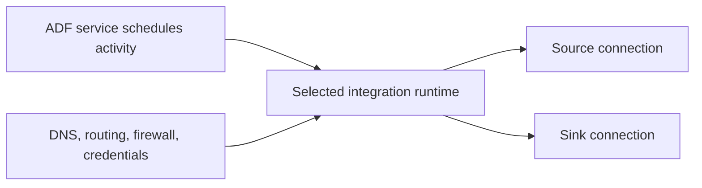

# 03. Azure IR, self-hosted IR, Azure-SSIS IR, and execution location

Choose the execution plane that can actually reach both ends of the activity.

## Data design and decision table

| Runtime | Typical use | Important constraint |
|---|---|---|
| Azure IR | Supported cloud Copy/Data Flow/dispatch | Region and managed-network configuration matter |
| Self-hosted IR (SHIR) | On-prem/private source or custom connectivity | Both Copy endpoints must be reachable from its Windows host |
| Azure-SSIS IR | Run existing SSIS packages | Package/catalog/network/licensing planning differs |

## Exact SHIR buttons and fields

**Manage → Integration runtimes → New → Azure, Self-Hosted → Continue → Self-Hosted → Continue**. Name `ir_onprem_dev`, optional description, **Create**. Copy a registration key into the supported SHIR installation on an approved Windows host through Integration Runtime Configuration Manager. Treat that key as a credential; do not commit or display it in logs. Complete registration and verify the node is online in Studio.

The host needs supported OS/prerequisites, outbound connectivity to required service endpoints, source and sink connectivity, and sufficient CPU/memory/network. Do not install SHIR on the user's machine as part of reading this guide. For availability, register additional approved nodes under the same logical runtime and follow documented node limits/configuration.

When creating the source linked service, select **Connect via integration runtime: `ir_onprem_dev`**. If the sink uses an Azure IR linked service but Copy requires SHIR because of the source, test sink access from SHIR too. An Azure-hosted linked service definition does not create a separate invisible transfer hop.

## Parameters and tuning

`connectVia` is a LinkedService property referencing the chosen IntegrationRuntime. Azure Copy DIUs are not SHIR VM sizes. On SHIR tune host resources, nodes, concurrent jobs, and source/sink throughput. Copy `parallelCopies` and pipeline ForEach concurrency multiply source connections; benchmark aggregate load.

## Governance and infrastructure automation

Use Azure IR with managed VNet/private endpoints for supported private cloud access when suitable. SHIR's network and credentials belong to the hosting environment; ADF managed VNet does not put that host inside the managed network. Platform IaC can define a runtime resource, but host installation/registration and secret lifecycle remain separate automation steps.

## Code push automation and maintenance

Keep IR names/type consistent across environments where linked-service deployment expects the same reference. Runtime sharing is a documented architecture, not a reason to copy another factory's registration key into Git. Patch and monitor hosts, rotate keys through controlled processes, and keep runtime ownership independent of application JSON.

## Tests

Test DNS/port/TLS/source login and actual Copy from the selected runtime; include sink reachability. Kill one test node and observe availability/queue behavior. Measure queue duration and source throttling separately from transfer time. A linked-service Test connection success does not prove a full-size Copy or failover works.

## Official references

- [Concepts Integration Runtime](https://learn.microsoft.com/en-us/azure/data-factory/concepts-integration-runtime)
- [Create Self Hosted Integration Runtime](https://learn.microsoft.com/en-us/azure/data-factory/create-self-hosted-integration-runtime)
- [Managed Virtual Network Private Endpoint](https://learn.microsoft.com/en-us/azure/data-factory/managed-virtual-network-private-endpoint)
- [Create Azure Ssis Integration Runtime](https://learn.microsoft.com/en-us/azure/data-factory/create-azure-ssis-integration-runtime)

[Guide index](../../AZURE_DATA_FACTORY_GUIDE_INDEX.md)
