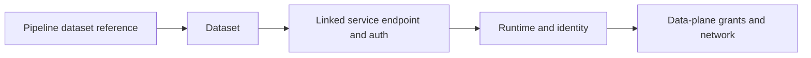

# 04. Linked services, managed identities, SQL credentials, and Key Vault

Define connections without making runtime input a secret distribution channel.

## Data design and buttons

**Manage → Linked services → New → Azure Data Lake Storage Gen2 → Continue**. Name `ls_adls`; choose the intended integration runtime. Authentication type **System Assigned Managed Identity**, select/enter the storage account endpoint, then **Test connection → Create**. The lab JSON is AzureBlobFS with a parameterized `url`; omitting key/SAS/service-principal fields selects its documented managed-identity route.

| Connection field | Example/value |
|---|---|
| Name | `ls_adls` |
| Account URL | `https://<storage-account>.dfs.core.windows.net` |
| Authentication | Factory system-assigned identity |
| Runtime | Approved Azure IR or SHIR |
| Linked-service parameter | `p_account_url` String |
| URL expression | `@linkedService().p_account_url` |

In storage **Access Control (IAM) → Add role assignment**, grant the development factory identity an approved scoped data role. Source reading commonly uses Storage Blob Data Reader; writing uses Storage Blob Data Contributor. ADLS ACL-based designs require appropriate traversal/execute on ancestor paths. Management-plane Contributor alone is not storage data access.

For Azure SQL use **New → Azure SQL Database**, configure the supported connector version, Server, Database, authentication and runtime. With managed identity, a DBA creates the contained database principal and grants exact read/write/procedure permissions. Connection setup in ADF does not create that SQL principal.

## Key Vault and parameters

Create an **Azure Key Vault** linked service with the vault base URL and approved identity. In a secret-enabled connector select the Key Vault reference, vault linked service, and Secret name; use a version only when intentionally pinning it. Grant the factory identity the documented secret access via vault RBAC/access policy. Keep tokens/passwords out of pipeline variables, global parameters, URLs, source JSON, and CI arguments.

Linked-service parameters select non-sensitive environment/dataset values. The passing chain is pipeline → dataset parameter → dataset linkedServiceName parameters → linked-service field. Merely defining a parameter in a pipeline does not populate the linked service automatically.

## Governance and infrastructure automation

Separate identities for management/deployment, ADF data access, external compute, and source APIs. Use managed identity where supported, scoped fallback secrets otherwise. Provision vault access, storage/SQL permissions, network and identity assignments before deploying application assets.

## Code push automation and maintenance

Parameterize environment-specific endpoints in exported ARM; inspect generated parameter names instead of guessing them. Test/prod use their own identities and vaults. A runtime source default and an ARM deployment override are different layers. Rotate credentials and test the failure/recovery path.

## Tests

Test allowed source/sink paths and denied unrelated storage; expired secret; wrong SQL database principal; TLS/certificate failures; and rotated credentials. Use the same identity/runtime as the scheduled activity. Mask activity inputs/outputs containing secrets with secureInput/secureOutput while retaining safe diagnostic fields.

## Official references

- [Connector Azure Data Lake Storage](https://learn.microsoft.com/en-us/azure/data-factory/connector-azure-data-lake-storage)
- [Connector Azure Sql Database](https://learn.microsoft.com/en-us/azure/data-factory/connector-azure-sql-database)
- [Store Credentials In Key Vault](https://learn.microsoft.com/en-us/azure/data-factory/store-credentials-in-key-vault)
- [Parameterize Linked Services](https://learn.microsoft.com/en-us/azure/data-factory/parameterize-linked-services)

[Guide index](../../AZURE_DATA_FACTORY_GUIDE_INDEX.md)
