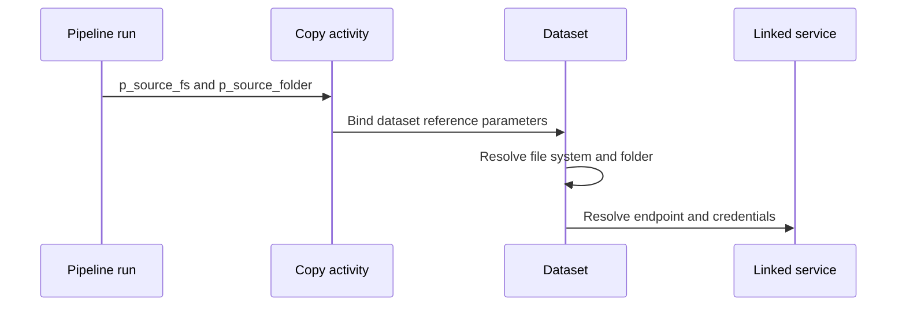

# 05. Datasets, formats, locations, and parameterized paths

Describe the selected source/sink data and keep transport separate from parsing.

## Data design and exact UI

**Author → + → Dataset → Azure Data Lake Storage Gen2 → Continue → Binary → Continue**. Name `ds_adls_binary`, Linked service `ls_adls`. Finish creation. Open **Parameters → New**: `p_file_system` String and `p_folder` String. In **Connection**, set File system with **Add dynamic content** `@dataset().p_file_system`; Directory `@dataset().p_folder`; leave File empty for folder Copy.



| Format | Use | Trap |
|---|---|---|
| Binary | Preserve file bytes | No row mapping or row-count semantics |
| DelimitedText | CSV/TSV rows | Header, quote, escape, delimiter, encoding |
| Json | JSON objects/arrays | Nested collections and file pattern |
| Parquet | Typed columnar analytics | Schema/type compatibility, partition discovery |
| Excel/XML/Avro/ORC | Supported connector/format combinations | Check limitations, compression and sink support |

For CSV create a DelimitedText dataset, set Column delimiter `,`, First row as header true, correct quote/escape/encoding, and approved schema import mode. Preview a representative file. Sample schema import is not a durable contract for every future file.

## Exact JSON location example

```json
{
  "type": "AzureBlobFSLocation",
  "fileSystem": {"value":"@dataset().p_file_system","type":"Expression"},
  "folderPath": {"value":"@dataset().p_folder","type":"Expression"}
}
```

In a Copy input dataset reference pass `p_file_system=@pipeline().parameters.p_source_fs` and `p_folder=@pipeline().parameters.p_source_folder`. Pipeline parameters and dataset parameters are separate scopes. For dynamic file naming use an additional `p_file` parameter, not a path string silently concatenated into the wrong field.

## Governance and infrastructure automation

Validate/allowlist container and folder selections in reusable frameworks. A caller choosing a path does not gain permissions, but broadly privileged factory identities may accidentally expose too many paths. Test factory and interactive browsing identities independently. The dataset object stores metadata; storage data and lifecycle remain external.

## Code push automation and maintenance

Keep format/schema assumptions versioned beside fixtures. Reuse datasets by explicit parameter contracts, not mutable UI defaults. Separate source/sink storage endpoint deployment settings from each logical batch's path values. Avoid a run-ID-only sink prefix when replay should update the same logical batch.

## Tests

Verify correct source/sink parameter names, folder versus filename, recursion, header/encoding, empty file, missing folder, nested JSON arrays, decimals/nulls, and unexpected schema. Binary file consistency is a different assertion from parsed row/revenue reconciliation.

## Official references

- [Concepts Datasets Linked Services](https://learn.microsoft.com/en-us/azure/data-factory/concepts-datasets-linked-services)
- [Format Binary](https://learn.microsoft.com/en-us/azure/data-factory/format-binary)
- [Format Delimited Text](https://learn.microsoft.com/en-us/azure/data-factory/format-delimited-text)
- [Format Json](https://learn.microsoft.com/en-us/azure/data-factory/format-json)

[Guide index](../../AZURE_DATA_FACTORY_GUIDE_INDEX.md)
