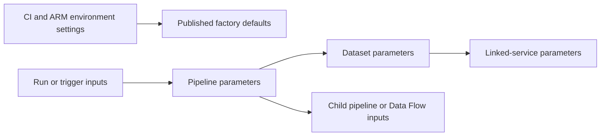

# 06. Parameter scopes and deployment versus runtime values

Know exactly where to define, pass, and read each value.

## Data design and reference map

| Mechanism | Define/set | Read/reference | Lifetime |
|---|---|---|---|
| Pipeline parameter | Canvas Parameters / trigger/run input | `@pipeline().parameters.p_batch_id` | Immutable per run |
| Pipeline variable | Canvas Variables / Set Variable | `@variables('v_label')` | Mutable in that pipeline run |
| Dataset parameter | Dataset Parameters / activity reference | `@dataset().p_folder` | Dataset invocation |
| Linked-service parameter | Linked service Parameters / reference | `@linkedService().p_account_url` | Connection invocation |
| Global parameter | Manage Global parameters | `@pipeline().globalParameters.<name>` | Factory configuration |
| Loop item | ForEach Items | `@item()` or `@item().entity` | Iteration |
| Activity output | Dependency execution | `@activity('LookupConfig').output.value` | Activity result |
| Child pipeline input | Execute Pipeline Settings | Child's pipeline parameter | Child run |
| Child return value | Supported Set Variable system return | `@activity('RunChild').output.pipelineReturnValue.<key>` | Completed child |
| Mapping Data Flow parameter | Data Flow Parameters / activity Parameters | `$p_region` in flow expression | Data Flow execution |
| ARM parameter | Generated deployment parameter file | ARM template `parameters(...)` | Deployment |
| CI variable | Vendor runner environment | Vendor-specific syntax | Build/release job |

The lab's runtime `p_source_folder` chooses a batch. Linked-service `p_account_url` chooses an account endpoint. An ARM parameter substitutes production endpoints into deployed definitions; it does not automatically become a pipeline run parameter. Do not use the same ambiguous name for unrelated scopes.

## Buttons and concrete passing chain

Select pipeline background → **Parameters → New**, Name `p_source_folder`, Type String, Default `incoming/orders/2026-10-12`. Select Copy → **Source**, choose dataset `ds_adls_binary`, and fill dataset parameter `p_folder` using **Add dynamic content** `@pipeline().parameters.p_source_folder`. Open dataset → **Connection**: Directory `@dataset().p_folder`.

For linked-service parameter passing, expose the parameter on the dataset's linked-service reference and map its value from the dataset parameter. Defining a linked-service parameter with a default is enough for the small lab, but production endpoint overrides belong in reviewed environment deployment configuration.

## Governance and infrastructure automation

Configuration values are not access grants. Global parameters are unsuitable for secrets. Pipeline inputs/outputs can be monitored; protect genuinely sensitive activity fields. Source IDs/path choices should be allowlisted when one broadly privileged factory serves many teams.

## Code push automation and maintenance

Document each parameter's name, type, default, caller, and validation. Keep business inputs in run/trigger parameters; environment infrastructure in deployment parameters. Validate the generated ARM parameter file after changing linked services or `arm-template-parameters-definition.json`.

## Tests

Test a valid override, missing/unknown key, wrong type, an array supplied as a string, a default unexpectedly inherited by a child, and a path pointing to the wrong environment. Review activity Inputs to see resolved values. Native return-value availability/contracts are covered in chapter 16; it is not a shared variable between parent and child.

## Official references

- [How To Expression Language Functions](https://learn.microsoft.com/en-us/azure/data-factory/how-to-expression-language-functions)
- [Control Flow Expression Language Functions](https://learn.microsoft.com/en-us/azure/data-factory/control-flow-expression-language-functions)
- [Parameterize Linked Services](https://learn.microsoft.com/en-us/azure/data-factory/parameterize-linked-services)
- [Parameters Data Flow](https://learn.microsoft.com/en-us/azure/data-factory/parameters-data-flow)

[Guide index](../../AZURE_DATA_FACTORY_GUIDE_INDEX.md)
