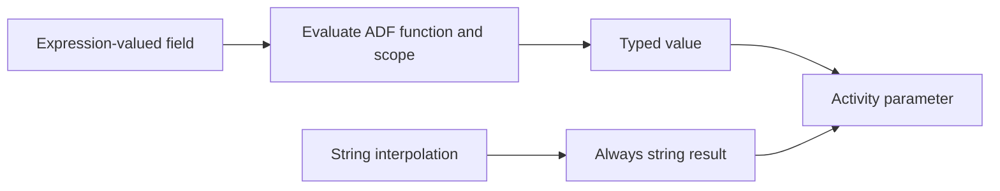

# 07. Expressions: types, interpolation, dates, escaping, and outputs

Use ADF syntax deliberately instead of mixing pipeline, SQL, Data Flow, and notebook languages.

## Data design and exact expression examples

| Purpose | Expression | Result/type |
|---|---|---|
| Read pipeline input | `@pipeline().parameters.p_batch_id` | Original parameter type |
| Compose batch folder | `@concat('landing/orders/batch=',pipeline().parameters.p_batch_id)` | String |
| Array loop | `@pipeline().parameters.p_entities` | Array, if parameter is Array |
| Current item field | `@item().entity` | That object's field |
| All Lookup rows | `@activity('LookupConfig').output.value` | Array when firstRowOnly=false |
| First Lookup row | `@activity('LookupBoundary').output.firstRow.high_version` | Field value |
| Read a variable | `@variables('v_label')` | Declared variable type |
| Numeric conversion | `@int(pipeline().parameters.p_limit)` | Integer |
| UTC date label | `@formatDateTime(utcNow(),'yyyy-MM-dd')` | String |
| India local date | `@convertTimeZone(utcNow(),'UTC','India Standard Time','yyyy-MM-dd')` | String |
| Literal at-sign | `@@literal` in expression-valued JSON | `@literal` |

ADF timezone identifiers follow its documented timezone naming, such as **India Standard Time**; don't copy Databricks' `Asia/Kolkata` setting directly into an ADF trigger.

`@pipeline().parameters.p_limit` preserves an Int value; `@{pipeline().parameters.p_limit}` interpolates it into a string. This matters for ForEach Items, conditions, numeric properties, and JSON request bodies. An array serialized inside quotes is not an array.

## Buttons and troubleshooting

Use **Add dynamic content** beside a supported property. Select the parameter/output in the editor or type the full expression, then confirm. The editor escapes embedded content; inspect **Code** if a JSON body becomes an unexpected JSON string. Use separate typed fields/objects where possible.

String literals use single quotes inside pipeline expressions. To include a single quote inside such a literal, double it. Mapping Data Flow is a different language (`$p_region`, `toString`, column expressions); SQL parameters/quoting and Databricks widgets differ again. ADF input strings are not automatically safe SQL bindings.

Use trigger-defined source boundaries/business dates for repeatable scheduled work. `utcNow()` in a repaired run generates a new time and can select different input. Pass `p_window_start`, `p_window_end`, or a stable batch ID rather than recomputing them at every activity.

## Governance and infrastructure automation

Avoid constructing arbitrary SQL, URLs, or storage paths from untrusted values. Prefer stored procedure parameters and allowlisted metadata. ADF does not turn a concatenated query into a prepared statement. Keep secrets in supported connector/vault authentication fields.

## Code push automation and maintenance

Store expressions as JSON expression objects where the API expects them, not an invented expression-wrapper everywhere. Trigger parameter strings may use expressions directly; activity typed expression properties commonly use value/type objects. Microsoft's validation utility and live engine are authoritative beyond the focused local example checks.

## Tests

Automate contracts for quoted/unquoted values, UTC/local day boundaries, negative/invalid integer conversion, apostrophes, null/empty values, missing output fields, and expired source boundaries. Run representative expressions in a disposable parameter-only pipeline; local reference tests do not emulate the entire ADF expression engine.

## Official references

- [Control Flow Expression Language Functions](https://learn.microsoft.com/en-us/azure/data-factory/control-flow-expression-language-functions)
- [Control Flow System Variables](https://learn.microsoft.com/en-us/azure/data-factory/control-flow-system-variables)
- [Parameters Data Flow](https://learn.microsoft.com/en-us/azure/data-factory/parameters-data-flow)

[Guide index](../../AZURE_DATA_FACTORY_GUIDE_INDEX.md)
