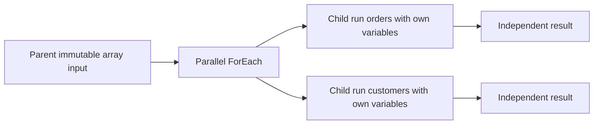

# 08. Variables, counters, arrays, and parallel-loop races

Keep iteration-local state inside isolated child pipeline runs.

## Data design and buttons

Pipeline background → **Variables → New**: Name `v_label`, Type String, Default empty. Add **Set Variable**, Name `BuildLabel`; **Variables** tab, select `v_label`, Value via dynamic content `@concat(pipeline().parameters.p_entity,'|',pipeline().parameters.p_batch_id)`.

Use pipeline parameters for externally supplied immutable inputs. Use variables only for mutable local state. Set Variable supports documented variable types; verify type names in the current UI instead of treating all JSON types as supported mutable variables.

A variable is scoped to the entire pipeline run, not one ForEach iteration. Two parallel iterations doing Set Variable then Copy can race and both copy the same entity. Pass `@item()` directly into activity/dataset/child parameters. The sample parent calls `pl_parameter_child`; each child has its own `v_label`.

## Counter and array patterns

Self-reference is not supported in a Set Variable expression for the variable being set. For a serial counter use `v_counter` plus `v_next`: Set `v_next=@string(add(int(variables('v_counter')),1))` then Set `v_counter=@variables('v_next')`, using supported types/conversion. Do not share that counter across parallel work.

Append Variable can collect a serial array, but does not make parallel appends transactional. Prefer durable per-item result records keyed by batch/entity and aggregate after all child runs complete. ForEach batchCount is an upper concurrency bound, not a guarantee every item runs simultaneously.

## Governance and infrastructure automation

Each child still uses the factory's configured identity/runtime; isolation of variables does not mean separate cloud privileges. For multi-team factories, parameter allowlists and scoped linked services are required. Bound concurrency to source/vendor limits and SHIR capacity.

## Code push automation and maintenance

Document state ownership and retry behavior. Don't introduce a global variable to “simplify” a metadata-driven parallel framework. Counters used for pagination need an explicit serial Until loop; each iteration updates state only after the prior request outcome is known.

## Tests

Use entities `orders` and `customers` repeatedly with parallel batchCount 2/4 and inspect resolved child inputs. Prove each child receives the intended batch/entity. Test a deliberately shared variable in a disposable demo to understand the race, then retain the isolated design. Test rejected entity, empty batch ID, missing child parameter, and loop cancellation/retry.

## Official references

- [Control Flow Set Variable Activity](https://learn.microsoft.com/en-us/azure/data-factory/control-flow-set-variable-activity)
- [Control Flow Append Variable Activity](https://learn.microsoft.com/en-us/azure/data-factory/control-flow-append-variable-activity)
- [Control Flow For Each Activity](https://learn.microsoft.com/en-us/azure/data-factory/control-flow-for-each-activity)
- [Control Flow Execute Pipeline Activity](https://learn.microsoft.com/en-us/azure/data-factory/control-flow-execute-pipeline-activity)

[Guide index](../../AZURE_DATA_FACTORY_GUIDE_INDEX.md)
