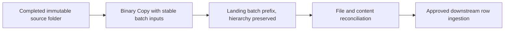

# 09. File ingestion: Binary/CSV, hierarchy, wildcards, and completion

Move a complete immutable delivery into a stable batch destination.

## Data design and exact lab steps

**Author → + → Pipeline**, Name `pl_copy_files`. Add the five String parameters from the lab. Drag **Copy data**; Name `CopyFiles`; **Source** Dataset `ds_adls_binary`, parameters File system from `p_source_fs`, folder from `p_source_folder`. Choose recursive directory read as needed. **Sink** Dataset the same parameterized Binary dataset, File system from `p_sink_fs`, folder:

```text
@concat(pipeline().parameters.p_landing_root,'/batch=',pipeline().parameters.p_batch_id)
```

Set Copy behavior **Preserve hierarchy**. For the lab use General/Policy timeout one hour, Retry `2`, Retry interval `30` seconds. In JSON this is timeout `0.01:00:00`, retry `2`, retryIntervalInSeconds `30`. Do not confuse the pipeline/activity timeout with a per-source HTTP request timeout.



| Read choice | Set here | Why |
|---|---|---|
| Directory + recursion | Source read settings | Copy complete folder tree |
| Wildcard folder/file | Copy Source settings | Match intended subset; not a dataset literal wildcard assumption |
| File list | Supported source file-list settings | Manifest-driven bounded set |
| Modified-time filter | Source connector read settings | Optimization; not a universal complete change/deletion feed |
| Binary format | Dataset | Preserve bytes, no row parser |
| CSV format | DelimitedText dataset | Parse rows; configure headers/types/mapping |

A repeated Copy to the same stable batch path can overwrite the same filenames with the same immutable content. That is file-level replay behavior, not a guarantee that a downstream append or event-triggered consumer won't double-process rows. A destination based only on a new pipeline RunId creates a different path on each retry/re-run and can duplicate logical batches.

## Governance and infrastructure automation

Grant source read/sink write and traversal or approved data roles. Keep source delivery separate from transformed data. Source files must be immutable/complete for the chosen batch; a folder being listed while files arrive is not a complete snapshot. Use manifests or upstream completion protocol for publication.

## Code push automation and maintenance

Version file naming/completion, format, hierarchy, and batch-ID contracts. Don't make Delete activity an implicit cleanup after a failed copy. Promote datasets/linked services together, and verify endpoint/path overrides for each environment. Source retention must support replay until acceptance.

## Tests

Initial fixture copy, unchanged rerun, interrupted transfer, nested folders, wildcard mismatch, zero files, partial delivery, duplicate filename with changed content, and missing sink write rights. Reconcile copied bytes/files and separately parse the CSV to assert three rows, IN 145.00 and US 50.00. The lab's nonempty-file gate alone is not content validation.

## Official references

- [Copy Activity Overview](https://learn.microsoft.com/en-us/azure/data-factory/copy-activity-overview)
- [Connector Azure Data Lake Storage](https://learn.microsoft.com/en-us/azure/data-factory/connector-azure-data-lake-storage)
- [Format Binary](https://learn.microsoft.com/en-us/azure/data-factory/format-binary)
- [Copy Activity Data Consistency](https://learn.microsoft.com/en-us/azure/data-factory/copy-activity-data-consistency)

[Guide index](../../AZURE_DATA_FACTORY_GUIDE_INDEX.md)
