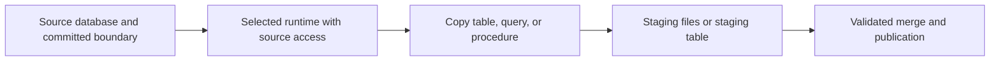

# 10. SQL/Oracle/on-prem database ingestion and source load

Configure query/table reads, runtime routing, and a reproducible extraction boundary.

## Data design and exact connection fields

For on-prem SQL Server use a supported SQL Server linked service and `ir_onprem_dev`. For Azure SQL choose the current Azure SQL Database connector/version. Do not assume their authentication/version/partition options are identical.

**Manage → Linked services → New → SQL Server/Azure SQL Database**: Name `ls_orders_sql`; select runtime, actual Server/Database, approved auth, and credential/vault reference. **Test connection → Create**. **Author → + → Dataset**, select the connector, name `ds_orders_sql`, linked service, schema `dbo`, table `Orders` where supported. Source dataset can expose allowlisted schema/table parameters.



Copy **Source** lets supported connectors choose Table, Query, or Stored procedure. Prefer procedure parameters for dynamic boundaries rather than interpolating untrusted SQL. A SQL example for a commit-ordered event ledger:

```sql
SELECT change_version, order_id, operation, amount, region
FROM dbo.OrderChangeLedger
WHERE change_version > @LowVersion AND change_version <= @HighVersion;
```

ADF doesn't automatically bind those T-SQL placeholders in a plain text query. Use the connector's stored-procedure parameter mapping or construct a validated numeric query through an explicit approved contract. See chapter 11 for watermark semantics.

## Parameters and performance

| Setting | Example/decision |
|---|---|
| Source schema/table | `dbo.Orders`, allowlisted |
| Boundary | Committed low/high version or captured time interval |
| Query timeout | Measured source workload, not arbitrary unlimited |
| Partition option | Supported connector/version-specific choice |
| Parallel copies | Start small and source-approved |
| Sink | Staging table/files, then merge |

Partitioning and parallelism can overload a transactional source. A high row count alone does not determine DIUs or SHIR hosts; source query plans, row width, network, sink write rate and contention matter. Reading replicas can change consistency/CDC availability.

## Governance and infrastructure automation

Source DBA grants table/procedure rights; ADF resource role does not. Configure DNS/routes/TLS/firewall for the actual runtime, and both endpoints for SHIR Copy. If using a private source and cloud sink, test sink reachability from SHIR. Keep source credentials scoped and rotated.

## Code push automation and maintenance

Keep connector version/driver assumptions, query/procedure, parameter mapping, source boundary, and sink schema in version control. Deploy SQL changes through the database release owner. ADF ARM deployment cannot install source CDC or grant database permissions automatically.

## Tests

Consistent snapshot extraction under concurrent writes, timezone/decimal/null handling, source throttling, partition coverage/no overlap, failure after partial sink write, and retries. For incremental processing validate same-time changes and hard deletes explicitly; a repeated full scan or high-watermark query alone doesn't solve them.

## Official references

- [Connector Sql Server](https://learn.microsoft.com/en-us/azure/data-factory/connector-sql-server)
- [Connector Azure Sql Database](https://learn.microsoft.com/en-us/azure/data-factory/connector-azure-sql-database)
- [Connector Oracle](https://learn.microsoft.com/en-us/azure/data-factory/connector-oracle)
- [Copy Activity Performance](https://learn.microsoft.com/en-us/azure/data-factory/copy-activity-performance)

[Guide index](../../AZURE_DATA_FACTORY_GUIDE_INDEX.md)
