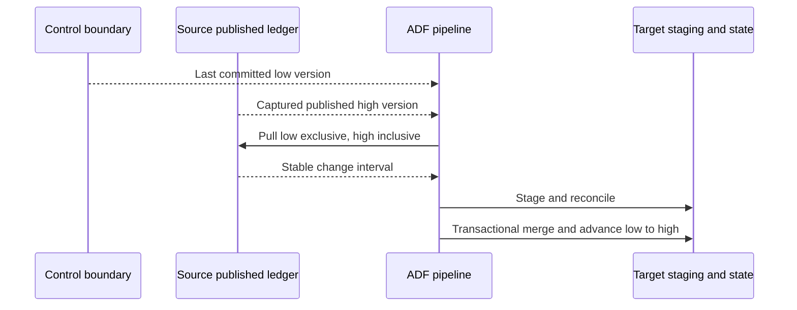

# 11. Incremental watermarks, committed boundaries, and transactional advancement

Capture a stable interval and move its boundary only after target acceptance.

## Data design

A timestamp watermark captures only changes represented by that timestamp. Hard deletes, late commits with old timestamps, equal-timestamp updates, and clocks drifting across systems can violate its assumptions. Use a source change feed when those behaviors cannot be controlled.

The robust contract for the SQL companion is a **published commit-ordered event version** with deletion events, not an arbitrary SQL IDENTITY value. Identity allocation order can differ from commit order under concurrency. A captured high version is safe only when every required event up to it is already visible and retained.

## Exact activity setup

Create **Lookup** `ReadLow` on the control database, First row only true; query/procedure returns `low_version`. Add Lookup `ReadHigh` dependent on ReadLow, returning `high_version` from the source's approved published boundary. Copy `CopyChanges` depends on ReadHigh and reads the stable interval. Parameters:

| Value | Expression |
|---|---|
| Low bound | `@activity('ReadLow').output.firstRow.low_version` |
| High bound | `@activity('ReadHigh').output.firstRow.high_version` |
| Batch identity | Stable caller-supplied `p_batch_id` |
| Run correlation | `@pipeline().RunId` for logs, not logical batch identity |

For timestamp extraction specify precisely `(low, high]` or `[low, high)` and its source guarantees. A common simple example uses `updated_at > low AND updated_at <= high`; late records with old values will still be missed. Overlap plus deduplication can mitigate bounded lateness, not arbitrary missing deletes.

Use a source stored procedure with typed parameters. After Copy, add a target **Stored procedure** or **Script** activity which validates staging, applies ordered state changes, and advances the control watermark in the same database transaction where feasible. The source read, ADF Copy, and target transaction are not one distributed transaction.

## Governance and infrastructure automation

Scope the factory identity to source reads, staging writes, and approved commit procedure execution. Control metadata includes source boundary, target commit, batch status, and schema contract. Allow one owner per entity or use transactional compare-and-set with row locking. Pipeline concurrency alone does not prevent other tools from writing the same control record.

## Code push automation and maintenance

The SQL companion in `examples/sql` illustrates the contract and a transactional commit gate. It requires source-specific adaptation and live SQL testing. Do not advance a watermark in a generic finally/completion handler. A deployment must preserve control state; truncating a watermark table is a replay change, not ordinary code rollout.

## Tests

Crash before/after Copy, after merge/before apparent activity success, and during watermark advancement. Repeat the interval and require stable state. Test equal timestamps, delayed commits, delete events, duplicate/conflicting versions, empty intervals, concurrent workers, and source retention expiry. The local reference tests exercise business invariants; live ADF/SQL transaction behavior remains a separate gate.

## Official references

- [Tutorial Incremental Copy Portal](https://learn.microsoft.com/en-us/azure/data-factory/tutorial-incremental-copy-portal)
- [Concepts Change Data Capture](https://learn.microsoft.com/en-us/azure/data-factory/concepts-change-data-capture)
- [Transform Data Using Stored Procedure](https://learn.microsoft.com/en-us/azure/data-factory/transform-data-using-stored-procedure)
- [Transform Data Using Script](https://learn.microsoft.com/en-us/azure/data-factory/transform-data-using-script)

[Guide index](../../AZURE_DATA_FACTORY_GUIDE_INDEX.md)
