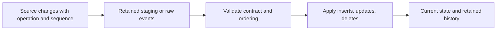

# 12. CDC, hard deletes, soft deletes, and snapshot comparison

Choose a change/deletion mechanism rather than expecting Copy to infer missing rows.

## Data design and mechanisms

| Source mechanism | What it captures | Required discipline |
|---|---|---|
| Database native CDC | Insert/update/delete operations and ordering | Enable source feature; retain logs beyond lag |
| Soft delete/tombstone | Explicit deleted flag/event | Export it before purge; retain sequence evidence |
| Complete scoped snapshots | Missing keys can imply deletes | Prove snapshot complete for the scope and boundary |
| Timestamp/ID pull | Only rows represented by that value | No automatic hard-delete visibility |
| File event or modified time | File arrival/change metadata | Not a database row-level change feed |

ADF offers native CDC/incremental options in supported Mapping Data Flow sources and a factory-level **Change Data Capture** resource. They have connector-specific capabilities. Ordinary pipelines remain batch; continuous CDC resources are a different execution surface. A generic Kafka/Event Hubs pipeline should use a supported streaming engine or storage landing strategy, covered in chapter 21.

## Buttons and exact choices

In **Author / Factory Resources → New → Change Data Capture**, follow its source/destination wizard, choose supported linked services and source objects, map to approved destination objects, configure latency and transformations, validate, and start only after source rights/retention are ready. The linked resource tutorial illustrates ADLS-to-SQL; that tutorial's incremental-file behavior is not identical to database-native hard-delete capture.

For custom CDC events in Mapping Data Flow, configure Source CDC options for the supported source, then sink update methods and key columns. For an operation column use **Alter Row** with predicates such as delete when `operation == 'D'` and upsert for insert/update, then allow those actions at the database sink. A marked row is not a database delete until the sink supports/enables that operation.

## Parameters and history

Preserve source key, operation, sequence/log position, payload, and source schema version. A late pre-delete update must not resurrect a key: retain highest sequence/tombstone or use a correctly configured CDC engine. SCD2 requires a separate history contract (tracked attributes, validity intervals, current row, delete closure); ordinary upsert is SCD1.

## Governance and infrastructure automation

DBA source configuration, replication/log rights, retention, sink key/permissions, and ADF identity/network setup are separate. History and removed values can be sensitive. Source/sink compatibility must be checked for each chosen connector/version.

## Code push automation and maintenance

Preserve CDC checkpoint identity across ordinary deployments. Renames/clones/source changes can represent a new state lineage; inspect documented checkpoint key behavior and test the actual connector rather than assuming continued progress. Review resnapshot/full-refresh impact on history and delete evidence.

## Tests

Insert/update/delete, unseen-key delete, out-of-order update after delete, partial versus full update, repeated changes, schema drift, retention gap, and fresh checkpoint resnapshot. For snapshot deletion detection, test a missing page/file or filtered extract: it must not delete absent keys as if the snapshot were complete.

## Official references

- [Concepts Change Data Capture](https://learn.microsoft.com/en-us/azure/data-factory/concepts-change-data-capture)
- [How To Change Data Capture Resource](https://learn.microsoft.com/en-us/azure/data-factory/how-to-change-data-capture-resource)
- [Data Flow Alter Row](https://learn.microsoft.com/en-us/azure/data-factory/data-flow-alter-row)
- [Data Flow Sink](https://learn.microsoft.com/en-us/azure/data-factory/data-flow-sink)

[Guide index](../../AZURE_DATA_FACTORY_GUIDE_INDEX.md)
