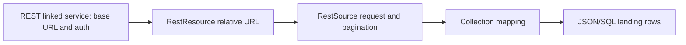

# 13. REST Copy: linked service, dataset, pagination, and JSON mapping

Copy API rows with the connector's native request and pagination fields.

## Data design and exact setup

**Manage → Linked services → New → REST**. Name `ls_vendor_rest`; Base URL the vendor's HTTPS endpoint; select the supported authentication type, certificate validation, runtime, and approved credentials/Key Vault references. Test connection/create. The checked-in anonymous `api.example.invalid` linked service is a structural illustration, not a working authenticated endpoint.

**Author → + → Dataset → REST**, Name `ds_rest_orders`, linked service; Relative URL `v1/orders?page_size=500` or dataset parameter `p_relative_url`. **Copy → Source**: Dataset this REST dataset, Request method GET (or supported POST), HTTP request timeout `00:01:00`, Request interval `00:00:01` as lab starting values.



For response contract `{"items":[...],"nextLink":"https://.../page2"}`, **Pagination rules** Key `AbsoluteUrl`, Value `$.nextLink`. In JSON:

```json
"paginationRules": {"AbsoluteUrl":"$.nextLink"}
```

Use the actual vendor response JSONPath; this is not `@activity(...).output`. Pagination supports several documented body/header/query patterns, but Copy's REST pagination does not support a top-level JSON-array response. Missing/null continuation and endpoint behavior must be tested. Do not leave a paging loop open indefinitely because a vendor repeats a cursor.

## Mapping and request fields

REST Copy's supported methods and source fields differ from Web activity and from REST sinks. Configure the collection reference `$.items` in Copy mapping, then map source `['order_id']` and `['amount']` to the JSON/table destination. The example copies selected rows; it does not archive full raw HTTP headers and page envelopes. For that requirement use an explicit extractor.

Private APIs need supported auth, not an Authorization token stored as a plaintext pipeline parameter. Connector-managed auth and token refresh must match the vendor's contract. Do not trust an unapproved pagination URL/domain or assume a generic rate-limit retry obeys every vendor policy.

## Governance and infrastructure automation

Provision runtime egress/private reachability, vendor allowlist/scopes and secret access. REST connector supports JSON responses; use HTTP connector/custom extraction for incompatible response formats. Raw/API rows can contain PII. Secure input/output fields containing tokens and retain safe run/count diagnostics.

## Code push automation and maintenance

Version request/body/schema/pagination/termination contracts. Source endpoint and credentials vary by deployment environment; relative URL/date/cursor can vary per business run. ADF Copy retry can re-read pages and duplicate an append-only sink; use stable staging and idempotent publication.

## Tests

One/multiple pages, empty page with continuation, repeated nextLink, null/missing final link, top-level-array incompatibility, 429/5xx/401, timeouts, token expiry, nested collection mapping, duplicate records, partial sink write and retry. Use vendor sandbox/mocked endpoint for live connector tests; Microsoft's local definition validation cannot call the API contract on your behalf.

## Official references

- [Connector Rest](https://learn.microsoft.com/en-us/azure/data-factory/connector-rest)
- [Format Json](https://learn.microsoft.com/en-us/azure/data-factory/format-json)
- [Copy Activity Schema And Type Mapping](https://learn.microsoft.com/en-us/azure/data-factory/copy-activity-schema-and-type-mapping)

[Guide index](../../AZURE_DATA_FACTORY_GUIDE_INDEX.md)
