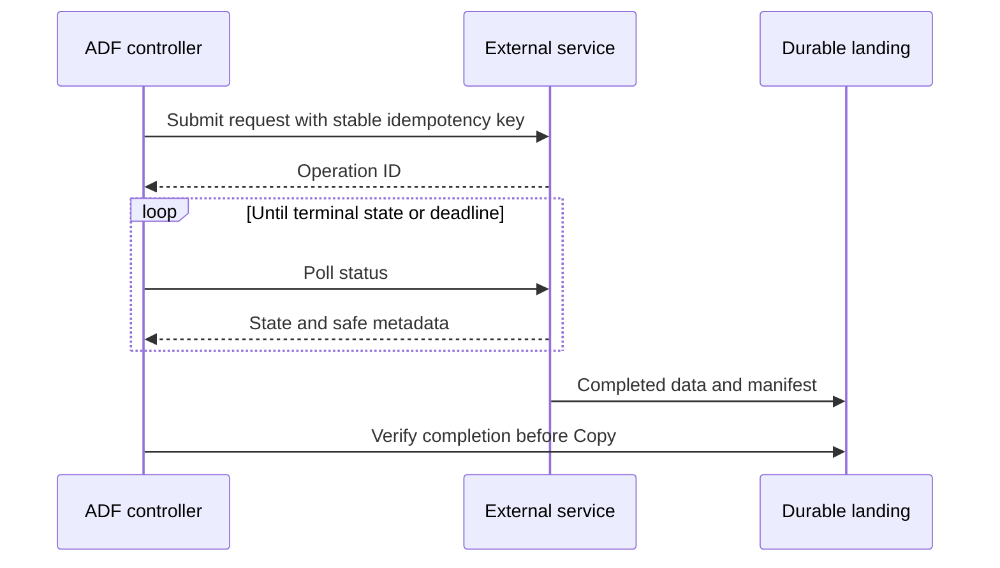

# 14. Web, HTTP Copy, Azure Functions, and custom paging

Choose a control request versus bulk transfer and make polling finite.

## Data design and selection

| Need | ADF route | Main constraint |
|---|---|---|
| Copy supported JSON API rows | REST Copy | Native pagination/JSON contract |
| Download a file/body from HTTP | HTTP connector Copy | Different auth/format/paging capabilities |
| Start an external job/control call | Web activity | Bounded response; asynchronous behavior |
| Complex vendor paging/auth logic | Function/custom extractor + landing | Own retry/cursor/manifest contract |
| Long-lived event processing | Streaming engine + ADF orchestration | Not a giant Until polling loop |

## Buttons and exact fields

Drag **Web** to pipeline canvas. **Settings** URL `https://api.example.invalid/jobs`, Method POST, Headers Content-Type application/json, Body from reviewed JSON/expression, Authentication the supported identity/credential route. Set HTTP timeout and activity timeout/retry deliberately. Web output is limited to the documented 4 MB; do not use it to transport a large dataset into a variable.

Web activity can follow the supported asynchronous request-reply pattern for 202/Location responses unless `turnOffAsync` is configured. If you design explicit polling, understand whether the first activity is already polling automatically. For custom Until use variables/status and a Wait between polls, a terminal condition, overall timeout and max-attempt/business deadline. Failed inner work is not a reason to assume Until always stops as desired—test its actual graph/error semantics.

For **Azure Function** activity select/create its linked service, Function name and method/body. Function activity response/schema/duration contracts differ from Web and general HTTP clients. For durable long-running work submit then poll completion through a supported orchestration contract rather than exceeding HTTP execution limits.

## Governance and infrastructure automation

Use managed identity where the receiving resource supports it, with the correct token audience/resource; not every third-party endpoint accepts Azure MI. Provision function/API identity, egress/DNS, source secret access and storage writes separately. Do not use SSRF-prone arbitrary caller-supplied URLs in a privileged factory.

## Code push automation and maintenance

Version function code beside ADF contracts but give each a deployment owner. Stable business request IDs prevent repeated side effects; pipeline RunId is for correlation and changes between reruns. Keep staging files outside the watched published prefix until a final completion manifest is verified.

## Tests

202 with/without valid Location, immediate 200, 401/403, 429 Retry-After, repeated cursor, expired operation, failed inner poll, max deadline, partial landing and request retry after remote commit. Test response type/size and output parsing; a Web response is not a guaranteed Copy row count.

## Official references

- [Control Flow Web Activity](https://learn.microsoft.com/en-us/azure/data-factory/control-flow-web-activity)
- [Connector Http](https://learn.microsoft.com/en-us/azure/data-factory/connector-http)
- [Control Flow Until Activity](https://learn.microsoft.com/en-us/azure/data-factory/control-flow-until-activity)
- [Control Flow Azure Function Activity](https://learn.microsoft.com/en-us/azure/data-factory/control-flow-azure-function-activity)

[Guide index](../../AZURE_DATA_FACTORY_GUIDE_INDEX.md)
