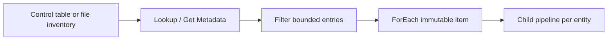

# 15. Lookup, Get Metadata, and Filter: output shapes and limits

Use bounded control metadata without treating it as a bulk-data channel.

## Data design and exact settings

Drag **Lookup** `LookupConfig`, select its dataset/query, and set **First row only** false for a table list. Use `@activity('LookupConfig').output.value` as ForEach Items. With First row only true use `.output.firstRow.<field>`, not `.output.value`. Lookup has documented limits of 5,000 rows and 4 MB; paginate/control-partition larger inventories and fail if completeness cannot be established.

Drag **Get Metadata** `ListFiles`; **Settings** choose the folder dataset, add **Field list: childItems** (or exists/size/lastModified when supported for that connector). The output `.childItems` contains metadata objects such as name/type, not the file rows. Its maximum returned metadata is 4 MB. Listing a folder does not recursively produce an unlimited complete inventory; design partitioned prefixes/manifests at scale.

Drag **Filter** `OnlyFiles`, Items `@activity('ListFiles').output.childItems`, Condition `@equals(item().type,'File')`. Its `.output.value` is the filtered array. The source inventory may contain directories, manifests, temporary files and incomplete uploads; type=File alone is not your completion protocol.

## Concrete parameter contract

| Field | Example |
|---|---|
| Entity key | `orders` |
| Source kind | `adls_files` / allowlisted supported kind |
| Source folder | `incoming/orders/2026-10-12` |
| Sink root | `landing/orders` |
| Enabled | Boolean, not text `'false'` |
| Batch ID | Stable business batch |
| Boundary | Explicit start/end/version where applicable |

Validate metadata rows before using them in SQL/path/endpoint fields. Do not allow a control-table edit to inject arbitrary SQL into a broadly privileged runtime. Filter enabled entities in the database or through a typed boolean condition.

## Governance and infrastructure automation

Separate access to the control metadata from access to all underlying datasets. Metadata can contain sensitive endpoints/object names. Limit who can enable entities, change queries, choose credentials, or set destructive cleanup paths. SHIR inventory queries still use its actual network/source rights.

## Code push automation and maintenance

Version the control schema, default policies, per-entity overrides, and how errors are recorded. A pipeline deployment changes code; metadata updates change runtime work and require their own review/audit. Avoid dynamic discovery of every table without allowlists or workload limits.

## Tests

FirstRowOnly true/false, empty result, missing field, 5,000-row boundary, metadata over 4 MB, folders/temporary files, wrong boolean type, duplicates, and disabled entity. Assert intended entity count before launching parallel children. Limit tests with oversized source inventory to a disposable service and confirm failure behavior.

## Official references

- [Control Flow Lookup Activity](https://learn.microsoft.com/en-us/azure/data-factory/control-flow-lookup-activity)
- [Control Flow Get Metadata Activity](https://learn.microsoft.com/en-us/azure/data-factory/control-flow-get-metadata-activity)
- [Control Flow Filter Activity](https://learn.microsoft.com/en-us/azure/data-factory/control-flow-filter-activity)

[Guide index](../../AZURE_DATA_FACTORY_GUIDE_INDEX.md)
