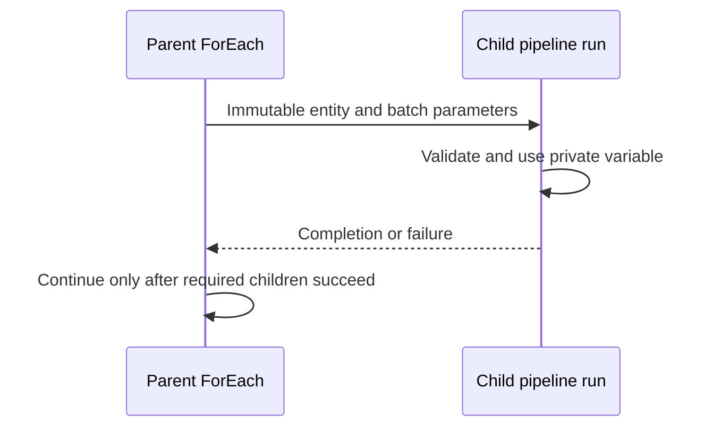

# 16. ForEach, Execute Pipeline, and child return values

Pass immutable per-item inputs and wait for real child outcomes.

## Data design and exact lab fields

Create `pl_parallel_parent` with `p_entities` Array default `["orders","customers"]`, `p_batch_id` String `demo-001`. Drag **ForEach** `EachEntity`; **Settings** Items `@pipeline().parameters.p_entities`; Sequential unchecked; Batch count `2`. Open its Activities editor and add **Execute Pipeline** `RunChild`.

**Execute Pipeline → Settings**: Invoked pipeline `pl_parameter_child`; **Wait on completion** true. Parameters `p_entity=@item()` and `p_batch_id=@pipeline().parameters.p_batch_id`. Child declares both String parameters and uses its own variable. No parent variable is set inside this parallel loop.



For object Items use `@item().entity` and other explicit fields. Avoid combining the wrong output shape from Lookup/Get Metadata/Filter. Parallel concurrency is bounded by ForEach, pipeline/IR limits, and source load; it is not a global ordering guarantee.

## Return values

The Microsoft Set Variable reference currently identifies pipeline return values as preview; check your environment's support. For supported use, in child **Set Variable → Variable type: Pipeline return value**, add keys with supported types and values, such as `status=ok`, `accepted_rows=3`. In parent after a waited child:

```text
@activity('RunChild').output.pipelineReturnValue.accepted_rows
```

Enable Wait on completion. A missing key or branch that didn't set the return value is not a meaningful zero count. Keep a consistent key/type contract across all successful child branches. The return payload is bounded; use a durable audit/control table for large per-item results and parallel-loop aggregation.

A parameter passed into a child is an input copy, not a reference to parent state. A native pipeline return value differs from Databricks `dbutils.notebook.exit` runOutput and from SQL activity output; don't interchange their property paths.

## Governance and infrastructure automation

Each child still uses its linked-service identity/runtime. Variable isolation fixes races, not broad permissions. Validate child input allowlists and batch identity. Grant metadata/control-table write access only to the audit owner.

## Code push automation and maintenance

Version parent/child parameter contracts together. Nested loop/control restrictions can require splitting work across children rather than piling every activity inside one container. Use supported nesting patterns and Microsoft's validator; don't assume arbitrary recursive pipelines are supported.

## Tests

Run valid parent, invalid entity, empty batch, omitted parameter, child failure, Wait on completion false versus true, missing return key, and parallel repetitions. Assert correct inputs/statuses and one durable result per logical entity/batch. The checked-in demo exercises inputs/isolation/Fail; it intentionally doesn't depend on preview return values.

## Official references

- [Control Flow For Each Activity](https://learn.microsoft.com/en-us/azure/data-factory/control-flow-for-each-activity)
- [Control Flow Execute Pipeline Activity](https://learn.microsoft.com/en-us/azure/data-factory/control-flow-execute-pipeline-activity)
- [Tutorial Pipeline Return Value](https://learn.microsoft.com/en-us/azure/data-factory/tutorial-pipeline-return-value)
- [Control Flow Set Variable Activity](https://learn.microsoft.com/en-us/azure/data-factory/control-flow-set-variable-activity)

[Guide index](../../AZURE_DATA_FACTORY_GUIDE_INDEX.md)
