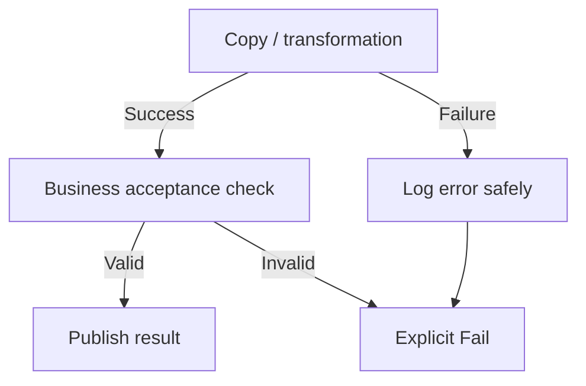

# 17. If, Switch, Until, retries, and error-propagation graphs

Make failure visible even when logging and cleanup succeed.

## Data design and exact conditions

The sample file pipeline uses **If Condition** `RequireFiles` after Copy succeeds. **Activities → Expression**:

```text
@greater(activity('CopyFiles').output.filesRead,0)
```

True branch Wait `Accepted`; false branch **Fail** with Error code `EMPTY_BATCH` and Message explaining the missing delivery. That gate proves nonempty file movement only, not row correctness.



Dependency conditions include Succeeded, Failed, Skipped, and Completed. The UI connectors represent different conditions; inspect the JSON `dependsOn.dependencyConditions` when reviewing. A logging activity on a failure path can succeed and affect pipeline terminal status. Test the actual graph, and add an explicit Fail where the contract requires failure propagation. Do not treat a green logging step as a successful data publication.

Use **Switch** for a bounded allowlisted source kind, with explicit default rejection. Use **Until** for serial polling: terminal Boolean expression, timeout, Wait/backoff, and a durable operation ID. A failed nested activity doesn't universally guarantee immediate loop termination; verify the documented pattern and use explicit terminal failure handling.

## Policy fields

| Field | Lab value | Meaning |
|---|---|---|
| `timeout` | `0.01:00:00` | Activity deadline |
| `retry` | `2` | Additional retry attempts |
| `retryIntervalInSeconds` | `30` | Delay between retries |
| `secureInput` / `secureOutput` | True for secret-bearing activities | Restrict monitor visibility of protected data |
| Fail `errorCode` | `EMPTY_BATCH` / `INVALID_INPUT` | Stable operational category |

Retry is safe only when the source/sink operation is idempotent or recoverable. An external POST, SQL append, Delete, or partial file publication may need stronger semantics. Retry interval is not a full vendor-specific backoff policy.

## Governance and infrastructure automation

Log safe identifiers/boundaries/errors, not credentials/raw PII. Define notification owner and severity. Avoid cleanup that deletes source/staging needed for recovery on failure. Restrict destructive actions and metadata edits.

## Code push automation and maintenance

Version dependency graphs and explicit Fail behavior with tests. Changing a branch condition can change publication/recovery semantics without changing the Copy schema. A completion-path watermark update can skip failed data; put commit advancement behind acceptance instead.

## Tests

Source fail, target fail after partial write, quality fail, logger fail, skipped branch, Until timeout, cancellation, max attempts, and missing output property. Verify final pipeline status and publication/watermark state, not just activity status. Re-run after remote commit and require stable business effect.

## Official references

- [Control Flow If Condition Activity](https://learn.microsoft.com/en-us/azure/data-factory/control-flow-if-condition-activity)
- [Control Flow Switch Activity](https://learn.microsoft.com/en-us/azure/data-factory/control-flow-switch-activity)
- [Control Flow Until Activity](https://learn.microsoft.com/en-us/azure/data-factory/control-flow-until-activity)
- [Control Flow Fail Activity](https://learn.microsoft.com/en-us/azure/data-factory/control-flow-fail-activity)
- [Tutorial Pipeline Failure Error Handling](https://learn.microsoft.com/en-us/azure/data-factory/tutorial-pipeline-failure-error-handling)

[Guide index](../../AZURE_DATA_FACTORY_GUIDE_INDEX.md)
