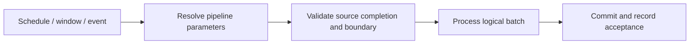

# 18. Schedule, tumbling windows, storage events, and batch identity

Use a trigger whose state and retry model match the source delivery contract.

## Data design and trigger choice

| Trigger | Choose for | Important behavior |
|---|---|---|
| Schedule | Periodic processing | Not a durable data-window dependency engine |
| Tumbling window | Consecutive stateful time windows/backfills | Window dependency/retry/concurrency configuration |
| Storage event | Supported Event Grid storage events | Arrival/deletion event is not data completeness or row CDC |
| Manual/API | Controlled rerun or external scheduling | Supply stable batch/boundary explicitly |



## Exact scheduled lab fields

Pipeline toolbar **Add trigger → New/Edit → New**. Name `tr_daily_files_stopped`, Type Schedule, Recurrence Day every `1`, Time zone **India Standard Time**, scheduled time `04:00`. Review start/end and activation. The checked-in trigger has `runtimeState: Stopped`; start only after live tests.

The lab selects the previous completed **India-local day**, not the UTC day of the repaired activity:

```text
@concat('incoming/orders/',formatDateTime(addDays(convertTimeZone(trigger().scheduledTime,'UTC','India Standard Time'),-1),'yyyy-MM-dd'))
```

Pass the same date into a stable business `p_batch_id`. Schedule trigger parameter syntax uses its trigger context; pipeline code uses the already supplied parameters. A pipeline `utcNow()` recalculation on rerun can select a different batch.

## Tumbling and event fields

For Tumbling window choose Frequency, Interval, Start time, Delay, Max concurrency, retry settings and dependencies where needed. In its pipeline parameter mapping use the documented window context such as `@trigger().outputs.windowStartTime` and windowEndTime. Do not paste schedule-only `trigger().scheduledTime` into a different trigger type without checking its supported context.

For storage-event trigger select subscription/account/container, event type, blob path begins/ends filters, and empty-blob behavior. Map `@triggerBody().folderPath` / fileName into pipeline inputs when that contract is supported. Container/path filters have connector-specific syntax; test an actual delivered event. BlobCreated may fire before a multi-file batch is complete. A BlobDeleted notification is not an instruction to delete unrelated database rows.

## Governance and infrastructure automation

Provision Event Grid registration/permissions, storage network and factory identity. Restrict who can start/stop triggers. Trigger deployment/status management belongs to release automation, not arbitrary PR validation. Preserve tumbling-window state and dependencies across deployments.

## Code push automation and maintenance

Export/deploy reviewed trigger configuration, stop the affected triggers through the approved predeployment script, and restart only those intended to be active after success. Record previous states. Don't combine two independent schedulers without deduplication/concurrency control.

## Tests

UTC/local date boundary, late delivery, empty/multiple/duplicate events, stopped versus active trigger, schedule daylight-saving behavior for relevant zones, missed windows/backfills, dependent window failure, rerun with stable input, and deployment preserving stopped triggers. A 04:00 start is not proof of a 06:00 deadline; benchmark the full processing/verification window.

## Official references

- [How To Create Schedule Trigger](https://learn.microsoft.com/en-us/azure/data-factory/how-to-create-schedule-trigger)
- [How To Create Tumbling Window Trigger](https://learn.microsoft.com/en-us/azure/data-factory/how-to-create-tumbling-window-trigger)
- [How To Create Event Trigger](https://learn.microsoft.com/en-us/azure/data-factory/how-to-create-event-trigger)
- [Control Flow System Variables](https://learn.microsoft.com/en-us/azure/data-factory/control-flow-system-variables)

[Guide index](../../AZURE_DATA_FACTORY_GUIDE_INDEX.md)
