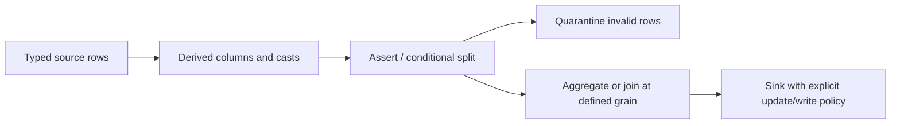

# 19. Mapping Data Flow transformations: schema, joins, aggregate, and sink

Build a managed Spark graph and retain the business grain through transformations.

## Data design and exact UI walkthrough

**Author → + → Data flow → Mapping Data Flow**, Name `df_orders_curated`. **Add Source**, select a supported dataset/inline source; define projection/schema and choose schema drift/validation deliberately. Use fixture-backed development input. Toggle **Data Flow Debug** only when ready to incur managed Spark debug cost; choose an approved IR/session configuration.

Using plus signs on transformation outputs, add **Derived Column** for typed amount/date normalization, **Conditional Split** for valid/invalid branches, **Aggregate** for order-date/region metrics, and **Sink** for the approved destination. Use **Data preview** under debug to inspect representative transformations; preview itself is not a full-scale acceptance test.

| Transform | Set/check | Trap |
|---|---|---|
| Derived Column | Name/expression/type | Invalid cast or timezone shift |
| Join | Left/right keys/type, cardinality | Header amount multiplied by line rows |
| Aggregate | Group-by keys, decimal sum | Wrong grain or missing empty groups |
| Window | Partition/order/frame | Non-deterministic latest-row tie |
| Flatten | Unroll root/array contract | Cartesian multiplication of multiple arrays |
| Assert/Split | Named constraints, failure path | Silently dropped bad rows |
| Sink | Dataset, mapping, update methods/keys | Append on retry duplicates |

Use source-provided ordering to reduce CDC events to an intended current-state candidate. A generic Window ranking without a delete/order contract is not complete CDC. SCD2 requires expiry/current logic and interval tests; an ordinary database sink upsert keeps no history by itself.

## Governance and infrastructure automation

Mapping Data Flow runs on Azure managed compute configured through an Azure IR, not on SHIR's machine. Source/sink connector/private network capabilities must fit the chosen flow. Enable sink deletes/updates only for authorized tables, and retain quarantined raw evidence under restricted access.

## Code push automation and maintenance

Data Flow source code/expressions and pipeline Data Flow activity configuration are both deployment assets. Deploy projection/mapping/schema changes with compatible sink migrations. Avoid silently accepting every drifted column into curated sensitive datasets. Keep debug sessions, IR settings, runtime dependencies, and TTL expectations reviewed.

## Tests

Null/invalid decimal, timezone boundary, duplicates/order ties, row multiplication, empty aggregates, array flattening, schema drift, quarantine, and sink retry. Compare complete data outputs and schemas through a pipeline test run, not only debug previews. Record startup versus processing duration and observed cost.

## Official references

- [Concepts Data Flow Overview](https://learn.microsoft.com/en-us/azure/data-factory/concepts-data-flow-overview)
- [Concepts Data Flow Debug Mode](https://learn.microsoft.com/en-us/azure/data-factory/concepts-data-flow-debug-mode)
- [Data Flow Derived Column](https://learn.microsoft.com/en-us/azure/data-factory/data-flow-derived-column)
- [Data Flow Join](https://learn.microsoft.com/en-us/azure/data-factory/data-flow-join)
- [Data Flow Aggregate](https://learn.microsoft.com/en-us/azure/data-factory/data-flow-aggregate)
- [Data Flow Sink](https://learn.microsoft.com/en-us/azure/data-factory/data-flow-sink)

[Guide index](../../AZURE_DATA_FACTORY_GUIDE_INDEX.md)
