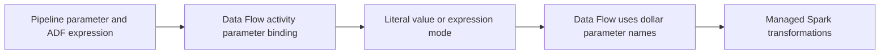

# 20. Data Flow parameters, expression mode, compute, and performance

Bind runtime inputs while keeping its expression language separate from pipeline syntax.

## Data design and exact parameter flow

Open `df_orders_curated`, click blank canvas → **Parameters**: `p_region` String, default `IN`; `p_min_amount` String, default `0.00`; convert it deliberately with a supported `toDecimal` expression. In its transformation expressions use `$p_region`, not `@pipeline().parameters.p_region`.

Pipeline: drag **Data Flow**, select that flow; **Parameters** bind `p_region` from pipeline `@pipeline().parameters.p_region`. Choose **Pipeline expression** when passing a pipeline-derived value; choose the correct Data Flow expression interpretation for expressions meant to execute on columns.

For a String parameter containing `upper(column1)`, leaving Expression unchecked treats it as literal text. Checking Expression makes it a Data Flow expression, which can evaluate against rows. Do not let untrusted callers inject arbitrary transformation expressions through this toggle.

## Type/date examples

| Layer | Example | Meaning |
|---|---|---|
| Pipeline | `@pipeline().parameters.p_region` | Runtime value passed into activity |
| Data Flow | `$p_region` | Flow parameter reference |
| Data Flow filter | `region == $p_region` | Column predicate |
| Pipeline date | `@pipeline().parameters.p_window_start` | ISO string contract |
| Data Flow conversion | Approved `toTimestamp(...)` expression with explicit format | Row/runtime timestamp conversion |

Mapping Data Flow has its own timestamp precision/format constraints. Follow the documented conversion when passing pipeline timestamps; don't assume every ISO string/precision automatically matches a Timestamp parameter.

## Compute fields and debugging

In Data Flow activity **Settings**, choose Integration runtime, supported Compute type/Core count, and relevant logging/run settings. Azure IR Data Flow properties and debug session settings control managed compute; Copy DIU and SHIR host size do not size this Spark cluster.

Sequential Data Flows can use configured TTL to reuse a cluster where supported; a debug cluster's lifetime and production activity compute are separate. Startup latency can dominate tiny runs. Toggle Debug off after exploration; its active session has charges. Tune partitions, join broadcasting/skew and sink parallelism only after checking semantics.

## Governance and infrastructure automation

Provision managed VNet/private endpoints and source/sink rights for Data Flow's execution plane. Secure production sink/key settings and expression-authoring permissions. Central policies/cost tags can constrain compute choices where supported.

## Code push automation and maintenance

Version flow parameters/types, pipeline binding, IR compute, and debug fixtures. Test parameter-mode toggles and type changes before publishing. Use copied representative fixtures rather than production-sized debug scans or unrestricted drift.

## Tests

Literal versus expression String, Int/Decimal conversion, null/missing input, high-precision timestamp, wrong region filter, changed source schema, startup latency, skew, and repeated sink publication. Assert output parity before/after performance tuning. Microsoft's local validation catches definitions, not all runtime expression/type outcomes.

## Official references

- [Parameters Data Flow](https://learn.microsoft.com/en-us/azure/data-factory/parameters-data-flow)
- [Concepts Integration Runtime Performance](https://learn.microsoft.com/en-us/azure/data-factory/concepts-integration-runtime-performance)
- [Concepts Data Flow Debug Mode](https://learn.microsoft.com/en-us/azure/data-factory/concepts-data-flow-debug-mode)
- [Concepts Data Flow Performance](https://learn.microsoft.com/en-us/azure/data-factory/concepts-data-flow-performance)

[Guide index](../../AZURE_DATA_FACTORY_GUIDE_INDEX.md)
