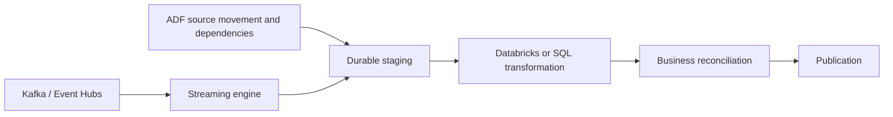

# 21. Databricks, Synapse, SQL, functions, and streaming boundaries

Use ADF as the orchestrator while keeping compute-specific semantics explicit.

## Data design

| Work | Activity/route | Parameter boundary |
|---|---|---|
| Databricks notebook | Azure Databricks Notebook | Base Parameters → notebook widgets |
| SQL transformations/commit | Script or Stored procedure | Connector-supported typed SQL/procedure params |
| Synapse workload | Supported SQL/notebook/pipeline integration | Engine/activity-specific arguments |
| Custom service | Azure Function or Web | Request/response contract |
| Kafka/Event Hubs processing | Databricks/Flink/other supported stream processor | Offsets/checkpoints belong to streaming engine |

## Databricks buttons and exact parameters

**Manage → Linked services → New → Azure Databricks**, choose workspace, approved supported authentication and compute settings. Add **Notebook** activity `RunOrders`. **Azure Databricks** tab select the linked service; **Settings** Notebook path the actual deployed absolute workspace path. **Base Parameters**:

| Key | ADF value |
|---|---|
| `catalog` | `@pipeline().parameters.p_catalog` |
| `run_date` | `@pipeline().parameters.p_run_date` |
| `batch_id` | `@pipeline().parameters.p_batch_id` |
| `adf_run_id` | `@pipeline().RunId` |

Notebook reads `dbutils.widgets.get('batch_id')`. To return a small JSON result use `dbutils.notebook.exit(json.dumps({...}))`; ADF reads activity output runOutput, applying `json(...)` only if the actual output is a JSON string. This differs from Execute Pipeline return values and Databricks task values.

Use a reviewed already-deployed Databricks Job/API integration for multi-task workflows where suitable. Keep code deployment/versioning separate from pipeline orchestration; a mutable personal notebook path is a poor production contract.

## Governance and infrastructure automation

ADF identity/link authentication, Databricks execution identity, Unity Catalog/source privileges, compute permissions, and network reachability are separate. SHIR reaching an on-prem DB does not automatically let a Databricks cluster reach it. Provision each execution plane.

## Code push automation and maintenance

Use coordinated versioned ADF and external-compute artifacts. Record ADF run ID, external run URL/ID, code revision, resolved inputs, source/target boundaries, and final acceptance. Choose one scheduler for one logical workflow. External request idempotency prevents duplicate run creation, while target write idempotency prevents duplicate business effects—both may be needed.

## Tests

Parameter default/override, wrong widget key/type, expired auth, wrong code revision, external timeout, job accepted-but-later-failed, runOutput type/missing field, source retry and target commit retry. Verify ADF fails when the required external outcome or reconciliation fails; submission success alone is insufficient.

## Official references

- [Transform Data Databricks Notebook](https://learn.microsoft.com/en-us/azure/data-factory/transform-data-databricks-notebook)
- [Transform Data Using Script](https://learn.microsoft.com/en-us/azure/data-factory/transform-data-using-script)
- [Transform Data Using Stored Procedure](https://learn.microsoft.com/en-us/azure/data-factory/transform-data-using-stored-procedure)
- [Control Flow Azure Function Activity](https://learn.microsoft.com/en-us/azure/data-factory/control-flow-azure-function-activity)

[Guide index](../../AZURE_DATA_FACTORY_GUIDE_INDEX.md)
