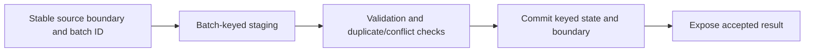

# 22. Loading, SQL upsert, deletes, partitions, and idempotent publication

Define what retrying a load changes before choosing append, overwrite, or upsert.

## Data design and sink contracts

| Sink approach | Good use | Retry/deletion risk |
|---|---|---|
| Stable file batch prefix | Immutable batch landing | Downstream consumer must deduplicate logical batch |
| SQL append | Append-only facts with key constraints/guards | Retried rows duplicate without enforcement |
| SQL Copy upsert | Supported SCD1 keyed updates | Does not infer source hard deletes or keep SCD2 history |
| Staging + transactional procedure | Ordered changes, reconciliation, watermark commit | Requires concurrency, staging isolation, SQL tests |
| Data Flow Alter Row/sink methods | Supported insert/update/delete/upsert | Wrong predicate/key can update/delete wrong rows |
| Partition replacement | Complete bounded authoritative partition | Incomplete extract can destroy valid rows |

## Buttons and exact fields

For supported Azure SQL Copy sink, choose dataset/table; **Sink → Write behavior: Upsert**, select key columns matching the business primary key, and supported temporary-table settings. Review generated `writeBehavior: upsert` and `upsertSettings.keys` against your connector version. Upsert is not a universal delete or late-event ordering engine.

For stronger loading, Copy to a staging table keyed by batch ID/entity; add **Stored procedure**/Script activity after acceptance. Procedure locks/checks the expected prior boundary, rejects contradictory duplicate keys/sequences, applies only newer versions, retains delete sequence evidence, and advances the watermark transactionally. The SQL example illustrates this shape; adapt/test on your real engine.

Do not truncate a shared staging table in preCopyScript when another pipeline can write it. Do not use an incrementing row counter as durable ordering evidence. An operation code is a source contract; ADF Copy does not invent it from absent rows.

## Governance and infrastructure automation

Restrict target modification to intended tables/procedures. Separate source-reader, stage-writer and publication roles where the platform permits. Retain rejected rows and prior data versions under appropriate privacy policy. Granting broad DELETE to a reusable sink multiplies impact of a bad metadata row.

## Code push automation and maintenance

Version sink/schema/mapping/commit procedure together. Batch identity survives retry/re-run; RunId is correlation. Advance source progress only after target acceptance, and preserve state through code releases. A code rollback doesn't reverse already published data; design replay/correction and consumer cutover.

## Tests

Same batch twice, crash after sink commit, conflicting duplicate sequence, late update after delete, mismatched key columns, all rows removed from an authoritative partition, concurrent batches sharing staging, and partial snapshot. Assert target rows/totals plus committed boundary; a pipeline success/rowsCopied counter alone doesn't prove correctness.

## Official references

- [Connector Azure Sql Database](https://learn.microsoft.com/en-us/azure/data-factory/connector-azure-sql-database)
- [Data Flow Alter Row](https://learn.microsoft.com/en-us/azure/data-factory/data-flow-alter-row)
- [Data Flow Sink](https://learn.microsoft.com/en-us/azure/data-factory/data-flow-sink)
- [Transform Data Using Stored Procedure](https://learn.microsoft.com/en-us/azure/data-factory/transform-data-using-stored-procedure)

[Guide index](../../AZURE_DATA_FACTORY_GUIDE_INDEX.md)
