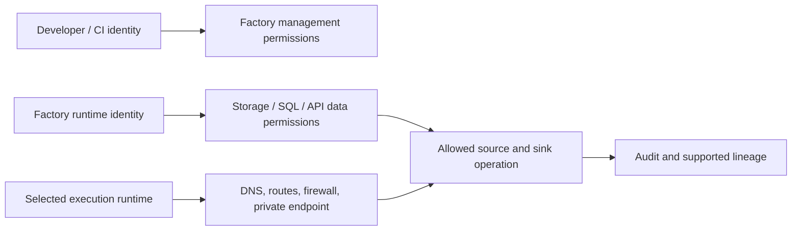

# 23. Security, private endpoints, Purview, RBAC, and diagnostic access

Keep management permissions, data permissions, networking, and lineage distinct.

## Data design and security layers

ADF factory RBAC governs authoring/management, not all data systems. Storage data-plane roles/ACLs, SQL users/grants, Key Vault secret access, vendor scopes, and Databricks UC rights remain separate. A broad factory identity can become a data-access proxy for callers who can edit pipelines; control authoring and parameter contracts accordingly.

## Buttons and fields

In Azure Portal factory **Identity**, record the managed identity principal ID. In each target resource's **Access Control (IAM)** or SQL/vault administration surface grant the approved scoped rights. In Studio **Manage → Linked services**, select the intended identity/runtime and test a permitted path.

For Azure IR managed-network design, create/select the supported **Managed virtual network** configuration, then **Manage → Managed private endpoints → New**, choose supported resource type and actual resource ID. Approve the private endpoint request on the target resource; confirm its status before expecting a connection. A pending request does not permit data access. SHIR/private on-prem routes are a different plane.

When supported, connect Microsoft Purview through Studio's governance integration and grant documented scan/lineage access. Lineage discovery is not the storage/SQL enforcement layer, and not every custom function/API/Databricks side effect is automatically captured. Record unsupported edges manually.

## Privacy and activity policy

Use secureInput/secureOutput for activities containing credentials or protected response bodies. This reduces diagnostic visibility; preserve safe correlation/status/boundary metadata separately. Avoid raw PII in pipeline parameter values, logs, email messages, or CI artifacts. Pipeline definitions/ARM state can expose endpoints and metadata even without tokens.

## Infrastructure and code push automation

Platform IaC owns factories, identities, endpoints, role assignments, diagnostics, network, runtime bootstrap and governance connections. Application ARM owns reviewed pipelines/datasets/linked-service settings. Source permission changes follow source-owner release procedures. Keep deploy identity and runtime data identity separate; CI doesn't need broad source data rights just to generate templates.

## Tests

Allowed/denied storage paths, unapproved endpoint, private DNS/firewall failure, expired token, wrong audience, SQL principal absence, denied secret, author able to misuse broad runtime identity, and real consumer disclosure rules. Test diagnostics/lineage presence and retention; a Test connection success is not a complete security test. Re-run with the exact identity/runtime used in production.

## Official references

- [Data Factory Service Identity](https://learn.microsoft.com/en-us/azure/data-factory/data-factory-service-identity)
- [Managed Virtual Network Private Endpoint](https://learn.microsoft.com/en-us/azure/data-factory/managed-virtual-network-private-endpoint)
- [Store Credentials In Key Vault](https://learn.microsoft.com/en-us/azure/data-factory/store-credentials-in-key-vault)
- [Connect Data Factory To Azure Purview](https://learn.microsoft.com/en-us/azure/data-factory/connect-data-factory-to-azure-purview)

[Guide index](../../AZURE_DATA_FACTORY_GUIDE_INDEX.md)
