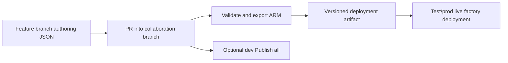

# 25. Git branches, collaboration, Publish all, and exported ARM

Review source changes and understand what is actually live in a factory.

## Data design and states

ADF Git mode tracks source definitions; live mode contains deployed resources. Feature branches are for authoring/review. The collaboration branch is the integration point. The traditional publish branch (often `adf_publish`) contains generated deployment artifacts, not the preferred place to edit pipeline source manually.

## Buttons and exact repo settings

**Manage → Git configuration → Configure**. Select Azure DevOps Git or GitHub and the appropriate organization/account, Repository, Collaboration branch, Publish branch, and Root folder. For a dedicated application repo Root folder should match the ADF source directory; in this educational repo it is `adf_guide/examples/factory`.

Use the branch selector to create/switch a feature branch. Make changes, **Save all**, review the Git diff/PR, merge to the collaboration branch, then validate/publish according to the selected release process. **Publish all** is performed from the supported collaboration context; a private branch isn't the production publication path.

The examples include `publish_config.json` with publishBranch `adf_publish`. Use a distinct publish-branch name if another factory/project shares the repository. ADF configuration for your real factory must use actual names/IDs, not blindly adopt this repository's `main` SQL-catalog branch as its collaboration release branch.

## Deployment versus runtime parameters

Generated ARM wraps factory resources and environment-specific fields. `arm-template-parameters-definition.json` selects what becomes an ARM deployment parameter. Runtime pipeline/dataset/linked-service parameters keep their separate meanings. Inspect generated names/types/defaults after each relevant source change.

## Governance and infrastructure automation

Only development should be Git-integrated in the recommended promotion model. Test/prod are deployed through release automation. Protect source/publish branches, use least-privilege repository access, and maintain deployment ownership. A Git credential and an Azure deployment identity are different.

## Code push automation and maintenance

Choose either the traditional manual-dev Publish/`adf_publish` artifact route or automated validation/export from source, then make artifact ownership clear. Do not race two generation/deployment systems or edit generated ARM as if it were canonical source. Include deleted/renamed resources and trigger states in the release plan.

## Tests

Unpublished edit versus Trigger now, feature-branch debug versus collaboration publication, environment endpoint override, missing linked-service reference, deleted entity cleanup, stopped trigger state, and replay after a release. Use local Microsoft utilities to validate/export; live Test connection/run remains required.

## Official references

- [Source Control](https://learn.microsoft.com/en-us/azure/data-factory/source-control)
- [Continuous Integration Deployment](https://learn.microsoft.com/en-us/azure/data-factory/continuous-integration-deployment)
- [Continuous Integration Delivery Improvements](https://learn.microsoft.com/en-us/azure/data-factory/continuous-integration-delivery-improvements)
- [Continuous Integration Delivery Resource Manager Custom Parameters](https://learn.microsoft.com/en-us/azure/data-factory/continuous-integration-delivery-resource-manager-custom-parameters)

[Guide index](../../AZURE_DATA_FACTORY_GUIDE_INDEX.md)
