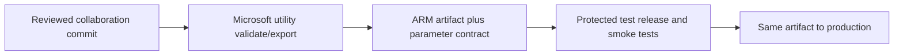

# 26. Azure DevOps CI/CD: build artifacts, environment overrides, and trigger handling

Generate once, test the same artifact, and promote it with a controlled release.

## Data design and pipeline stages



From **Azure DevOps → Pipelines → New pipeline**, choose your source repository and existing YAML. Use a Node version supported by the current utility (the guide validates with Node 22; Microsoft documentation also identifies Node 20 compatibility). Run `npm ci` on the pinned tools package, then:

```sh
cd adf_guide/tools
npm run build -- validate ../examples/factory \
  '/subscriptions/<sub>/resourceGroups/<rg>/providers/Microsoft.DataFactory/factories/<dev-factory>'
npm run build -- export ../examples/factory \
  '/subscriptions/<sub>/resourceGroups/<rg>/providers/Microsoft.DataFactory/factories/<dev-factory>' arm-output
```

The output folder is relative to the command working directory. Export validates before generation and does not deploy the live factory. The npm wrapper is pinned; it downloads Microsoft's current validation bundle, so record the downloaded bundle hash and tool/runtime versions for reproducibility.

## Buttons and release fields

**Project settings → Service connections → New service connection → Azure Resource Manager**: select the approved workload-federation route where supported, subscription/scope, and a descriptive connection name. Restrict pipeline use. **Pipelines → Library** contains protected environment values; **Environments** supplies approved release gates.

Build/export artifact includes `ARMTemplateForFactory.json`, generated parameters, related templates/scripts as applicable. In release deploy to target Resource group/Factory name using the reviewed environment parameter file. Do not guess nested linked-service parameter names: inspect export output and use the checked-in parameter contract in the lab.

## Trigger lifecycle and deletion

Use the documented current pre/post deployment script (including the changed-trigger variant where appropriate), with PowerShell Core/Az dependencies on the runner. It can stop affected triggers before deployment, manage cleanup/deletion, and restart intended triggers afterward. Preserve previous/intended states and test failures between phases. Don't restart every trigger blindly or clean up unrelated shared resources.

## Governance and infrastructure automation

CI definition validation does not require source database/storage data rights. Release identity needs the approved Azure management scope; runtime factory identities require separate environment data rights. Never put credentials in ARM plain strings or log substituted secure values. Bootstrap identity/network/vault/permissions before enabling triggers.

## Code push automation and maintenance

Promote the same immutable ARM artifact, not a newly regenerated prod variant from a moving branch. Serialize target deployments. Separate platform IaC from app ARM ownership. Copy sample deployment templates only after configuring real environments and permissions; this guide's active CI deploys nothing.

## Tests

Malformed references/expressions, missing deployment parameter, wrong factory endpoint, deleted/renamed resources, active/stopped triggers, interrupted pre/deploy/post phases, and test runs failing acceptance. Validate/what-if alone cannot prove live connector/data behavior; require safe smoke tests and reconciliation before promotion.

## Official references

- [Continuous Integration Delivery Improvements](https://learn.microsoft.com/en-us/azure/data-factory/continuous-integration-delivery-improvements)
- [Continuous Integration Delivery Automate Azure Pipelines](https://learn.microsoft.com/en-us/azure/data-factory/continuous-integration-delivery-automate-azure-pipelines)
- [Continuous Integration Delivery Sample Script](https://learn.microsoft.com/en-us/azure/data-factory/continuous-integration-delivery-sample-script)
- [Continuous Integration Deployment](https://learn.microsoft.com/en-us/azure/data-factory/continuous-integration-deployment)

[Guide index](../../AZURE_DATA_FACTORY_GUIDE_INDEX.md)
