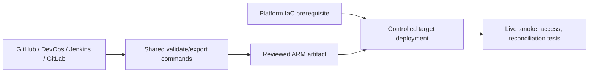

# 27. GitHub Actions, Jenkins, GitLab, Bicep, and Terraform alternatives

Replace the runner without changing the ADF artifact or runtime data contract.

## Data design and alternatives

| Tool | Set up | ADF actions |
|---|---|---|
| GitHub Actions | Protected environment, Azure federated identity, id-token permission | Validate/export, predeploy, ARM deploy, smoke tests, postdeploy |
| Azure DevOps | Approved ARM service connection and protected environments | Same artifact lifecycle |
| Jenkins | Approved managed agent and Azure identity/credential binding | Same CLI/script stages; serialize release |
| GitLab | Protected variables/environment and matching federation or fallback auth | Same artifact stages; resource group lock |
| Bicep/ARM | Platform resource definitions | Factory identity/network/diagnostics bootstrap |
| Terraform | Locked provider/backend and ownership | Platform factory/identity/IR/network resources |

## Exact GitHub environment fields

Repository **Settings → Environments → New environment**: `adf-test` / `adf-prod`, approved branches/reviewers. Variables: target Subscription ID, Tenant ID, deployment Client ID, Resource group, Factory name, and reviewed parameter-file location. Configure the Azure identity's federated credential for the matching GitHub environment subject. Workflow requires `permissions: contents: read, id-token: write`; use a reviewed pinned Azure login action.

Azure workload federation authenticates to Azure ARM; it is not Databricks' `github-oidc` authentication adapter. GitLab/Jenkins need their matching identity setup or protected approved fallback credentials. Do not paste real `az login --service-principal --password ...` secrets into YAML.

## Governance and infrastructure automation

The Bicep template in `examples/templates` creates a factory with system-assigned identity and emits its resource/principal IDs. It does not grant every source permission or deploy private endpoints automatically. Application pipelines come from generated ARM. Decide whether Terraform/Bicep or exported ARM owns each object; do not let both own the same pipeline and compete on state.

Use encrypted locked remote Terraform state with restricted access. Pin providers and review destructive plans. ARM/Bicep deployment modes and deletion behavior differ from an explicit pre/post cleanup script; avoid broad complete-mode deployments in a shared resource group without a reviewed resource inventory.

## Code push automation and maintenance

Templates are opt-in under `examples/templates`, with prerequisites and placeholders. Keep validator/export/runtime versions and generated parameter contracts visible. A release should record Git SHA, artifact hash, Azure deployment ID, trigger states, smoke run IDs and acceptance results. Reverting code doesn't restore copied data, source retention or private routing.

## Tests

Wrong federation subject/environment, insufficient ARM role, missing runtime data rights, deployment concurrency, parameter override omission, trigger state restoration and cleanup scope. Run the same fixture/reconciliation across the chosen runner. Local guide CI only builds/tests artifacts and diagrams; no Azure deployment was performed.

## Official references

- [Continuous Integration Deployment](https://learn.microsoft.com/en-us/azure/data-factory/continuous-integration-deployment)
- [Continuous Integration Delivery Improvements](https://learn.microsoft.com/en-us/azure/data-factory/continuous-integration-delivery-improvements)
- [Quickstart Create Data Factory Resource Manager Template](https://learn.microsoft.com/en-us/azure/data-factory/quickstart-create-data-factory-resource-manager-template)
- [Azure login with GitHub OIDC](https://learn.microsoft.com/en-us/azure/developer/github/connect-from-azure-openid-connect)

[Guide index](../../AZURE_DATA_FACTORY_GUIDE_INDEX.md)
