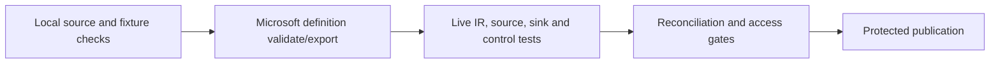

# 28. Tests: source contracts, definition validation, integration, and release gates

Check real data outcomes separately from ADF resource shape and run status.

## Data design and test matrix

| Level | Automate when | Evidence |
|---|---|---|
| Local JSON/graph contracts | Each PR | References, parameter names/types, safe sample trigger state |
| Microsoft validate/export | Each build | Valid definitions and generated ARM/parameter file |
| Local fixture oracle | Each PR | Stable batch identity, file hashes/rows/totals, version/delete rules |
| Live connector/IR | Before promotion | Test connection plus actual safe Copy |
| Pipeline/child/control flow | Before promotion | Correct inputs, failures, retry/status propagation |
| Source/API/schema contracts | Change and scheduled checks | Pagination, delete, column/type behavior |
| Reconciliation/access | Every release/batch as appropriate | Accepted rows/amounts/boundary and allowed/denied identities |
| Performance/recovery | Releases and periodic exercises | Measured deadline, source load, retention, RPO/RTO |



## Exact commands

```sh
python3 -m unittest discover -s adf_guide/examples/tests -v
python3 adf_guide/tools/validate_guide.py
python3 adf_guide/tools/validate_factory.py
cd adf_guide/tools
npm ci --ignore-scripts --no-audit --no-fund
npm run build -- validate ../examples/factory \
  '/subscriptions/00000000-0000-0000-0000-000000000000/resourceGroups/rg-adf-guide/providers/Microsoft.DataFactory/factories/adf-guide-dev'
```

The zero-UUID resource ID is deliberately illustrative. The validator downloads Microsoft's bundle and validates definitions; it does not authenticate/deploy or execute a factory. Local Python expression examples are focused contract/oracle checks, not a complete emulator of ADF, Mapping Data Flow, SQL Server or Azure services.

## Buttons and live gates

In Studio use parameter-only parent/child demo first. **Debug** with valid inputs; repeat with invalid `p_entity`, expect explicit failure. For file Copy use a disposable container/folder and approved managed identity. Compare actual source/sink file bytes and parsed fixture totals after one run and an unchanged rerun.

Inspect **Output/Monitor → Activity runs → Input/Output/Error** to prove values resolve as intended. Test **Trigger now** against published definitions after deployment, not only Debug current authoring edits. For production quality failures, use explicit Fail/commit gates so logging success doesn't hide failed data.

## Governance and infrastructure automation

PR validation receives no production data credentials. Live test identity accesses only approved test sources/sinks. Provision/cost-control test IR/Data Flow compute and clean only test-owned resources. Secure sensitive inputs/outputs and store safe evidence with the release SHA.

## Code push automation and maintenance

Block promotion on failed required checks. Include data/schema/SQL changes in coordinated migration testing, not just JSON deploy validation. Save source boundary, factory/activity run IDs, artifact/tool versions, resolved business inputs, output hashes/totals and acceptance result.

## Failure tests

Retry after partial/committed sink write; parallel variables; late files; missing manifest; equal/late timestamps; delete/reordered events; unknown entity; paginated API failure; source retention expiry; clock zone boundary; stopped trigger during deployment; wrong source identity. Green pipeline status and rowsCopied alone do not prove a complete correct batch.

## Official references

- [Continuous Integration Delivery Improvements](https://learn.microsoft.com/en-us/azure/data-factory/continuous-integration-delivery-improvements)
- [Iterative Development Debugging](https://learn.microsoft.com/en-us/azure/data-factory/iterative-development-debugging)
- [Copy Activity Data Consistency](https://learn.microsoft.com/en-us/azure/data-factory/copy-activity-data-consistency)
- [Tutorial Pipeline Failure Error Handling](https://learn.microsoft.com/en-us/azure/data-factory/tutorial-pipeline-failure-error-handling)

[Guide index](../../AZURE_DATA_FACTORY_GUIDE_INDEX.md)
