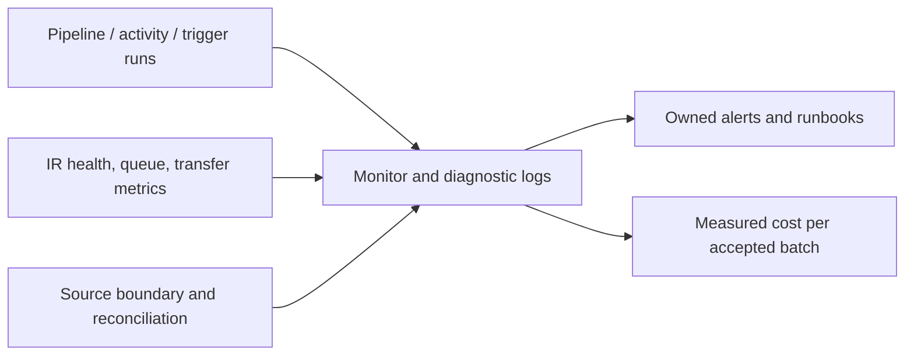

# 29. Monitoring, Log Analytics, Copy bottlenecks, and cost

Diagnose the slow stage and watch freshness/completeness alongside run status.

## Data design and monitoring flow

**Monitor → Pipeline runs**: filter factory/run/pipeline/time, open the run and activity details. For Copy inspect input/output, bytes/rows/files, used IR, execution details, queue and transfer phases. For SHIR inspect node health/capacity; for Data Flow distinguish cluster startup from transformation time.

## Parameters and tuning table

| Observation | Investigate/tune | Measure |
|---|---|---|
| Long queue | SHIR capacity/available workers/concurrency | Queue duration and host utilization |
| Slow first byte | Source query/connection/plan | Source latency/load |
| Slow transfer | Source/sink/network throttling | Throughput and limiting endpoint |
| Too many small files | Upstream delivery/file sizes/listing | File overhead and source completeness |
| Slow flow startup | Managed Spark startup/TTL/workload | Startup versus compute duration/cost |
| Hot/skewed join | Data Flow partition/join strategy | Spill/skew and equal output |
| Overloaded source | Fewer parallel copies/loops | Source CPU/connections and deadline |

Copy DIU is Azure IR data-movement capacity; it isn't a SHIR setting or Data Flow Spark core count. More DIUs won't fix an unindexed source query or an API rate limit. Do not change several knobs simultaneously and infer which helped.

## Diagnostic configuration

Azure Portal factory **Diagnostic settings → Add diagnostic setting**: choose required pipeline/activity/trigger/runtime categories, approved Log Analytics/storage destination and retention. Query the selected table mode's schema; resource-specific versus AzureDiagnostics tables differ. Do not publish a KQL query claiming one universal schema without verifying your diagnostic settings.

Alerts should cover failed/late/missing batches, source lag/retention, quarantine/conflict, unexpected zero input, SHIR offline/queue growth and missed window. Include safe factory/run/entity/batch IDs and a runbook owner. A successful pipeline can copy zero/wrong-scope rows.

## Governance and infrastructure automation

Logs can contain source metadata, SQL text and activity outputs; restrict access/retention and secure secret-bearing outputs. IaC provisions diagnostic routing/alert rules and runtime hosting. Pipeline authorship and access to log payloads are separate grants.

## Code push automation and maintenance

Version alert queries, thresholds and runbooks against the actual table schema. Estimate costs from activity orchestration, data movement, Data Flow/debug runtime and external SQL/Databricks/network services. Pricing is region/configuration/time dependent; this guide provides no fabricated universal dollar/throughput figures.

## Tests

Inject failure, stale source, zero input, SHIR node loss, source throttle, delayed files and quality failure. Verify alert routing/deduplication and publication freshness. Benchmark a realistic full-size batch including startup, retries and reconciliation; a tiny fixture cannot establish a 100-million-order 06:00 SLA.

## Official references

- [Monitor Visually](https://learn.microsoft.com/en-us/azure/data-factory/monitor-visually)
- [Monitor Programmatically](https://learn.microsoft.com/en-us/azure/data-factory/monitor-programmatically)
- [Copy Activity Performance](https://learn.microsoft.com/en-us/azure/data-factory/copy-activity-performance)
- [Copy Activity Performance Troubleshooting](https://learn.microsoft.com/en-us/azure/data-factory/copy-activity-performance-troubleshooting)
- [Concepts Data Flow Debug Mode](https://learn.microsoft.com/en-us/azure/data-factory/concepts-data-flow-debug-mode)

[Guide index](../../AZURE_DATA_FACTORY_GUIDE_INDEX.md)
