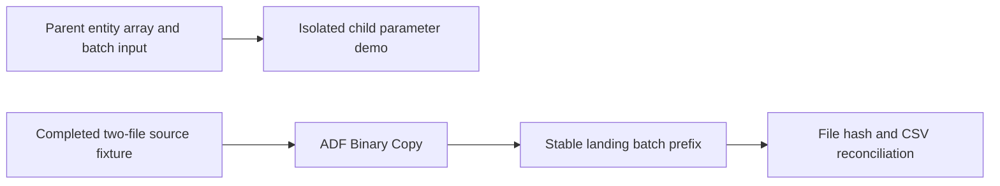

# 30. Worked lab: parameter isolation, file Copy, rerun, and reconciliation

Use the validated sample factory and record exact expected results.

## Data design and prerequisites

This lab has two independent pieces: a parameter-only parent/child demo with no data service dependency, and a real ADLS Binary Copy plus content verification. The REST asset is a definition illustration with a fake endpoint. All triggers start stopped.

## Exact buttons and input values

Import/connect the validated source root through the documented Git/code authoring route, adapt actual factory/account names, and bootstrap managed identity/network permissions. In `pl_parallel_parent`, **Debug** with `p_entities=["orders","customers"]`, `p_batch_id=demo-001`. Both children should succeed and their Set Variable labels be `orders|demo-001` and `customers|demo-001`. Test `pl_parameter_child` with `p_entity=unapproved`; expect `INVALID_INPUT` failure.

Create file system/container `lab` in approved ADLS. Upload exactly `orders_001.csv` and `orders_002.csv` from fixtures into `incoming/orders/2026-10-12`. The fixture manifest belongs in control metadata unless you intentionally want to copy it as another binary file; keep it outside this two-file source for the stated counts.

**Manage → Linked services → ls_adls**: set `p_account_url` default/appropriate deployment override to the actual account URL and test connection. In `pl_copy_files` **Debug**:

| Parameter | Value |
|---|---|
| `p_source_fs` | `lab` |
| `p_source_folder` | `incoming/orders/2026-10-12` |
| `p_sink_fs` | `lab` |
| `p_landing_root` | `landing/orders` |
| `p_batch_id` | `orders-20261012-001` |

Expected sink prefix `landing/orders/batch=orders-20261012-001`; two unchanged filenames with matching bytes. CSV rows total 3: O100 120.00 IN, O300 50.00 US, O400 25.00 IN. Revenue IN 145.00, US 50.00. Binary Copy output reports file/byte metrics, not parsed business totals.

## Rerun and acceptance

Run unchanged with the same batch ID and verify the same file set/contents. Use the local verification helper on downloaded source/sink fixtures, or a live SQL/Databricks validation task for production-scale data. Do not point a downstream append consumer at repeated batch events without batch/key idempotency. New business batches need distinct stable IDs.

For **Trigger now** or CLI create-run, publish/deploy the reviewed definitions first. The supplied stopped schedule chooses the previous completed India-local day at 04:00. Do not start it for the fixture date without understanding the date/path mapping and source availability.

## Governance and infrastructure automation

Use development-only storage and least privilege. Factory resource identity/data grants/network setup precede live runs. Deployment identity does not automatically provide runtime data access. No real Azure factory was connected during authoring.

## Code push automation and maintenance

The official utility validates all sample definitions and exports ARM. Inspect generated factoryName/linked-service endpoint parameters and adapt the environment file; defaults remain illustrative. CI templates are opt-in, and active guide CI performs only definition/export/local/diagram checks.

## Tests

Valid/invalid child input, parallel repetitions, correct file copy, unchanged rerun, wrong folder, zero files, denied sink write, partial delivery, mixed batch files and corrupted output. Record actual ADF run IDs, activity outputs, output hashes/totals and source completion proof before calling the live lab verified.

## Official references

- [Iterative Development Debugging](https://learn.microsoft.com/en-us/azure/data-factory/iterative-development-debugging)
- [Control Flow Execute Pipeline Activity](https://learn.microsoft.com/en-us/azure/data-factory/control-flow-execute-pipeline-activity)
- [Copy Activity Overview](https://learn.microsoft.com/en-us/azure/data-factory/copy-activity-overview)
- [Continuous Integration Delivery Improvements](https://learn.microsoft.com/en-us/azure/data-factory/continuous-integration-delivery-improvements)

[Guide index](../../AZURE_DATA_FACTORY_GUIDE_INDEX.md)
