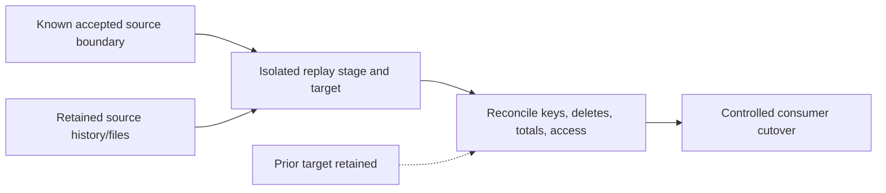

# 31. Backfill, recovery, region migration, and rollback

Restore boundaries, identities, triggers, and data—not only the pipeline JSON.

## Data design and recovery assets

A recovery plan needs source code/artifacts, control/watermark data, source files/logs, target data/history, factory identity/source grants, Key Vault secrets, network/IR configuration, SHIR host registration, trigger/window state and consumer contract. Git JSON alone recreates none of the retained data or every external permission.

## Exact backfill inputs and actions

Use a separate replay pipeline/configuration with `p_window_start`, `p_window_end`, `p_batch_id`, `p_target_scope`, and captured source boundary. Use a new isolated staging/target prefix for validation. Do not reset a production watermark casually or create new RunId-based logical batches that duplicate accepted facts.

For tumbling-window pipelines use the documented window rerun/dependency controls and explicit boundaries. For timestamp/version pipelines, provide fixed interval inputs and verify source retention. For a new CDC lineage, follow source/connector resnapshot procedures; the old source log boundary may no longer exist.

In **Monitor → Pipeline runs**, use the supported rerun controls only after checking whether original parameters/boundaries are preserved and which activities have committed side effects. A retry can call a downstream service again after it already committed. Record the actual parameters and batch outcome.

## Governance and infrastructure automation

Bootstrap recovery factory's new identity/grants/network and IR reachability. Restored JSON pointing at an old vault/account/runtime is not a complete environment restore. SHIR keys and source secret rotation must be managed securely. Keep sensitive backups/logs within the approved region/retention policy.

## Code push automation and maintenance

Revert code by redeploying a previous reviewed artifact; handle data/schema/control-state correction separately. Don't delete the factory or broad source folders to resolve a failed run. Review cleanup/deletion scope in pre/post deployment scripts. Preserve intended trigger states; don't restart scheduled processing before restored control/data state is accepted.

For cross-region migration rebuild infrastructure and validate source/sink egress/latency. Runtime sharing, private connectivity and connector support must be rechecked. RPO/RTO are measured recovery targets, not properties automatically supplied by ARM deployment.

## Tests

Restore a captured boundary, replay including deletes/out-of-order events, rerun committed batches, simulate expired source logs/files, lost control table, SHIR outage, identity replacement, stopped trigger restoration and consumer cutover failure. Measure lost-data interval/recovery time and verify both data/policy parity. Backups never restored remain unverified.

## Official references

- [How To Create Tumbling Window Trigger](https://learn.microsoft.com/en-us/azure/data-factory/how-to-create-tumbling-window-trigger)
- [Monitor Visually](https://learn.microsoft.com/en-us/azure/data-factory/monitor-visually)
- [Create Self Hosted Integration Runtime](https://learn.microsoft.com/en-us/azure/data-factory/create-self-hosted-integration-runtime)
- [Continuous Integration Delivery Sample Script](https://learn.microsoft.com/en-us/azure/data-factory/continuous-integration-delivery-sample-script)

[Guide index](../../AZURE_DATA_FACTORY_GUIDE_INDEX.md)
