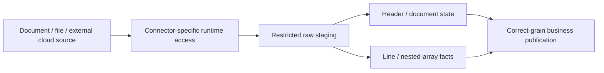

# 32. NoSQL, SFTP, nested documents, and cross-cloud source substitutions

Check each connector's operation/schema contract instead of replacing only a hostname.

## Data design and source alternatives

| Source | ADF route to evaluate | Distinct contract |
|---|---|---|
| Cosmos DB for NoSQL | Supported Cosmos connector/Data Flow capability | Partition key, request units, source change/delete mode |
| MongoDB Atlas | Supported Atlas connector | Filter/projection, BSON type mapping, network/auth |
| SFTP | SFTP linked service + file dataset | Host key, delivery completion, file-name/retention |
| S3/GCS | Supported cloud storage connector | Cloud credentials/region/egress and format support |
| Event stream | Streaming engine or storage landing + ADF | Kafka/PubSub/Kinesis protocols are different |

## Buttons and concrete choices

**Manage → Linked services → New**, choose the exact source connector, version/authentication/runtime and test against its documented capabilities. For Cosmos choose the approved account/database/container and partition/query strategy; bound read/write throughput. For Atlas configure its source-specific connection settings and credential/network contract. Do not promise all change-feed modes capture deletes.

For SFTP fill Host, Port, approved authentication/key references, host-key/fingerprint verification, and Connect via runtime. Do not turn off host verification as a default troubleshooting fix. Create Binary or row-format dataset with directory/file parameters. Require a vendor rename/manifest/completion convention before copying files that may still be written.

For S3/GCS use their supported connector rather than an AzureBlobFS URL substitution. Choose cloud-scoped credentials, region/network, and source/sink support. Managed identity for ADLS does not authenticate a GCS bucket.

## Nested transformation and grain

Raw documents need ID, partition key, source version/order, operation, payload and timestamp. Choose full-document versus partial-patch semantics. Mapping Data Flow Flatten changes grain: an order header amount joined to three line rows must not count three times. Use stable source line IDs if array positions can reorder. Handle empty/null arrays and schema drift explicitly.

## Governance and infrastructure automation

NoSQL documents can mix sensitive and non-sensitive fields; restrict raw data and curate approved disclosure. Source rate/cost/partition limits and cloud egress are platform requirements. Separate source credentials from pipeline inputs, and provision private routing/allowlists for the chosen runtime.

## Code push automation and maintenance

Version connector/version, type mapping, nested schema, delete contract and file completion protocol. Swapping SQL for Cosmos/Atlas changes state, keys, throughput and deletion semantics; swapping Jenkins for GitHub mostly changes deployment identity/runner. Use the same acceptance fixture only where the business contract is actually equivalent.

## Tests

Null/empty arrays, multiple arrays, reordered lines, missing fields, BSON/JSON type differences, partition skew, rate throttling, source deletes, partial patches, SFTP changed host key, incomplete file, cross-cloud denied credentials and egress performance. Reconcile header totals before/after flattening.

## Official references

- [Connector Azure Cosmos Db](https://learn.microsoft.com/en-us/azure/data-factory/connector-azure-cosmos-db)
- [Connector Mongodb Atlas](https://learn.microsoft.com/en-us/azure/data-factory/connector-mongodb-atlas)
- [Connector Sftp](https://learn.microsoft.com/en-us/azure/data-factory/connector-sftp)
- [Connector Amazon Simple Storage Service](https://learn.microsoft.com/en-us/azure/data-factory/connector-amazon-simple-storage-service)
- [Connector Google Cloud Storage](https://learn.microsoft.com/en-us/azure/data-factory/connector-google-cloud-storage)
- [Data Flow Flatten](https://learn.microsoft.com/en-us/azure/data-factory/data-flow-flatten)

[Guide index](../../AZURE_DATA_FACTORY_GUIDE_INDEX.md)
