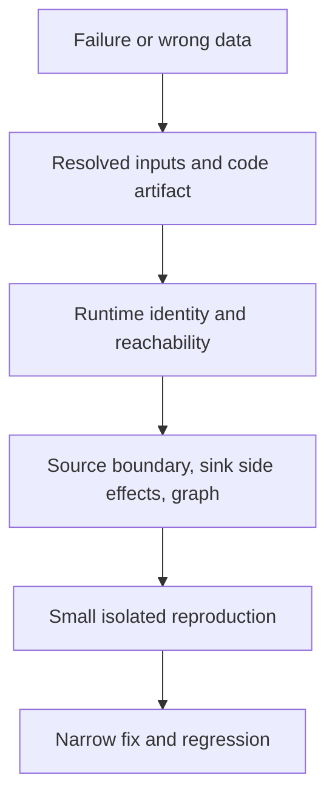

# 33. Troubleshooting by symptom, parameter, runtime, and graph

Find the failing layer before resetting state or broadening permissions.

## Data design and diagnostic map

| Symptom | Evidence first | Likely correction | Regression |
|---|---|---|---|
| Wrong folder/account | Activity Input, dataset/LS bindings | Fix scope/reference/ARM override | Override reaches intended environment |
| ForEach rejects Items | Lookup FirstRowOnly/output type | Use array .value or correct metadata array | Empty/valid list |
| Two entities copy same table | Shared variables + parallel loop | Direct item/child parameter passing | Parallel repeated entities |
| REST gets first page only | Paging response/rule | Correct JSONPath and termination | Multi/empty/final page |
| Duplicate after retry | Sink key/path/business batch | Stable staging and idempotent commit | Post-commit crash |
| Hard deletes missed | Source contract | CDC/tombstone/complete snapshot | Delete test |
| Access denied | Exact runtime identity/grants | Fix specific data/vault/SQL right | Allowed/denied scope |
| Timeout | Runtime DNS/route/TLS/source load | Fix execution-plane connectivity | Tiny actual Copy |
| Slow queue | SHIR health/concurrency | Capacity/source budget tuning | Multi-job benchmark |
| Debug works, trigger differs | Authoring versus published source | Deploy/publish reviewed revision | Trigger now source SHA |
| Pipeline green after error | Dependency/failure leaves | Explicit error propagation/Fail | Logger succeeds after main fails |
| ARM endpoint unchanged | Generated parameter contract | Override exact generated name | Inspect deployed connection |
| No trigger run | State/subscription/event filters | Correct active state and event settings | Actual event/window |

## Buttons and exact evidence

**Monitor → Pipeline runs → failing run → Activity runs**. Inspect Input, Output, Error, used integration runtime, Copy performance detail and parameters. For Debug inspect the authoring Output tab; record whether it ran unpublished code. For triggers inspect Trigger runs/state and event/window input. For SHIR inspect node status/logs with approved host access.

Retain factory/pipeline/activity/run IDs, source boundary, batch ID, runtime/identity, schema/connector version, release artifact SHA/hash, safe error text and target acceptance state. Never log secrets/connection tokens or dump raw PII for convenience.

## Governance and infrastructure automation

Differentiate management auth, factory data identity, SQL/vault/storage permissions, private endpoint approval, source ACLs and runtime networking. More factory RBAC won't fix an absent database user or a blocked source port. Check the actual scheduled identity/runtime rather than your interactive browser's access.

## Code push automation and maintenance

Version a narrow fix and replay only through the reviewed state/retention procedure. Don't delete checkpoints/control tables, reset watermarks, turn off TLS/host-key verification, skip incompatible rows blindly, or truncate targets just to obtain a green run. Schema/data correction can be separate from source JSON deployment.

## Tests

Reproduce the reported failure with the smallest relevant fixture, then assert final business output, boundary/status and access—not only activity success. Add a specific regression for the observed bug. Test relevant retry/cancellation/deployment paths after changing failure handling or state semantics.

## Official references

- [Monitor Visually](https://learn.microsoft.com/en-us/azure/data-factory/monitor-visually)
- [Copy Activity Performance Troubleshooting](https://learn.microsoft.com/en-us/azure/data-factory/copy-activity-performance-troubleshooting)
- [Control Flow Expression Language Functions](https://learn.microsoft.com/en-us/azure/data-factory/control-flow-expression-language-functions)
- [Tutorial Pipeline Failure Error Handling](https://learn.microsoft.com/en-us/azure/data-factory/tutorial-pipeline-failure-error-handling)

[Guide index](../../AZURE_DATA_FACTORY_GUIDE_INDEX.md)
