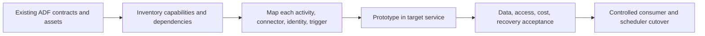

# 34. ADF versus Synapse pipelines and Fabric Data Factory

Use the requested ADF service and plan migrations by capability, not product-name substitution.

## Data design and scope

This handbook targets Azure Data Factory v2. Synapse pipelines share many activity/connector concepts but live in a different workspace/deployment/compute context. Fabric Data Factory has its own capacity, workspace, connection, Git/deployment and activity experience. Microsoft describes Fabric as the next generation, but that does not make ADF JSON/resources/settings universally interchangeable.

| Concern | ADF baseline | Migration question |
|---|---|---|
| Source connectivity | Linked service + selected IR | Target connection/gateway/managed network support |
| Transformation | Mapping Data Flow or external compute | Equivalent engine, expressions, schema semantics |
| Runtime inputs | Pipeline/dataset/LS parameters | Target scope/type/return conventions |
| Source progress | Watermarks/CDC/windows | State transfer/reinitialization and delete parity |
| Code deployment | Source Git + exported ARM | Target Git/deployment artifact ownership |
| Identity | Factory managed identity/source credentials | Target identity and source data grants |
| Cost | ADF activities/movement/compute/external services | Target capacity plus workload/egress costs |

## Buttons and implementation boundary

Use the linked official comparison/migration documentation for current target menus and supported activities. Do not click Fabric workspace settings expecting an ADF resource-group deployment, or paste an ADF `AzureBlobFS` linked-service JSON into a Fabric connection form. Within this repository the validated source root and ARM generation apply to ADF only.

A migration inventory should list pipeline/activity/dataset/connector, parameters/expressions, source deletion/order/retention, trigger/window behavior, network, permissions, secrets, monitoring, source/target schemas, consumer contracts and rollback. Pick one representative source/transform/sink path and test it before changing every pipeline.

## Governance and infrastructure automation

The target's workspace roles/catalog/policies do not automatically recreate source SQL/storage/vault rights. Preserve PII classification, lineage, audit, regional data/egress policy and source throughput budget. Prove identity and private connectivity from the new execution plane.

## Code push automation and maintenance

Version migration mappings and target-specific deployment automation. Promote the same accepted business contract while allowing intentionally different implementations. Keep old source/state read paths for the agreed rollback period; two active schedulers can duplicate work. A renamed activity/source connector may create a new incremental-state lineage.

## Tests

Run the same representative fixtures and captured source boundaries through old/new paths. Compare keys, types/nulls/timezones/decimals, deletes/history, idempotent replay, trigger/window behavior, failure status, access/lineage and throughput/cost. Rehearse backfill and cutover. Record unsupported/changed capabilities explicitly instead of calling every permutation equivalent.

## Official references

- [Official ADF/Fabric comparison](https://learn.microsoft.com/en-us/fabric/data-factory/compare-fabric-data-factory-and-azure-data-factory)
- [Continuous Integration Deployment](https://learn.microsoft.com/en-us/azure/data-factory/continuous-integration-deployment)
- [Concepts Integration Runtime](https://learn.microsoft.com/en-us/azure/data-factory/concepts-integration-runtime)
- [Parameters Data Flow](https://learn.microsoft.com/en-us/azure/data-factory/parameters-data-flow)

[Guide index](../../AZURE_DATA_FACTORY_GUIDE_INDEX.md)
