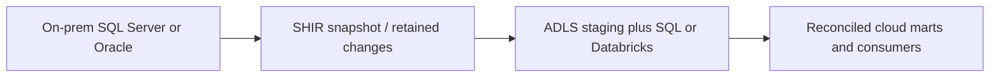
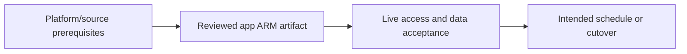

# On-prem warehouse migration to Azure

Use SHIR, snapshots, CDC, parallel validation and controlled cutover.

## Data design

## Exact field/input checklist

| Input/field | Supply |
|---|---|
| `runtime` | ir_onprem_dev, supported Windows hosts |
| `source_boundary` | Consistent snapshot and published CDC bridge |
| `sink` | Approved ADLS/SQL staging |
| `batch_id` | Stable source-boundary identity |

## Walkthrough

1. Inventory source jobs, SQL/report semantics, source/consumer access and retention before creating Copy activities.
2. Configure chapter 03 SHIR, then source/sink linked services/datasets using chapters 04–05; test both endpoints from SHIR.
3. Capture a consistent snapshot and bridge it to retained changes with no missing interval; use chapters 10–12 for boundaries/deletes.
4. Run old/new outputs at captured boundaries, reconcile keys/amounts/nulls/timezone/history, and approve consumer cutover.
5. Drain changes and cut over; a write freeze may be needed if no safe source/cutover contract exists. Rehearse rollback for writes after cutover.

Exact UI fields, expressions, prerequisites and code are in: [03. Azure IR, self-hosted IR, Azure-SSIS IR, and execution location](../chapters/03-integration-runtimes.md); [04. Linked services, managed identities, SQL credentials, and Key Vault](../chapters/04-linked-services-identity.md); [10. SQL/Oracle/on-prem database ingestion and source load](../chapters/10-database-copy.md); [11. Incremental watermarks, committed boundaries, and transactional advancement](../chapters/11-watermarks.md); [12. CDC, hard deletes, soft deletes, and snapshot comparison](../chapters/12-cdc-deletes.md); [21. Databricks, Synapse, SQL, functions, and streaming boundaries](../chapters/21-external-compute.md); [31. Backfill, recovery, region migration, and rollback](../chapters/31-backfill-recovery.md).

## Governance and infrastructure automation

Platform IaC provisions cloud identity/network/storage; source DBA owns snapshot/CDC permissions and retention. Factory management rights are not source data rights.

## Code push automation and maintenance

Promote ADF and external SQL/Databricks versions together. Azure DevOps/GitHub/Jenkins can deploy the same ARM; none replaces source configuration or reconciliation.

## Tests to automate and rehearse

Snapshot+CDC gap, deletes, parallel counts/decimals, source overload, SHIR failover, interrupted cutover and RPO/RTO.

## Technology substitutions

Preserve the source/delete/order/completion and acceptance contract when replacing a component. Azure IR versus SHIR changes reachability/capacity; Binary versus row Copy changes parsing/mapping; SQL versus Mapping Data Flow versus Databricks changes compute and state semantics; Azure DevOps versus GitHub/Jenkins/GitLab changes runner/authentication. Connector/cloud/protocol replacements require their own capability tests. A Cartesian combination is not proof of compatibility.

## Completion evidence

Capture reviewed source/artifact hash, resolved business inputs, runtime/identity, source boundary/completion proof, ADF/external run IDs, target acceptance and measured freshness/recovery/cost. This is a recipe; no live Azure factory execution was performed during authoring.

[Guide index](../../AZURE_DATA_FACTORY_GUIDE_INDEX.md)
