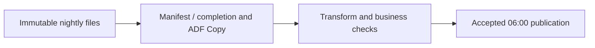
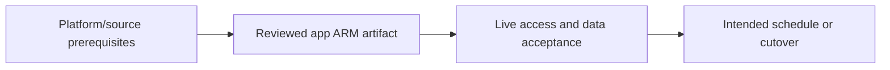

# Daily files: 100 million orders by 6 a.m.

Use a completion contract, bounded Copy and measured processing capacity.

## Data design

## Exact field/input checklist

| Input/field | Supply |
|---|---|
| `source_folder` | Partitioned completed delivery |
| `batch_id` | Source business date or manifest ID |
| `trigger` | Scheduled/event with correct context |
| `performance` | Measured file/byte/source limits |

## Walkthrough

1. Define file completion, expected rows/bytes, business timezone and late-arrival policy.
2. Use chapter 09 file Copy and chapter 18 trigger values; a storage event or quiet folder is not complete-batch proof.
3. Select transformation engine from chapters 19–21 and include reconciliation before publishing a freshness marker.
4. Benchmark realistic bytes, small-file overhead, skew, source/sink limits and retry reserve; row count alone cannot size DIUs.
5. Alert on missing/late/zero/invalid batches and preserve source files until acceptance/replay requirements are met.

Exact UI fields, expressions, prerequisites and code are in: [09. File ingestion: Binary/CSV, hierarchy, wildcards, and completion](../chapters/09-file-copy.md); [18. Schedule, tumbling windows, storage events, and batch identity](../chapters/18-triggers-windows-events.md); [19. Mapping Data Flow transformations: schema, joins, aggregate, and sink](../chapters/19-mapping-data-flows.md); [21. Databricks, Synapse, SQL, functions, and streaming boundaries](../chapters/21-external-compute.md); [28. Tests: source contracts, definition validation, integration, and release gates](../chapters/28-test-strategy.md); [29. Monitoring, Log Analytics, Copy bottlenecks, and cost](../chapters/29-monitor-cost-performance.md).

## Governance and infrastructure automation

Restrict source/sink writes, isolate raw/curated access and provision event/routing/IR prerequisites.

## Code push automation and maintenance

Deploy stopped/reviewed triggers through the release owner; code push is not a reason to replay production data blindly.

## Tests to automate and rehearse

Partial/late/missing delivery, empty batch, stable rerun, mixed files, deadline including retry/startup/reconciliation and alerts.

## Technology substitutions

Preserve the source/delete/order/completion and acceptance contract when replacing a component. Azure IR versus SHIR changes reachability/capacity; Binary versus row Copy changes parsing/mapping; SQL versus Mapping Data Flow versus Databricks changes compute and state semantics; Azure DevOps versus GitHub/Jenkins/GitLab changes runner/authentication. Connector/cloud/protocol replacements require their own capability tests. A Cartesian combination is not proof of compatibility.

## Completion evidence

Capture reviewed source/artifact hash, resolved business inputs, runtime/identity, source boundary/completion proof, ADF/external run IDs, target acceptance and measured freshness/recovery/cost. This is a recipe; no live Azure factory execution was performed during authoring.

[Guide index](../../AZURE_DATA_FACTORY_GUIDE_INDEX.md)
