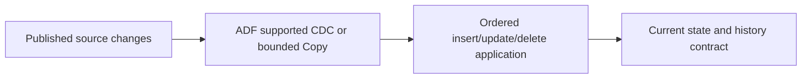
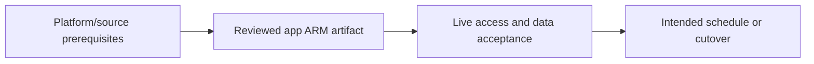

# Incremental database CDC with hard deletes

Choose native CDC or a complete ordered ledger, then commit state and boundary.

## Data design

## Exact field/input checklist

| Input/field | Supply |
|---|---|
| `boundary_kind` | Source-native CDC or commit-ordered version |
| `operation` | Explicit I/U/D semantics |
| `keys` | Approved business key |
| `retention` | Beyond source lag/recovery |

## Walkthrough

1. Have the DBA enable/authorize the supported source change mechanism and establish retention.
2. Use chapter 12 native CDC or chapter 11 stable low/high interval with source completeness proof.
3. Configure Data Flow sink update methods/keys or a batch-isolated staging plus transactional SQL commit; do not infer hard deletes from timestamp absence.
4. Retain delete ordering evidence so a late update cannot resurrect a key; define history separately from SCD1 upsert.
5. Monitor progress/log expiry and document resnapshot/full-refresh behavior before changing source/checkpoint lineage.

Exact UI fields, expressions, prerequisites and code are in: [10. SQL/Oracle/on-prem database ingestion and source load](../chapters/10-database-copy.md); [11. Incremental watermarks, committed boundaries, and transactional advancement](../chapters/11-watermarks.md); [12. CDC, hard deletes, soft deletes, and snapshot comparison](../chapters/12-cdc-deletes.md); [19. Mapping Data Flow transformations: schema, joins, aggregate, and sink](../chapters/19-mapping-data-flows.md); [22. Loading, SQL upsert, deletes, partitions, and idempotent publication](../chapters/22-loading-idempotency.md); [31. Backfill, recovery, region migration, and rollback](../chapters/31-backfill-recovery.md).

## Governance and infrastructure automation

Source log privileges, sink modification/procedure rights, sensitive history and control state need explicit owners.

## Code push automation and maintenance

Version source schema/order/delete contract and commit procedure with ADF definitions. Preserve state across ordinary app deployment.

## Tests to automate and rehearse

Insert/update/delete, duplicate/conflicting sequence, late update after delete, partial patches, retry after commit, retention gap and resnapshot.

## Technology substitutions

Preserve the source/delete/order/completion and acceptance contract when replacing a component. Azure IR versus SHIR changes reachability/capacity; Binary versus row Copy changes parsing/mapping; SQL versus Mapping Data Flow versus Databricks changes compute and state semantics; Azure DevOps versus GitHub/Jenkins/GitLab changes runner/authentication. Connector/cloud/protocol replacements require their own capability tests. A Cartesian combination is not proof of compatibility.

## Completion evidence

Capture reviewed source/artifact hash, resolved business inputs, runtime/identity, source boundary/completion proof, ADF/external run IDs, target acceptance and measured freshness/recovery/cost. This is a recipe; no live Azure factory execution was performed during authoring.

[Guide index](../../AZURE_DATA_FACTORY_GUIDE_INDEX.md)
