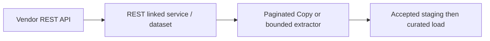
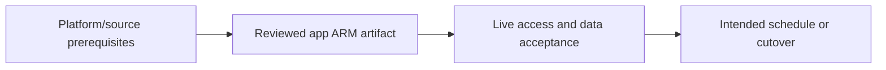

# Paginated SaaS REST API to durable landing

Configure native pagination or a custom extractor for unsupported contracts.

## Data design

## Exact field/input checklist

| Input/field | Supply |
|---|---|
| `request` | GET/POST supported by source route |
| `pagination` | AbsoluteUrl $.nextLink for the sample contract |
| `collection` | $.items mapping |
| `auth` | Supported scoped credentials, no plaintext parameter |

## Walkthrough

1. Check vendor request/response/auth/rate/delete/continuation contract before choosing REST versus HTTP/Web/custom extraction.
2. Follow chapter 13 linked-service/dataset/Source settings and map the real JSONPath; the example endpoint is deliberately fake.
3. For top-level-array or complex token/cursor behavior use chapter 14 custom extraction, bounded paging and completed staging manifest.
4. Use stable business keys/batches for retries; selected REST rows are not full raw HTTP envelope archives.
5. Advance any durable cursor only after accepted complete extraction/publication; absence from a page is not deletion.

Exact UI fields, expressions, prerequisites and code are in: [04. Linked services, managed identities, SQL credentials, and Key Vault](../chapters/04-linked-services-identity.md); [07. Expressions: types, interpolation, dates, escaping, and outputs](../chapters/07-expressions.md); [13. REST Copy: linked service, dataset, pagination, and JSON mapping](../chapters/13-rest-copy.md); [14. Web, HTTP Copy, Azure Functions, and custom paging](../chapters/14-web-http-functions.md); [22. Loading, SQL upsert, deletes, partitions, and idempotent publication](../chapters/22-loading-idempotency.md); [28. Tests: source contracts, definition validation, integration, and release gates](../chapters/28-test-strategy.md).

## Governance and infrastructure automation

Provision runtime egress/vendor scopes/vault and restrict raw PII. Trust only approved continuation domains.

## Code push automation and maintenance

Pin request/schema/pagination contract and tests. CI definition success cannot prove a vendor endpoint or token refresh works.

## Tests to automate and rehearse

First/multiple/empty/final pages, repeated cursor, 429/5xx/401, expiry, wrong collection path, partial sink and duplicate replay.

## Technology substitutions

Preserve the source/delete/order/completion and acceptance contract when replacing a component. Azure IR versus SHIR changes reachability/capacity; Binary versus row Copy changes parsing/mapping; SQL versus Mapping Data Flow versus Databricks changes compute and state semantics; Azure DevOps versus GitHub/Jenkins/GitLab changes runner/authentication. Connector/cloud/protocol replacements require their own capability tests. A Cartesian combination is not proof of compatibility.

## Completion evidence

Capture reviewed source/artifact hash, resolved business inputs, runtime/identity, source boundary/completion proof, ADF/external run IDs, target acceptance and measured freshness/recovery/cost. This is a recipe; no live Azure factory execution was performed during authoring.

[Guide index](../../AZURE_DATA_FACTORY_GUIDE_INDEX.md)
