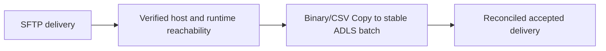
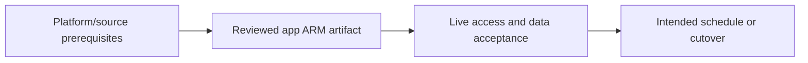

# SFTP files to ADLS with verified completion

Preserve transport identity, host keys and a stable business batch.

## Data design

## Exact field/input checklist

| Input/field | Supply |
|---|---|
| `host_port` | Approved SFTP endpoint and port |
| `host_key` | Approved fingerprint validation |
| `completion` | Vendor manifest/rename protocol |
| `batch_id` | Stable delivery ID |

## Walkthrough

1. Agree complete-file/delivery protocol and retention with the sender; do not read an actively written filename as final.
2. Create SFTP linked service/dataset and select the actual runtime using chapter 32.
3. Use Binary Copy for byte-preserved landing or explicit row-format dataset for parsing; configure wildcards/recursion carefully.
4. Reconcile expected file names/bytes/rows and publish only accepted batches. Cleanup source only under a reviewed accepted-state lifecycle.
5. Rotate source credentials/host keys through an approved process and alert on mismatched fingerprint rather than disabling verification.

Exact UI fields, expressions, prerequisites and code are in: [03. Azure IR, self-hosted IR, Azure-SSIS IR, and execution location](../chapters/03-integration-runtimes.md); [04. Linked services, managed identities, SQL credentials, and Key Vault](../chapters/04-linked-services-identity.md); [05. Datasets, formats, locations, and parameterized paths](../chapters/05-datasets-and-paths.md); [09. File ingestion: Binary/CSV, hierarchy, wildcards, and completion](../chapters/09-file-copy.md); [28. Tests: source contracts, definition validation, integration, and release gates](../chapters/28-test-strategy.md); [32. NoSQL, SFTP, nested documents, and cross-cloud source substitutions](../chapters/32-nosql-sftp-crosscloud.md).

## Governance and infrastructure automation

Protect SSH keys/passwords in supported secret references; allow runtime source/sink connectivity and restrict cleanup rights.

## Code push automation and maintenance

Version file format/completion/host-key contracts and source retention. Deploy endpoint changes separately from business-date inputs.

## Tests to automate and rehearse

Host-key change, incomplete file, lost connection, nested files, wildcard omission, duplicate filename changed content and replay after target commit.

## Technology substitutions

Preserve the source/delete/order/completion and acceptance contract when replacing a component. Azure IR versus SHIR changes reachability/capacity; Binary versus row Copy changes parsing/mapping; SQL versus Mapping Data Flow versus Databricks changes compute and state semantics; Azure DevOps versus GitHub/Jenkins/GitLab changes runner/authentication. Connector/cloud/protocol replacements require their own capability tests. A Cartesian combination is not proof of compatibility.

## Completion evidence

Capture reviewed source/artifact hash, resolved business inputs, runtime/identity, source boundary/completion proof, ADF/external run IDs, target acceptance and measured freshness/recovery/cost. This is a recipe; no live Azure factory execution was performed during authoring.

[Guide index](../../AZURE_DATA_FACTORY_GUIDE_INDEX.md)
