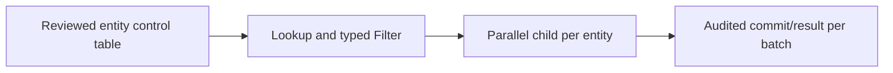
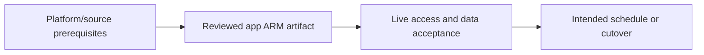

# Many tables with metadata-driven parallel ingestion

Use bounded Lookup, immutable loop inputs and isolated children/control state.

## Data design

## Exact field/input checklist

| Input/field | Supply |
|---|---|
| `Lookup` | First row only false, bounded rows/bytes |
| `ForEach` | Items Lookup output.value |
| `batchCount` | Source-approved upper limit |
| `child` | Wait on completion true and explicit keys |

## Walkthrough

1. Define allowlisted control schema, source-kind cases, sink objects, parameter types, contract version and per-entity ownership.
2. Follow chapters 15–16 Lookup/Filter/ForEach/Execute Pipeline settings; page large metadata rather than silently truncate.
3. Pass @item() fields directly; never Set Variable to share each iteration source/target choice.
4. Record each entity/batch result and committed source boundary durably; use locked compare-and-set for concurrent progress.
5. Reconcile enabled/expected versus attempted/accepted/failed entities, and canary new metadata configurations before broad rollout.

Exact UI fields, expressions, prerequisites and code are in: [06. Parameter scopes and deployment versus runtime values](../chapters/06-parameter-map.md); [08. Variables, counters, arrays, and parallel-loop races](../chapters/08-variables-and-concurrency.md); [15. Lookup, Get Metadata, and Filter: output shapes and limits](../chapters/15-lookup-metadata-filter.md); [16. ForEach, Execute Pipeline, and child return values](../chapters/16-foreach-child-returns.md); [24. Metadata-driven ingestion framework and configuration ownership](../chapters/24-metadata-framework.md); [28. Tests: source contracts, definition validation, integration, and release gates](../chapters/28-test-strategy.md).

## Governance and infrastructure automation

Control-table edits can redirect privileged work; govern/audit them and reject arbitrary SQL/paths/credentials.

## Code push automation and maintenance

Promote framework/metadata schema with tests, and audit runtime configuration updates separately from ARM deployment.

## Tests to automate and rehearse

Missing/disabled/bad type entity, truncation, path/query injection, shared-variable race, child failure, source throttling and stale progress commit.

## Technology substitutions

Preserve the source/delete/order/completion and acceptance contract when replacing a component. Azure IR versus SHIR changes reachability/capacity; Binary versus row Copy changes parsing/mapping; SQL versus Mapping Data Flow versus Databricks changes compute and state semantics; Azure DevOps versus GitHub/Jenkins/GitLab changes runner/authentication. Connector/cloud/protocol replacements require their own capability tests. A Cartesian combination is not proof of compatibility.

## Completion evidence

Capture reviewed source/artifact hash, resolved business inputs, runtime/identity, source boundary/completion proof, ADF/external run IDs, target acceptance and measured freshness/recovery/cost. This is a recipe; no live Azure factory execution was performed during authoring.

[Guide index](../../AZURE_DATA_FACTORY_GUIDE_INDEX.md)
