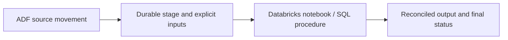
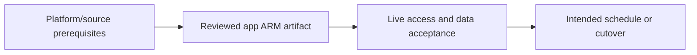

# ADF orchestration with Databricks or SQL transformations

Move sources first and verify external computation outcomes before publication.

## Data design

## Exact field/input checklist

| Input/field | Supply |
|---|---|
| `notebook` | Actual versioned absolute path |
| `Base Parameters` | catalog, run_date, batch_id, adf_run_id |
| `SQL` | Typed procedure parameters |
| `result` | Real terminal status and content assertions |

## Walkthrough

1. Choose ADF source/IR path and durable staging, then a suitable external transformation engine.
2. Create the external linked service and chapter 21 activity fields; pass exact keys and distinguish widget/procedure inputs.
3. Ensure the external compute identity and execution plane can access stage/source/target; SHIR reachability is not inherited by Databricks.
4. Await real external completion, interpret bounded output contract, and verify business results before publication.
5. Correlate ADF and external run IDs and preserve stable batch idempotency for reruns.

Exact UI fields, expressions, prerequisites and code are in: [03. Azure IR, self-hosted IR, Azure-SSIS IR, and execution location](../chapters/03-integration-runtimes.md); [06. Parameter scopes and deployment versus runtime values](../chapters/06-parameter-map.md); [17. If, Switch, Until, retries, and error-propagation graphs](../chapters/17-conditions-errors-until.md); [21. Databricks, Synapse, SQL, functions, and streaming boundaries](../chapters/21-external-compute.md); [22. Loading, SQL upsert, deletes, partitions, and idempotent publication](../chapters/22-loading-idempotency.md); [28. Tests: source contracts, definition validation, integration, and release gates](../chapters/28-test-strategy.md).

## Governance and infrastructure automation

Management/ADF/source/external compute/UC/SQL identities and rights are separate. Restrict raw data and protected outputs.

## Code push automation and maintenance

Coordinate immutable ADF and compute revisions; choose one scheduler and keep request-idempotency distinct from write-idempotency.

## Tests to automate and rehearse

Wrong input key/type, source access denied, job accepted then failed, timeout, runOutput parse, partial commit and repeated batch effect.

## Technology substitutions

Preserve the source/delete/order/completion and acceptance contract when replacing a component. Azure IR versus SHIR changes reachability/capacity; Binary versus row Copy changes parsing/mapping; SQL versus Mapping Data Flow versus Databricks changes compute and state semantics; Azure DevOps versus GitHub/Jenkins/GitLab changes runner/authentication. Connector/cloud/protocol replacements require their own capability tests. A Cartesian combination is not proof of compatibility.

## Completion evidence

Capture reviewed source/artifact hash, resolved business inputs, runtime/identity, source boundary/completion proof, ADF/external run IDs, target acceptance and measured freshness/recovery/cost. This is a recipe; no live Azure factory execution was performed during authoring.

[Guide index](../../AZURE_DATA_FACTORY_GUIDE_INDEX.md)
