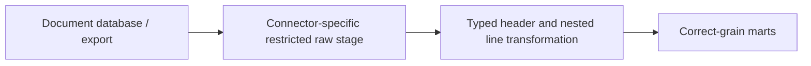
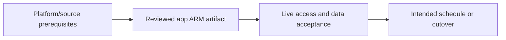

# Cosmos/MongoDB documents to header and line facts

Preserve source versions/deletes and avoid row multiplication when flattening.

## Data design

## Exact field/input checklist

| Input/field | Supply |
|---|---|
| `source_key` | Document ID and partition contract |
| `change_mode` | Full document/patch/delete capability |
| `schema` | Versioned nested contract |
| `line_key` | Stable source line identifier |

## Walkthrough

1. Confirm supported source connector/version and change/delete semantics; do not assume every feed captures hard deletes.
2. Configure source identity/runtime/query/partition/rate settings using chapter 32.
3. Retain raw payload/source version and transform with explicit schema, null-array and quarantine policy.
4. Separate one-row/order header facts from one-row/stable-item facts; verify joins/Flatten do not multiply header revenue.
5. Test partial patches, item reorder, source retention and delete replay before publishing curated data.

Exact UI fields, expressions, prerequisites and code are in: [12. CDC, hard deletes, soft deletes, and snapshot comparison](../chapters/12-cdc-deletes.md); [19. Mapping Data Flow transformations: schema, joins, aggregate, and sink](../chapters/19-mapping-data-flows.md); [20. Data Flow parameters, expression mode, compute, and performance](../chapters/20-data-flow-parameters.md); [22. Loading, SQL upsert, deletes, partitions, and idempotent publication](../chapters/22-loading-idempotency.md); [32. NoSQL, SFTP, nested documents, and cross-cloud source substitutions](../chapters/32-nosql-sftp-crosscloud.md).

## Governance and infrastructure automation

Documents can mix PII and arbitrary fields; restrict raw storage, source scopes/throughput and curated disclosures.

## Code push automation and maintenance

Version nested fixtures, mapping/projection/type/key and operation contract; connector swaps require semantic tests.

## Tests to automate and rehearse

Empty/null/multiple arrays, reordered items, missing fields, type drift, partition skew/throttle, patches/deletes and duplicated totals.

## Technology substitutions

Preserve the source/delete/order/completion and acceptance contract when replacing a component. Azure IR versus SHIR changes reachability/capacity; Binary versus row Copy changes parsing/mapping; SQL versus Mapping Data Flow versus Databricks changes compute and state semantics; Azure DevOps versus GitHub/Jenkins/GitLab changes runner/authentication. Connector/cloud/protocol replacements require their own capability tests. A Cartesian combination is not proof of compatibility.

## Completion evidence

Capture reviewed source/artifact hash, resolved business inputs, runtime/identity, source boundary/completion proof, ADF/external run IDs, target acceptance and measured freshness/recovery/cost. This is a recipe; no live Azure factory execution was performed during authoring.

[Guide index](../../AZURE_DATA_FACTORY_GUIDE_INDEX.md)
