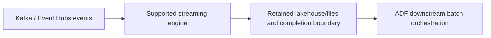
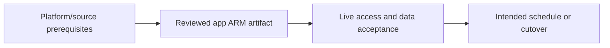

# Kafka/Event Hubs with ADF batch orchestration

Keep streaming offsets/state in the streaming engine and give ADF completed handoffs.

## Data design

## Exact field/input checklist

| Input/field | Supply |
|---|---|
| `stream_state` | Engine-specific offsets/checkpoints |
| `handoff` | Published table version or completed files |
| `ADF trigger` | Appropriate bounded run/event |
| `sink` | Idempotent downstream effect |

## Walkthrough

1. Separate analytics freshness from event-consumer processing and end-user online latency requirements.
2. Use a supported stream engine for continuous Kafka/Event Hubs consumption; ordinary ADF Copy is not its streaming state owner.
3. Persist raw events/offset evidence and a stable accepted handoff; configure ADF to process complete downstream boundaries.
4. For database-native continuous CDC consider its separate supported ADF CDC resource, not a generic Kafka hostname substitution.
5. Monitor stream lag/retention plus ADF freshness/reconciliation and test crash after external commit.

Exact UI fields, expressions, prerequisites and code are in: [12. CDC, hard deletes, soft deletes, and snapshot comparison](../chapters/12-cdc-deletes.md); [14. Web, HTTP Copy, Azure Functions, and custom paging](../chapters/14-web-http-functions.md); [18. Schedule, tumbling windows, storage events, and batch identity](../chapters/18-triggers-windows-events.md); [21. Databricks, Synapse, SQL, functions, and streaming boundaries](../chapters/21-external-compute.md); [29. Monitoring, Log Analytics, Copy bottlenecks, and cost](../chapters/29-monitor-cost-performance.md); [31. Backfill, recovery, region migration, and rollback](../chapters/31-backfill-recovery.md).

## Governance and infrastructure automation

Streaming source identity/checkpoint access and ADF source/sink permissions/network are independent; govern retained event data.

## Code push automation and maintenance

Deploy streaming and ADF artifacts through coordinated contracts; do not create duplicate scheduling loops or reset streaming checkpoints from a factory deployment.

## Tests to automate and rehearse

Late/duplicate/poison events, source retention loss, incomplete handoff, duplicate events starting ADF twice and external sink retry.

## Technology substitutions

Preserve the source/delete/order/completion and acceptance contract when replacing a component. Azure IR versus SHIR changes reachability/capacity; Binary versus row Copy changes parsing/mapping; SQL versus Mapping Data Flow versus Databricks changes compute and state semantics; Azure DevOps versus GitHub/Jenkins/GitLab changes runner/authentication. Connector/cloud/protocol replacements require their own capability tests. A Cartesian combination is not proof of compatibility.

## Completion evidence

Capture reviewed source/artifact hash, resolved business inputs, runtime/identity, source boundary/completion proof, ADF/external run IDs, target acceptance and measured freshness/recovery/cost. This is a recipe; no live Azure factory execution was performed during authoring.

[Guide index](../../AZURE_DATA_FACTORY_GUIDE_INDEX.md)
