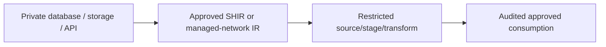

# Private source/sink access and governed enterprise pipelines

Configure actual execution-plane routes and least-privilege source identities.

## Data design

## Exact field/input checklist

| Input/field | Supply |
|---|---|
| `runtime` | Chosen execution-plane connectivity |
| `identity` | Factory or connector-supported identity |
| `endpoint` | Approved private endpoint and DNS |
| `logs` | Safe diagnostics and retention |

## Walkthrough

1. Inventory factory-management versus source-data/vault/SQL rights and the actual execution plane for each activity.
2. Bootstrap chapter 23 managed private endpoints or chapter 03 SHIR routes/registration and approve target requests.
3. Grant only needed source/sink rights, configure secret references, and test allowed and denied paths as the production identity.
4. Secure sensitive activity inputs/outputs and retain safe boundary/run/status evidence; configure diagnostics/lineage.
5. Review broad factory authoring/metadata edit permissions because a privileged runtime identity can expose data through edited pipelines.

Exact UI fields, expressions, prerequisites and code are in: [03. Azure IR, self-hosted IR, Azure-SSIS IR, and execution location](../chapters/03-integration-runtimes.md); [04. Linked services, managed identities, SQL credentials, and Key Vault](../chapters/04-linked-services-identity.md); [23. Security, private endpoints, Purview, RBAC, and diagnostic access](../chapters/23-security-network-governance.md); [24. Metadata-driven ingestion framework and configuration ownership](../chapters/24-metadata-framework.md); [29. Monitoring, Log Analytics, Copy bottlenecks, and cost](../chapters/29-monitor-cost-performance.md).

## Governance and infrastructure automation

Platform owner handles identity/network/vault/logs; data/source owners handle grants/classification. Purview lineage is not access enforcement.

## Code push automation and maintenance

Use separate deployment/runtime identities, protected environments and scoped infrastructure/application ownership.

## Tests to automate and rehearse

Unapproved endpoint, wrong DNS/TLS, denied secret/SQL principal/path, credential rotation, unsafe metadata edit and diagnostic disclosure.

## Technology substitutions

Preserve the source/delete/order/completion and acceptance contract when replacing a component. Azure IR versus SHIR changes reachability/capacity; Binary versus row Copy changes parsing/mapping; SQL versus Mapping Data Flow versus Databricks changes compute and state semantics; Azure DevOps versus GitHub/Jenkins/GitLab changes runner/authentication. Connector/cloud/protocol replacements require their own capability tests. A Cartesian combination is not proof of compatibility.

## Completion evidence

Capture reviewed source/artifact hash, resolved business inputs, runtime/identity, source boundary/completion proof, ADF/external run IDs, target acceptance and measured freshness/recovery/cost. This is a recipe; no live Azure factory execution was performed during authoring.

[Guide index](../../AZURE_DATA_FACTORY_GUIDE_INDEX.md)
