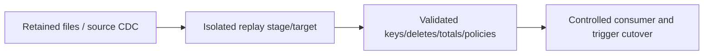
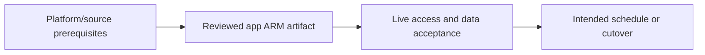

# Backfill, source retention gaps and region recovery

Restore explicit boundaries, data, control state, identity and scheduler state.

## Data design

## Exact field/input checklist

| Input/field | Supply |
|---|---|
| `source_boundary` | Captured retained interval/version |
| `replay_target` | Isolated approved scope |
| `batch_id` | Stable logical replay contract |
| `RPO_RTO` | Measured target |

## Walkthrough

1. Classify missing code, data, source history, watermark, identity/network, IR or trigger/window state.
2. Preserve failure evidence and stop competing writers safely; create an isolated recovery path.
3. Use fixed inputs from chapter 31 and ensure source history/files still exist; expired boundaries require controlled resnapshot/reconciliation.
4. Restore runtime identities/permissions/network and test both content and access before cutover.
5. Restore only intended trigger states and rehearse failure after consumer cutover; code rollback alone cannot reconstruct missing data.

Exact UI fields, expressions, prerequisites and code are in: [11. Incremental watermarks, committed boundaries, and transactional advancement](../chapters/11-watermarks.md); [12. CDC, hard deletes, soft deletes, and snapshot comparison](../chapters/12-cdc-deletes.md); [18. Schedule, tumbling windows, storage events, and batch identity](../chapters/18-triggers-windows-events.md); [22. Loading, SQL upsert, deletes, partitions, and idempotent publication](../chapters/22-loading-idempotency.md); [31. Backfill, recovery, region migration, and rollback](../chapters/31-backfill-recovery.md).

## Governance and infrastructure automation

Protect source/control/data backups and recreate environment-specific identities/grants, Key Vault and IR host registration.

## Code push automation and maintenance

Separate infrastructure restore, app deploy, replay/correction and consumer cutover stages; avoid broad deletion or reset as recovery.

## Tests to automate and rehearse

Replay within/beyond retention, delete ordering, duplicate committed batches, lost control table, SHIR outage, permission parity and measured recovery.

## Technology substitutions

Preserve the source/delete/order/completion and acceptance contract when replacing a component. Azure IR versus SHIR changes reachability/capacity; Binary versus row Copy changes parsing/mapping; SQL versus Mapping Data Flow versus Databricks changes compute and state semantics; Azure DevOps versus GitHub/Jenkins/GitLab changes runner/authentication. Connector/cloud/protocol replacements require their own capability tests. A Cartesian combination is not proof of compatibility.

## Completion evidence

Capture reviewed source/artifact hash, resolved business inputs, runtime/identity, source boundary/completion proof, ADF/external run IDs, target acceptance and measured freshness/recovery/cost. This is a recipe; no live Azure factory execution was performed during authoring.

[Guide index](../../AZURE_DATA_FACTORY_GUIDE_INDEX.md)
