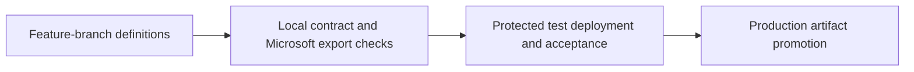
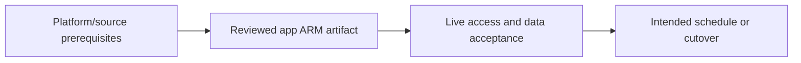

# Dev/test/prod delivery and maintenance

Promote the same reviewed ARM artifact with tested parameter and trigger contracts.

## Data design

## Exact field/input checklist

| Input/field | Supply |
|---|---|
| `source_root` | adf_guide/examples/factory for this project |
| `ARM overrides` | Verified generated names |
| `release identity` | Approved Azure federation/scope |
| `trigger_states` | Recorded intended pre/post states |

## Walkthrough

1. Use chapter 25 collaboration/feature source model; committing JSON does not publish a factory.
2. Run local tests and Microsoft validate/export with chapters 26–27, preserving tool/runtime/bundle hashes.
3. Apply target endpoint/factory overrides from the actual generated parameter contract and bootstrap data/network permissions first.
4. Use affected-trigger predeployment handling, deploy, execute safe smoke and real acceptance checks, then restore intended triggers.
5. Promote the same artifact and record run IDs/results; rollback code/data/control/schema independently according to the recovery contract.

Exact UI fields, expressions, prerequisites and code are in: [25. Git branches, collaboration, Publish all, and exported ARM](../chapters/25-git-publish.md); [26. Azure DevOps CI/CD: build artifacts, environment overrides, and trigger handling](../chapters/26-azure-devops-ci.md); [27. GitHub Actions, Jenkins, GitLab, Bicep, and Terraform alternatives](../chapters/27-other-ci-and-infra.md); [28. Tests: source contracts, definition validation, integration, and release gates](../chapters/28-test-strategy.md); [30. Worked lab: parameter isolation, file Copy, rerun, and reconciliation](../chapters/30-worked-lab.md); [33. Troubleshooting by symptom, parameter, runtime, and graph](../chapters/33-troubleshooting.md).

## Governance and infrastructure automation

Dev alone is Git-integrated in the recommended model; separate deploy identity/source rights and protect environments/artifacts.

## Code push automation and maintenance

Azure DevOps, GitHub, Jenkins or GitLab can share export/deploy semantics; choose one owner, pin tooling and serialize deployments.

## Tests to automate and rehearse

Missing overrides, wrong identity, deleted resources, active/stopped triggers, failed smoke, interrupted deploy and migration compatibility.

## Technology substitutions

Preserve the source/delete/order/completion and acceptance contract when replacing a component. Azure IR versus SHIR changes reachability/capacity; Binary versus row Copy changes parsing/mapping; SQL versus Mapping Data Flow versus Databricks changes compute and state semantics; Azure DevOps versus GitHub/Jenkins/GitLab changes runner/authentication. Connector/cloud/protocol replacements require their own capability tests. A Cartesian combination is not proof of compatibility.

## Completion evidence

Capture reviewed source/artifact hash, resolved business inputs, runtime/identity, source boundary/completion proof, ADF/external run IDs, target acceptance and measured freshness/recovery/cost. This is a recipe; no live Azure factory execution was performed during authoring.

[Guide index](../../AZURE_DATA_FACTORY_GUIDE_INDEX.md)
