# Architecture Diagram Gallery

[Scenario index](../DATA_SYSTEM_DESIGN_INDEX.md)

These rendered samples provide a static fallback for the embedded Mermaid sources. Every diagram in the scenario library was parsed and rendered during validation. The gallery samples different flows, logical models, cutover sequences, governance, and delivery.

## Regenerate the diagrams

```sh
npm ci --prefix data_system_design/tools --ignore-scripts
npm exec --prefix data_system_design/tools -- playwright install chromium
node data_system_design/tools/render_diagrams.cjs
python3 data_system_design/tools/validate_design_docs.py
```

The renderer uses a fresh headless test browser and the locked Mermaid dependency. DESIGN_CHROMIUM_PATH can select an already installed compatible test browser; DIAGRAM_RUNTIME_DIR can select an external dependency folder. Each source hash links the render evidence to the current diagram text. Source files remain the editable authority. PNG and SVG examples are generated output.

Flowcharts use a vertical reading path. Sequence and schema views are naturally wider; open the SVG or source at its readable size rather than shrinking labels. The surrounding captions carry the meaning without relying on color.

## S01 azure vm

Data moves through Database backup and log transport, retains recoverable input in Azure Blob backup archive, and publishes through Existing BI against SQL Server after validation.

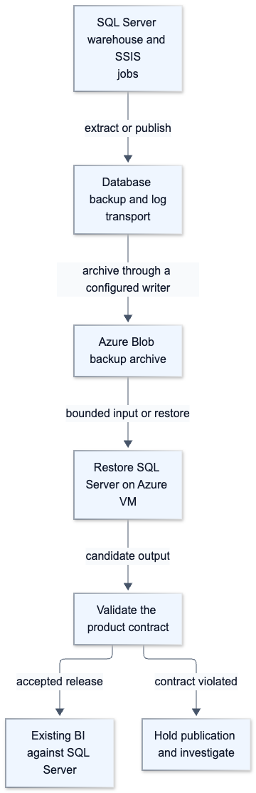

[Vector SVG](rendered/S01-azure-vm.svg) · [Mermaid source](diagrams/S01-azure-vm.mmd)

## S01 sequence

This sequence exposes the boundary at which a crash, catch-up, or endpoint switch affects correctness. It is schematic; implement the contract with the selected source and sink protocols.

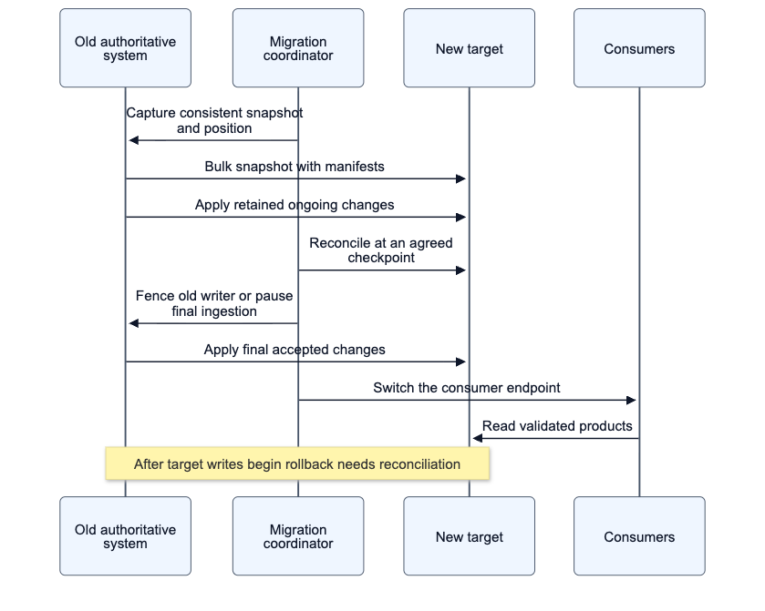

[Vector SVG](rendered/S01-sequence.svg) · [Mermaid source](diagrams/S01-sequence.mmd)

## S03 aws

Data moves through Glue bounded extract, retains recoverable input in S3 replayable landing, and publishes through Athena reads Iceberg after validation.

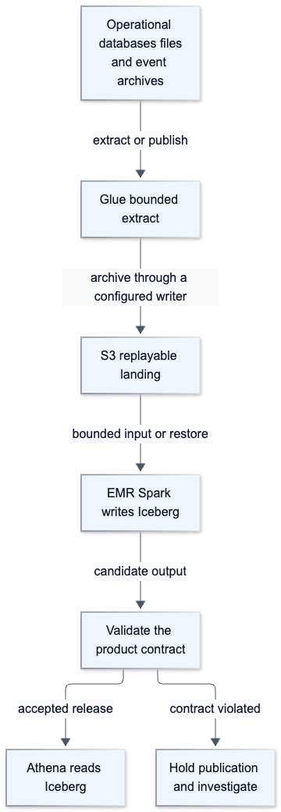

[Vector SVG](rendered/S03-aws.svg) · [Mermaid source](diagrams/S03-aws.mmd)

## S12 gcp

Data moves through Google Pub Sub, retains recoverable input in GCS replayable landing, and publishes through BigQuery via supported write adapter after validation.

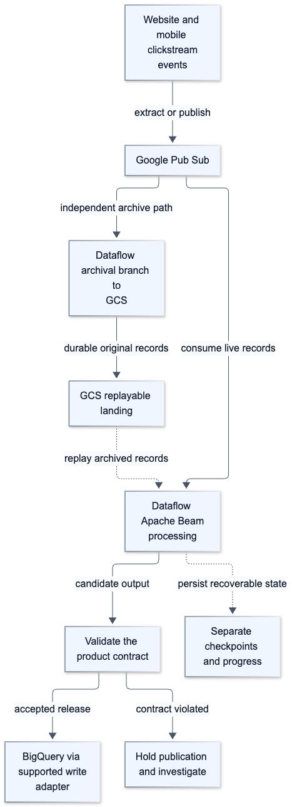

[Vector SVG](rendered/S12-gcp.svg) · [Mermaid source](diagrams/S12-gcp.mmd)

## S12 sequence

This sequence exposes the boundary at which a crash, catch-up, or endpoint switch affects correctness. It is schematic; implement the contract with the selected source and sink protocols.

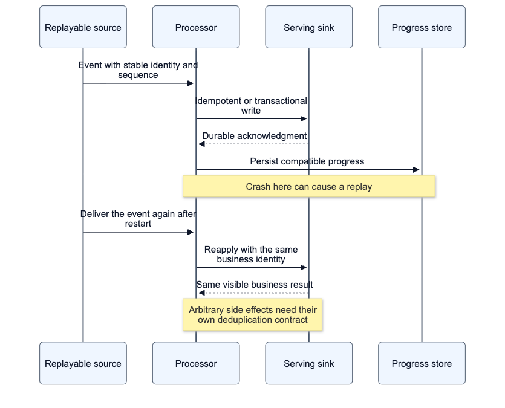

[Vector SVG](rendered/S12-sequence.svg) · [Mermaid source](diagrams/S12-sequence.mmd)

## S17 oss

Data moves through Debezium MongoDB with Kafka, retains recoverable input in S3 compatible raw storage, and publishes through Trino query API and BI after validation.

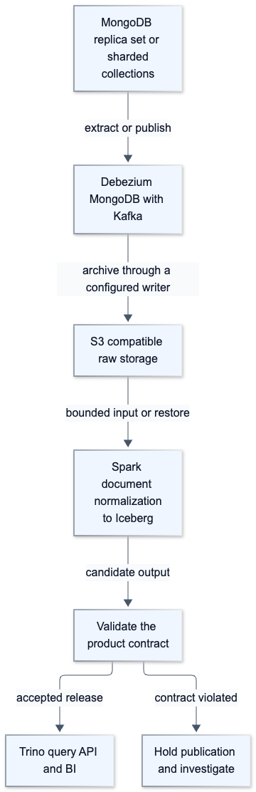

[Vector SVG](rendered/S17-oss.svg) · [Mermaid source](diagrams/S17-oss.mmd)

## S19 aws

Data moves through Kinesis Data Streams, retains recoverable input in S3 replayable landing, and publishes through DynamoDB projection or features after validation.

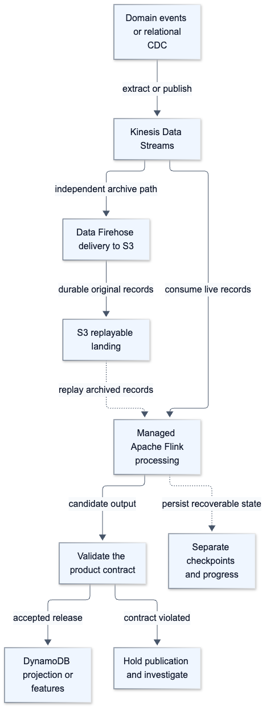

[Vector SVG](rendered/S19-aws.svg) · [Mermaid source](diagrams/S19-aws.mmd)

## S20 model

The star model preserves order-line grain. Each fact resolves to one customer history version and one product; non-overlapping validity intervals prevent duplicate enrichment.

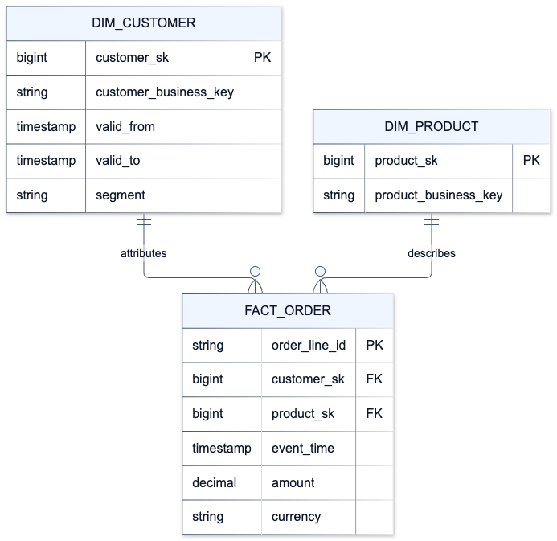

[Vector SVG](rendered/S20-model.svg) · [Mermaid source](diagrams/S20-model.mmd)

## S23 governance

Ownership and metadata describe the intended controls. Infrastructure automation deploys resources, and engine/storage permission tests prove enforcement at real access paths.

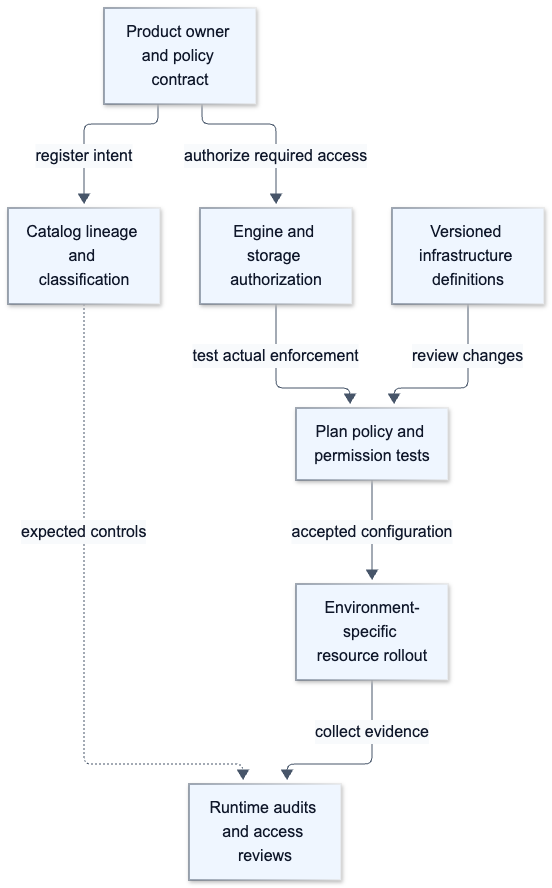

[Vector SVG](rendered/S23-governance.svg) · [Mermaid source](diagrams/S23-governance.mmd)

## S35 azure vector

Data moves through Document version ingestion worker, retains recoverable input in Blob originals and ACL manifest, and publishes through Azure AI Search plus retrieval API after validation.

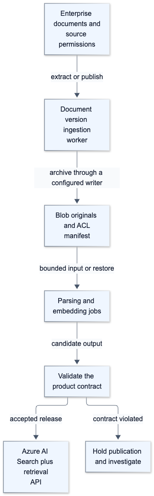

[Vector SVG](rendered/S35-azure-vector.svg) · [Mermaid source](diagrams/S35-azure-vector.mmd)

## S36 aws neptune

Data moves through CDC or file connector worker, retains recoverable input in S3 relationship archive, and publishes through Neptune plus constrained query API after validation.

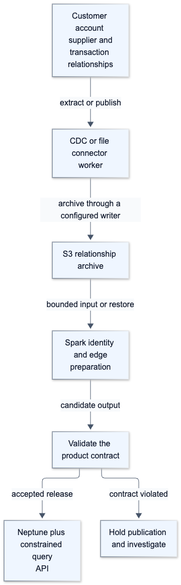

[Vector SVG](rendered/S36-aws-neptune.svg) · [Mermaid source](diagrams/S36-aws-neptune.mmd)

## S42 delivery

CI builds and tests a release. CD deploys the same artifact, runtime orchestration controls execution, and consumer-level checks detect regressions after promotion.

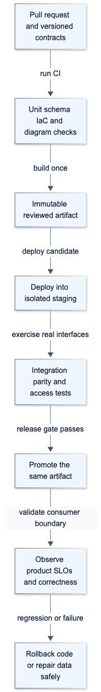

[Vector SVG](rendered/S42-delivery.svg) · [Mermaid source](diagrams/S42-delivery.mmd)

## S42 outbox

The source transaction atomically creates business state and its outbox record. Downstream delivery still needs destination-specific deduplication or reconciliation; the outbox alone does not make an arbitrary external action exactly once.

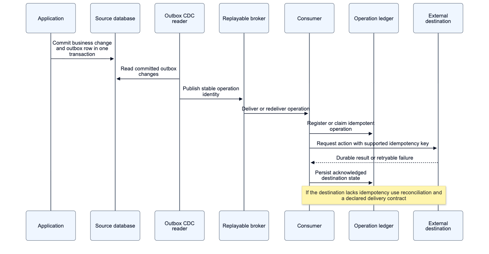

[Vector SVG](rendered/S42-outbox.svg) · [Mermaid source](diagrams/S42-outbox.mmd)
