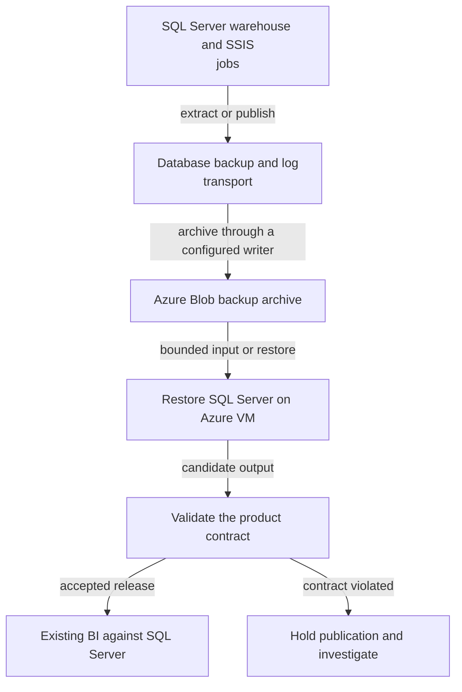
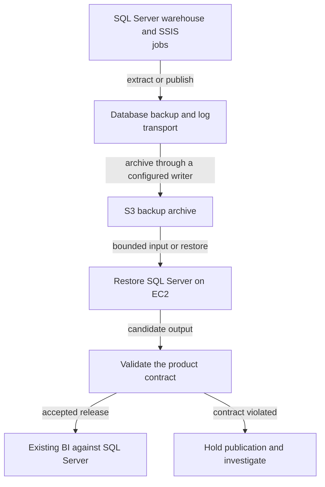
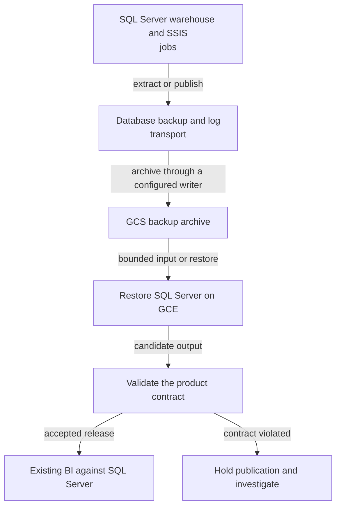
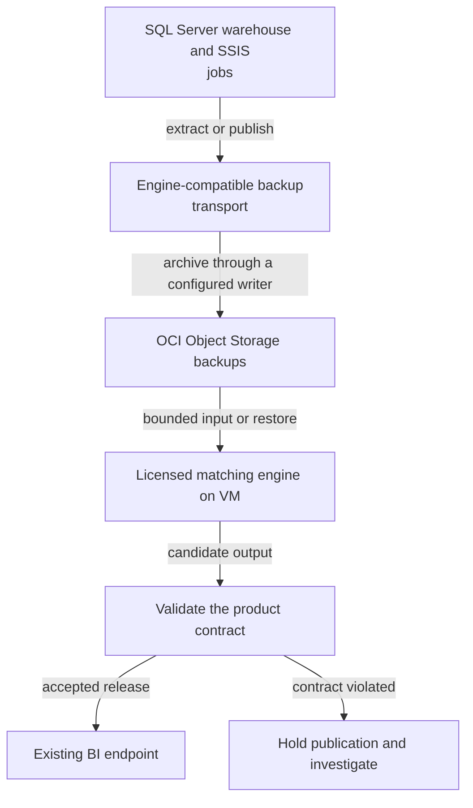
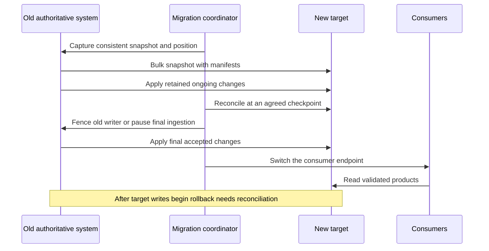
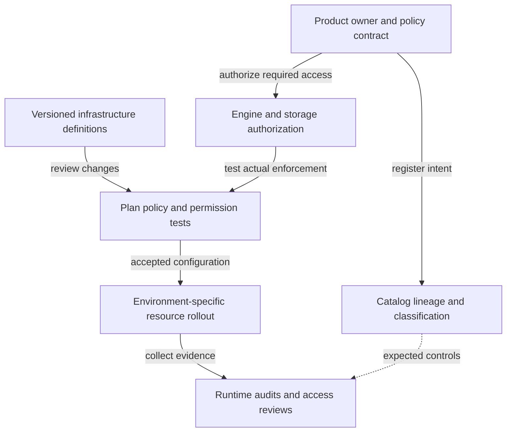
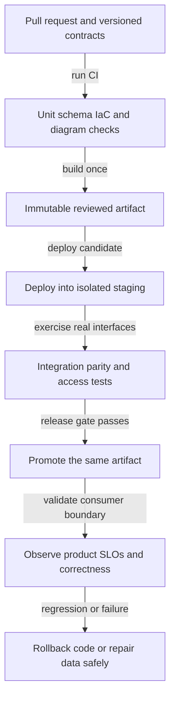

# S01 Move an on premises warehouse to cloud virtual machines

[Scenario index](../../DATA_SYSTEM_DESIGN_INDEX.md) · **Family:** Migration · **Mode:** vm

Preserve the database engine and existing reports while replacing the data center. Illustrative targets: 20 TB, a four hour migration window, and reports available during bulk transfer. Distinguish moving hosts from changing the warehouse engine.

## Requirements to clarify

Confirm source versions and access, daily and peak volume, read versus write freshness, consumer query patterns, error tolerance, budget, operating skills, residency, retention, and recovery objectives. The numeric targets in this scenario are exercise assumptions, not vendor guarantees.

**Data grain:** Existing facts and dimensions retain their original grain.

**Identity and progress:** Existing primary keys plus a migration manifest.

## Data design

1. Inventory SQL Agent, SSIS, linked servers, authentication, licenses, database extensions, and report connection strings.
2. Provision matching engine versions on cloud VMs; measure bandwidth and restore a representative backup before committing to the transfer schedule.
3. Restore a consistent full backup, catch up with supported log shipping or replication, and record the source recovery position.
4. Compare report outputs and job behavior, fence the old writer, apply final changes, switch connections, and retain a controlled rollback window.

### Correctness contract

- Exactly one authoritative ingestion writer exists at cutover.
- Data and logs must restore to a consistent recovery point; independent file copies are not a database backup.
- Preserve numeric precision, collation, timezone rules, identity values, and permissions.

### Complete technology paths

These are proposed reference architectures, not exported vendor-certified deployments. Each path names concrete stages; when a worker or sink adapter is named, its connector configuration and code must be implemented and tested. The diagrams describe the data plane; operational deployment appears below.

#### Azure virtual machine lift and shift

Data moves through Database backup and log transport, retains recoverable input in Azure Blob backup archive, and publishes through Existing BI against SQL Server after validation.



[Editable diagram source](../diagrams/S01-azure-vm.mmd)

**Why this path helps:** Keeps the engine and much of the existing package behavior while moving hosting.

**What must be designed and verified:** Validate licenses, guest operating system, network identities, and unsupported external dependencies.

Technology references: [Azure Migrate overview](https://learn.microsoft.com/en-us/azure/migrate/migrate-services-overview).

#### AWS EC2 lift and shift

Data moves through Database backup and log transport, retains recoverable input in S3 backup archive, and publishes through Existing BI against SQL Server after validation.



[Editable diagram source](../diagrams/S01-aws-vm.mmd)

**Why this path helps:** Preserves SQL Server semantics and lets infrastructure be reproduced.

**What must be designed and verified:** AWS DMS is a separate replication option, not a replacement for engine and job restoration.

Technology references: [AWS DMS ongoing replication](https://docs.aws.amazon.com/dms/latest/userguide/CHAP_Task.CDC.html).

#### Google Compute Engine lift and shift

Data moves through Database backup and log transport, retains recoverable input in GCS backup archive, and publishes through Existing BI against SQL Server after validation.



[Editable diagram source](../diagrams/S01-gcp-vm.mmd)

**Why this path helps:** Separates the hosting move from a later logical warehouse redesign.

**What must be designed and verified:** Confirm SQL Server licensing, operating-system support, domain connectivity, and restore bandwidth.

Technology references: [Google Cloud migration planning](https://docs.cloud.google.com/architecture/migration-to-gcp-getting-started).

#### OCI Compute hosting alternative

Data moves through Engine-compatible backup transport, retains recoverable input in OCI Object Storage backups, and publishes through Existing BI endpoint after validation.



[Editable diagram source](../diagrams/S01-oci-vm.mmd)

**Why this path helps:** Can retain a matching engine when the organization already runs OCI.

**What must be designed and verified:** Verify exact engine, VM image, support, licensing, and restore path; Oracle GoldenGate is not a generic VM mover.

Technology references: [OCI GoldenGate](https://docs.oracle.com/en/cloud/paas/goldengate-service/index.html).

### Order of critical operations

This sequence exposes the boundary at which a crash, catch-up, or endpoint switch affects correctness. It is schematic; implement the contract with the selected source and sink protocols.



[Editable diagram source](../diagrams/S01-sequence.mmd)

### Replace each component deliberately

| Component | Alternatives | Why change it | What changes | Test before switching |
| --- | --- | --- | --- | --- |
| Host and cloud | Azure VM, AWS EC2, Google Compute Engine, OCI Compute | Change data-center hosting while preserving the engine. | Validate supported VM images, licenses, network identity, disks, backup transport, and monitoring. | Restore representative backups and run original jobs and reports. |
| Migration transport | Engine backup/log replay, supported native replication, verified migration services | Balance transfer duration, final catch-up, and compatibility. | Preserve a consistent recovery position and source log retention; offline appliances still need delta catch-up. | Inject disconnects, restore logs, reconcile totals, and rehearse writer fencing. |
| Migration strategy | Lift and shift; managed database replatform; analytical warehouse redesign | Reduce compatibility risk now or deliberately modernize the platform. | Changing the engine changes SQL, jobs, grants, schema, and physical design; see S02 for replatforming. | Run SQL parity, data reconciliation, workload testing, and an updated rollback rehearsal. |

A substitution is accepted only after the source protocol, input/output types, table format, catalog, region, identity, mutations, replay, and consumer API still meet the stated contract. Moving to a new cloud may also move network placement, keys, quotas, and cost ownership. A list of names alone is not a valid architecture.

## Governance and infrastructure automation

### Scenario governance rules

- Move service identities and database grants explicitly rather than copying administrator credentials.
- Restrict migration staging and backup access; backups contain the full sensitive dataset.
- Record license assumptions, restore evidence, and approved decommission criteria.

Ownership and metadata describe the intended controls. Infrastructure automation deploys resources, and engine/storage permission tests prove enforcement at real access paths.



[Editable diagram source](../diagrams/S01-governance.mmd)

### Governance technology alternatives

| Platform | Catalog and ownership | Enforcement | Infrastructure controls | Boundary to test |
| --- | --- | --- | --- | --- |
| Azure | Microsoft Purview discovery plus actual engine grants | Entra identities, Azure RBAC, storage ACLs and query roles | Private routing, managed identities, source-safe runtimes | Catalog visibility is not a universal storage deny policy. |
| AWS | Glue Catalog and Lake Formation where integrated | IAM, supported Lake Formation grants, warehouse or service roles | VPC endpoints, KMS, workload IAM roles | Test direct S3 access and each engine integration separately. |
| Google Cloud | Knowledge Catalog formerly Dataplex Universal Catalog | IAM, BigQuery policies, storage permissions, service-specific enforcement | Service accounts, approved regions, private connectivity | Metadata policy intent must be verified at the actual execution and export paths. |
| Databricks | Unity Catalog plus product ownership and lineage | Unity Catalog grants and workspace or storage identities | Separate environments, locations, compute policies and progress state | Cataloged access can still be undermined by ungoverned direct storage credentials. |
| Snowflake | Horizon catalog capabilities and versioned products | Roles, grants, policies and secure sharing contracts | Account location, integrations, workload sizing and resource budgets | Validate feature availability and distinguish native, shared, and open-table access paths. |
| Open source or hybrid | OpenMetadata or DataHub plus a table catalog | Engine RBAC, cloud IAM, and supported policy integrations | Vault or cloud secrets, TLS, private endpoints and operational backup | Discovery tools do not automatically enforce permissions in every connector or engine. |

Discovery can be replaced with OpenMetadata or DataHub while keeping the same engine and storage enforcement. Source systems, object stores, query engines, exported copies, and caches are separate authorization surfaces. Instrument OpenLineage or native lineage where compatible; verify gaps instead of treating a catalog scan as complete operational lineage.

### Infrastructure automation alternatives

| Approach | Benefit | Implementation requirements | Important boundary |
| --- | --- | --- | --- |
| Terraform | Broad provider ecosystem and declarative plans | Separate remote state by ownership and environment; secure and lock it; validate provider coverage. | Providers and resource APIs differ, so shared language does not mean identical modules. |
| OpenTofu | Open-source-oriented declarative infrastructure workflow | Use explicit versions, tested providers, isolated state and encryption where configured. | Review migration and provider compatibility rather than assuming state interchange is universally safe. |
| Pulumi | General-purpose language infrastructure definitions | Test programs, preview changes, protect state and secrets, and scope automation identities. | Language-level power needs disciplined reproducibility and resource ownership. |
| Native cloud IaC | Bicep/ARM on Azure, CDK/CloudFormation on AWS, provider-specific declarative tools elsewhere | Keep environment parameters and identity controls explicit; import or manage existing resources carefully. | Native templates stay within their platform contract; job code and table data need separate lifecycle management. |
| Configuration and GitOps | Ansible/Packer for hosts; Helm and Argo CD for supported Kubernetes workloads | Bake versioned images, apply least privilege, and keep cloud resources under a separately declared owner. | GitOps reconciliation of manifests is not an automatic warehouse schema or historical data migration. |

Provision network paths, storage, catalogs, workload identities, secrets references, logging, backup, compute limits, and budgets before deploying jobs. Separate environments and remote state; do not commit state or credentials. Use explicit providers and versions, prevent two tools from owning the same resource, and test an isolated rebuild. For private sources, place a trusted runner or ingestion runtime on the reachable network; a CI runner location is a real architectural dependency.

## Code delivery and runtime automation

CI builds and tests a release. CD deploys the same artifact, runtime orchestration controls execution, and consumer-level checks detect regressions after promotion.



[Editable diagram source](../diagrams/S01-delivery.mmd)

### Delivery alternatives and compatible scope

| Delivery choice | Benefit | Scope for this scenario | Deployment and identity implications |
| --- | --- | --- | --- |
| GitHub Actions | Hosted or private runners with PR checks and environment-specific release jobs. | Azure virtual machine lift and shift, AWS EC2 lift and shift, Google Compute Engine lift and shift, OCI Compute hosting alternative | Provider CLI or API deploys the reviewed immutable job artifact; production gate records the artifact digest. Use environment-bound short-lived cloud identity where supported; restrict token claims and trusted branches. |
| Jenkins | Private-network runners and shared libraries suit existing enterprise delivery estates. | Azure virtual machine lift and shift, AWS EC2 lift and shift, Google Compute Engine lift and shift, OCI Compute hosting alternative | A Jenkinsfile builds and tests once; a shared deploy library applies the reviewed artifact and records evidence. Isolate agents, pin plugins and dependencies, and scope credentials to a job and environment. |
| GitLab CI | Merge-request tests, protected environments, and configurable runners keep delivery close to source control. | Azure virtual machine lift and shift, AWS EC2 lift and shift, Google Compute Engine lift and shift, OCI Compute hosting alternative | Stage-specific jobs publish an immutable artifact and invoke the chosen platform deployment adapter. Use protected runners and environment permissions; identity federation depends on the target provider. |
| Azure DevOps Pipelines | Native Azure delivery and enterprise service connections suit Azure-centered teams. | Azure virtual machine lift and shift | For ADF use validated factory artifacts and environment parameterization; for Databricks use bundles or the supported API. ADF factory resource deployment and pipeline definition publishing are separate lifecycle steps. |
| AWS CodePipeline and CodeBuild | Native AWS build roles and pipeline stages reduce cross-service identity plumbing. | AWS EC2 lift and shift | Publish job artifacts and apply the chosen AWS or warehouse deployment adapter; CDK synthesizes CloudFormation. Build VPC access, source connection, artifact encryption, and least-privilege deploy roles must be provisioned. |
| Google Cloud Build | Containerized build steps integrate with Google service accounts and artifact storage. | Google Compute Engine lift and shift | Build a job image or template and deploy through Dataflow, Composer, Cloud Run, or warehouse-specific interfaces. Cloud Deploy has supported workload targets; data jobs require their actual job APIs rather than assumed generic support. |
| GitHub or GitLab build with Argo CD | A reconciler promotes declared Kubernetes manifests and makes drift visible. | Conditional: add a supported Kubernetes or native-cloud target before choosing this option | CI updates the reviewed image digest or Helm values in Git; Argo CD reconciles the selected namespace. Argo CD reconciles Kubernetes resources; cloud infrastructure and managed warehouse DDL remain separately owned. |
| Tekton pipelines on Kubernetes | Kubernetes-native task execution can fit a self-managed platform engineering estate. | Conditional: add a supported Kubernetes or native-cloud target before choosing this option | Pipeline tasks execute tests and platform-specific deploy steps; cloud resource state stays in the chosen IaC backend. Operators must manage cluster availability, runner permissions, artifact provenance, and secrets. |

### Runtime and platform deployment differences

SQL/dbt releases deploy model code plus controlled DDL and grants. Spark releases publish a tested wheel, JAR, container, or job definition. Flink releases must coordinate compatible state or savepoints before changing a job. ADF releases publish validated factory definitions with environment parameters and deliberate trigger handling. Databricks uses Declarative Automation Bundles or supported APIs; Fabric requires supported Git and deployment behavior per item. Kubernetes services use versioned manifests and image digests. The same CI tool can call these interfaces, but the interfaces are not interchangeable.

Runtime choices: Existing SQL Agent or SSIS schedule, Airflow with existing-engine adapter, Prefect with existing-engine adapter. For a continuous stream, an orchestrator manages lifecycle and repair; it should not start a fresh consumer for every arriving message.

### Safe promotion and rollback

Build once, record the code and dependency versions, test an isolated deployment with realistic interfaces, then promote the same artifact. Use expand-and-contract schema changes and avoid coupling destructive data changes to an ordinary code rollback. A failed publication retains the last accepted product version and clearly exposes stale or partial status. After target writes begin, switching connections back requires reverse synchronization or accepting a declared data-loss window.

## Tests to run and automate

| Test | Automation and cadence | Evidence and failure action |
| --- | --- | --- |
| Restore a backup and replay logs into an isolated VM; compare table counts and business totals. | Deterministic fixture in CI; expensive restore or full-load variants before cutover | Persist inputs, artifact version, expected result and actual result. Block publication or promotion when the declared contract fails. |
| Execute representative stored procedures, SSIS packages, linked-server queries, and BI reports. | Isolated integration test before promotion and on connector upgrades | Persist inputs, artifact version, expected result and actual result. Block publication or promotion when the declared contract fails. |
| Inject a broken VPN and resume the transfer without restarting the entire bulk copy. | Failure or replay drill in an isolated environment on a scheduled cadence | Persist inputs, artifact version, expected result and actual result. Block publication or promotion when the declared contract fails. |
| Rehearse cutover, writer fencing, DNS or connection updates, and rollback with new target writes. | End-to-end or representative workload exercise before major releases | Persist inputs, artifact version, expected result and actual result. Block publication or promotion when the declared contract fails. |
| Permissions and tenant boundary | Automate authorized and denied reads on staging; rerun after policy changes | Test engine query, direct object access, exports and caches. A metadata-only permissions check is insufficient. |
| Infrastructure and supply chain | Automate syntax, plan, policy, secret scanning and dependency checks on each PR | Reject unapproved region, broad IAM, exposed storage, overlapping ownership, or unexpected destructive changes. |
| Data freshness and completeness | Continuously measure at the consumer boundary; compare periodic source manifests | Alert the owner and show stale or partial status. Job exit status is not the SLO. |
| Recovery and business acceptance | Automate restore/replay evidence; schedule a supervised drill and business review | Record actual RPO/RTO, reconciled business totals and remaining exceptions. Full production drills need the operational change process. |

### What needs human judgment

Automate repeatable fixtures, contracts, type/schema compatibility, data reconciliation, permission denial, infrastructure policy, load probes, and recovery evidence. Business owners still approve changed metric meaning, reconciliation tolerances, retention exceptions, and consumer acceptance. Security and operations review the intended policy and the consequences of a cutover; scripts produce evidence rather than defining policy by themselves.

## Failure recovery and tradeoffs

- VM hosting preserves compatibility but also retains database patching, capacity planning, and legacy operational work.
- A managed cloud warehouse is a redesign alternative, not a transparent lift and shift.
- After target writes begin, switching connections back requires reverse synchronization or accepting a declared data-loss window.

Preserve the exact input and output release manifests, progress positions, job versions, and validation evidence. Recovery starts from the last durable accepted boundary and uses a compatible source and sink. Coordinate live and repair writers; if a sink has changed after the saved checkpoint, reconcile or rebuild rather than assuming connection switching restores correctness.

## Explore the documented combinations

```sh
python3 data_system_design/tools/enumerate_designs.py --scenario S01 --count
python3 data_system_design/tools/enumerate_designs.py --scenario S01 --limit 12
```

The enumerator expands the documented data bundles, runtime orchestration, metadata alternatives, eligible delivery systems, and their infrastructure tools. It rejects native-cloud delivery outside its cloud and Kubernetes delivery without a Kubernetes runtime. These are design candidates requiring the stated integration checks, not generated deployable infrastructure or proof that arbitrary products interoperate.

## Source references

- [Azure Migrate overview](https://learn.microsoft.com/en-us/azure/migrate/migrate-services-overview)
- [AWS DMS ongoing replication](https://docs.aws.amazon.com/dms/latest/userguide/CHAP_Task.CDC.html)
- [Google Cloud migration planning](https://docs.cloud.google.com/architecture/migration-to-gcp-getting-started)
- [GitHub Actions OIDC](https://docs.github.com/en/actions/concepts/security/openid-connect)
- [Terraform state](https://developer.hashicorp.com/terraform/language/state)
- [dbt data tests](https://docs.getdbt.com/docs/build/data-tests)

[Technology roles](../TECHNOLOGY_CHOICES.md) · [Automation recipes](../AUTOMATION_PLAYBOOK.md) · [Test patterns](../TESTING_PLAYBOOK.md) · [Compatibility rules](../COMPATIBILITY.md)
