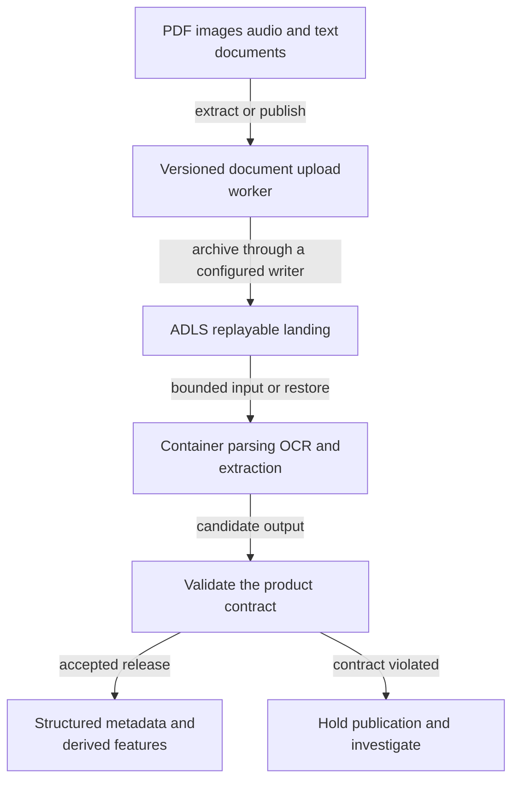
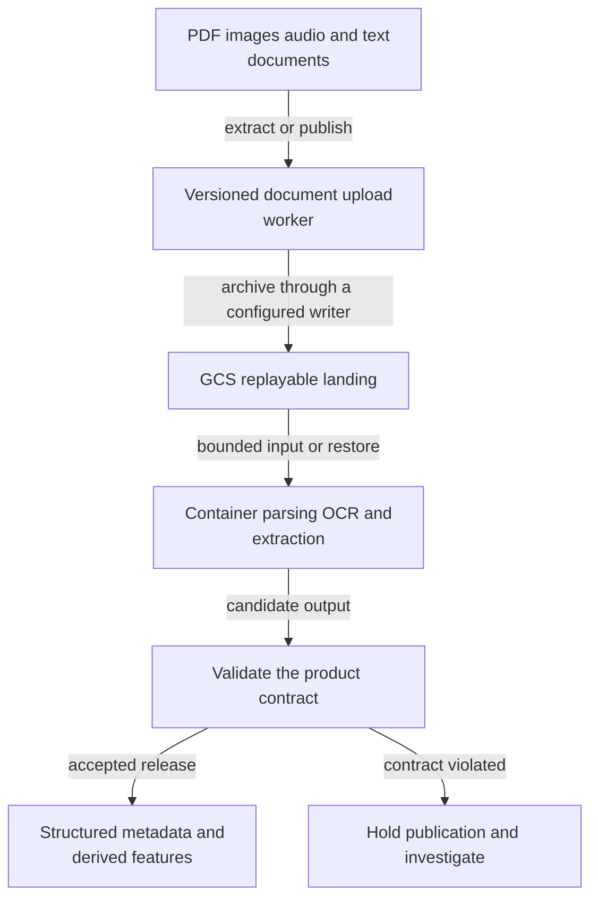
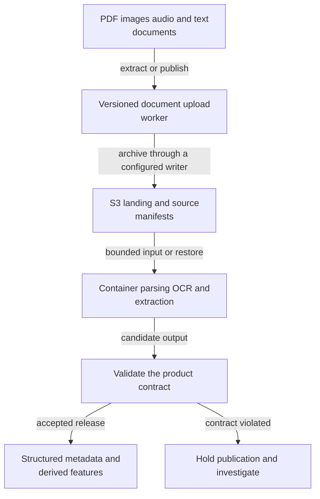
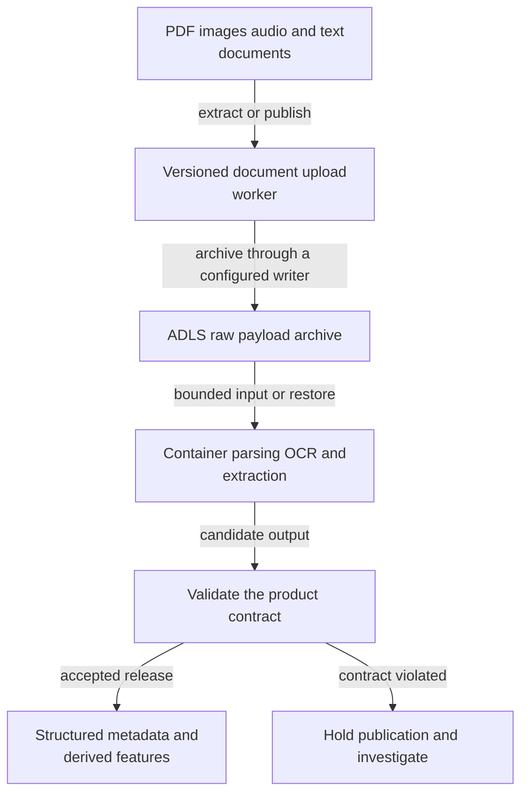
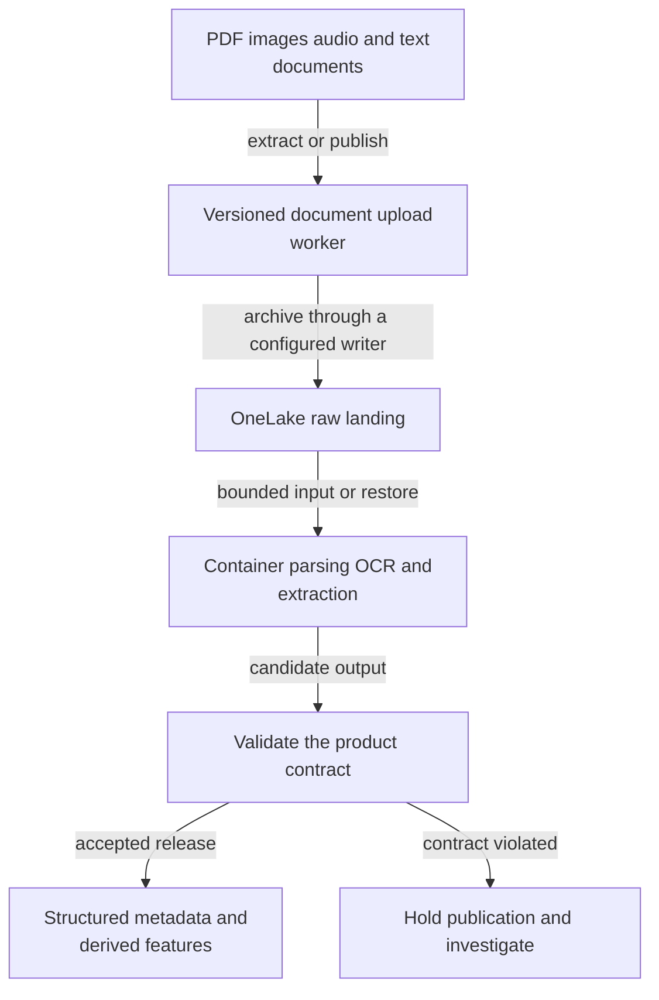
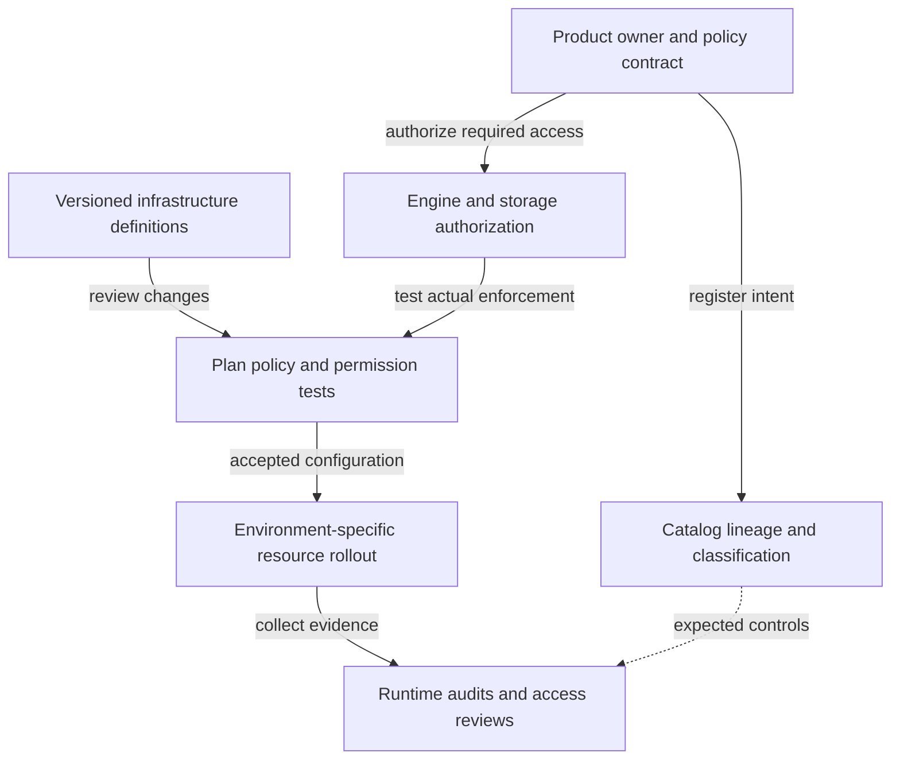
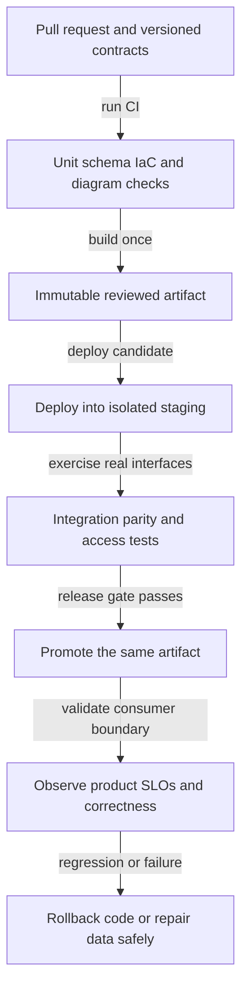

# S34 Process documents images and other unstructured data

[Scenario index](../../DATA_SYSTEM_DESIGN_INDEX.md) · **Family:** ML and AI · **Mode:** unstructured

Extract useful metadata and analytical features while retaining source evidence. Illustrative objective: document versions and permissions survive parsing and reprocessing.

## Requirements to clarify

Confirm source versions and access, daily and peak volume, read versus write freshness, consumer query patterns, error tolerance, budget, operating skills, residency, retention, and recovery objectives. The numeric targets in this scenario are exercise assumptions, not vendor guarantees.

**Data grain:** Source object version extracted page or chunk and derived feature.

**Identity and progress:** Object URI immutable version checksum parser version and chunk ID.

## Data design

1. Store original objects durably and register version, checksum, owner, and access metadata.
2. Run format-specific parsing or OCR with sandboxing, size limits, and retryable job state.
3. Validate extracted content and publish structured metadata or derived features.
4. Reprocess under a new parser version into a separate release before replacing consumer outputs.

### Correctness contract

- Original document identity must survive extraction and chunking.
- Parsing quality and source completeness are measured independently.
- Failed extraction must not make the original object undiscoverable.

### Complete technology paths

These are proposed reference architectures, not exported vendor-certified deployments. Each path names concrete stages; when a worker or sink adapter is named, its connector configuration and code must be implemented and tested. The diagrams describe the data plane; operational deployment appears below.

#### AWS managed and native services

Data moves through Versioned document upload worker, retains recoverable input in S3 replayable landing, and publishes through Structured metadata and derived features after validation.


[Editable diagram source](../diagrams/S34-aws.mmd)

**Why this path helps:** Keeps extraction, storage, and warehouse operations in the AWS ecosystem.

**What must be designed and verified:** Configure source support, warehouse type mapping, distribution, IAM, and realistic capacity.

Technology references: [Apache Iceberg reliability](https://iceberg.apache.org/docs/latest/reliability/), [AWS analytics reference architecture](https://docs.aws.amazon.com/wellarchitected/latest/analytics-lens/reference-architecture-2.html).

#### Azure data services

Data moves through Versioned document upload worker, retains recoverable input in ADLS replayable landing, and publishes through Structured metadata and derived features after validation.



[Editable diagram source](../diagrams/S34-azure.mmd)

**Why this path helps:** ADF handles bounded movement while a SQL warehouse owns relational transformation.

**What must be designed and verified:** Synapse dedicated SQL, serverless SQL, Databricks, and Fabric are distinct execution surfaces.

Technology references: [Delta Lake documentation](https://docs.delta.io/), [Databricks Unity Catalog](https://docs.databricks.com/aws/en/data-governance/unity-catalog/).

#### Google Cloud data services

Data moves through Versioned document upload worker, retains recoverable input in GCS replayable landing, and publishes through Structured metadata and derived features after validation.



[Editable diagram source](../diagrams/S34-gcp.mmd)

**Why this path helps:** Managed storage and SQL analytics fit scalable relational reporting.

**What must be designed and verified:** Cloud Run extraction is an explicitly implemented worker; BigQuery load and streaming APIs differ.

Technology references: [Apache Iceberg reliability](https://iceberg.apache.org/docs/latest/reliability/), [Trino documentation](https://trino.io/docs/current/), [Google Cloud pipeline architecture](https://cloud.google.com/blog/topics/developers-practitioners/what-data-pipeline-architecture-should-i-use/).

#### Snowflake on AWS example

Data moves through Versioned document upload worker, retains recoverable input in S3 landing and source manifests, and publishes through Structured metadata and derived features after validation.



[Editable diagram source](../diagrams/S34-snowflake.mmd)

**Why this path helps:** A managed warehouse separates analytical compute from many source-specific extraction details.

**What must be designed and verified:** This managed-warehouse alternative changes the storage and engine contract; evaluate Snowflake-managed Iceberg separately.

Technology references: [Snowflake data loading](https://docs.snowflake.com/en/user-guide/data-load-overview).

#### Databricks on Azure example

Data moves through Versioned document upload worker, retains recoverable input in ADLS raw payload archive, and publishes through Structured metadata and derived features after validation.



[Editable diagram source](../diagrams/S34-databricks.mmd)

**Why this path helps:** One lakehouse compute ecosystem can process larger or less relational workloads.

**What must be designed and verified:** Lakeflow Jobs orchestrates work; table-format, catalog, and runtime compatibility still require tests.

Technology references: [Databricks Lakeflow Jobs](https://docs.databricks.com/aws/en/jobs/), [Delta Lake documentation](https://docs.delta.io/), [Databricks Unity Catalog](https://docs.databricks.com/aws/en/data-governance/unity-catalog/).

#### Open source and self managed

Data moves through Versioned document upload worker, retains recoverable input in S3 compatible raw storage, and publishes through Structured metadata and derived features after validation.


[Editable diagram source](../diagrams/S34-oss.mmd)

**Why this path helps:** Open interfaces provide placement flexibility and independent compute choices.

**What must be designed and verified:** Operate catalogs, object storage, compute, credentials, and recovery; verify S3 API compatibility.

Technology references: [Airbyte connector documentation](https://docs.airbyte.com/), [Apache Iceberg reliability](https://iceberg.apache.org/docs/latest/reliability/), [Trino documentation](https://trino.io/docs/current/).

#### Microsoft Fabric platform alternative

Data moves through Versioned document upload worker, retains recoverable input in OneLake raw landing, and publishes through Structured metadata and derived features after validation.



[Editable diagram source](../diagrams/S34-fabric.mmd)

**Why this path helps:** Integrated analytical workloads can simplify workspace-level operations.

**What must be designed and verified:** Validate item Git support, deployment APIs, capacity, OneLake permissions, and lakehouse versus warehouse behavior.

Technology references: [Microsoft modern warehouse architecture](https://learn.microsoft.com/azure/architecture/databases/architecture/dataops-mdw), [Fabric Real Time Intelligence](https://learn.microsoft.com/en-us/fabric/real-time-intelligence/overview).

### Replace each component deliberately

| Component | Alternatives | Why change it | What changes | Test before switching |
| --- | --- | --- | --- | --- |
| Source engine | PostgreSQL, MySQL, SQL Server, Oracle, MongoDB, DynamoDB, Cosmos DB, Cassandra, Bigtable | Match the operational workload or an existing estate. | Rework snapshot consistency, keys, delete capture, source ordering, and schema contracts. | Run source-specific bootstrap, mutation, delete, and retention tests. |
| Ingestion implementation | ADF, Glue workers, Airbyte, Fivetran, Informatica, Matillion, custom Python or Java workers | Trade connector maintenance against managed service cost and control. | Confirm endpoint support, network placement, source load, pagination or CDC envelopes, and acknowledgment rules. | Inject authentication, quota, partial-read, and retry failures. |
| Object storage | S3, ADLS Gen2, GCS, OCI Object Storage, IBM Cloud Object Storage, supported S3-compatible stores | Change placement, cost structure, or existing cloud integration. | Adjust IAM, encryption, filesystem assumptions, request costs, lifecycle and egress; verify table-writer support. | Resume multipart transfers, deny unauthorized access, and test recovery from actual retained versions. |
| Compute and transformation | Warehouse SQL with dbt, Spark, Flink, Beam on Dataflow, bounded Python with Polars or DuckDB | Fit relational, distributed, streaming, or bounded processing needs. | Rewrite runtime interfaces, date/type semantics, state handling, connector dependencies, and deployment artifacts. | Compare golden outputs plus load and restart behavior. |
| Orchestration | ADF or Fabric pipelines, Airflow, Dagster, Prefect, Lakeflow Jobs, cloud-native workflow services | Choose dependency handling, asset visibility, existing skills, and operations ownership. | Keep stable progress identities, timezones, backfill boundaries, concurrency controls, and external job submission. | Parse definitions, fail upstream work, and verify safe retries and recovery. |
| Serving | Snowflake, BigQuery, Redshift, Synapse, Fabric, Databricks SQL, Trino, ClickHouse, Pinot, Druid, purpose-built databases | Match consumer query shapes, freshness, concurrency, and operational read requirements. | Rework physical layout, query APIs, load adapters, tenant policies, mutations, and consumption models. | Benchmark actual consumer queries and reconcile output grain and precision. |
| BI and metric interface | Power BI, Tableau, Looker, Superset, Metabase, Cube, dbt Semantic Layer | Fit analyst workflow, semantic reuse, and existing licensing. | Translate semantic definitions, caching, refresh mode, identity propagation, and certified metrics. | Compare metric parity and denied-user behavior across interfaces. |

A substitution is accepted only after the source protocol, input/output types, table format, catalog, region, identity, mutations, replay, and consumer API still meet the stated contract. Moving to a new cloud may also move network placement, keys, quotas, and cost ownership. A list of names alone is not a valid architecture.

## Governance and infrastructure automation

### Scenario governance rules

- Carry source access rules into extracted text, thumbnails, and feature outputs.
- Quarantine malicious or prohibited files without exposing them in shared logs.
- Track licensing, retention, and deletion for every derived representation.

Ownership and metadata describe the intended controls. Infrastructure automation deploys resources, and engine/storage permission tests prove enforcement at real access paths.



[Editable diagram source](../diagrams/S34-governance.mmd)

### Governance technology alternatives

| Platform | Catalog and ownership | Enforcement | Infrastructure controls | Boundary to test |
| --- | --- | --- | --- | --- |
| Azure | Microsoft Purview discovery plus actual engine grants | Entra identities, Azure RBAC, storage ACLs and query roles | Private routing, managed identities, source-safe runtimes | Catalog visibility is not a universal storage deny policy. |
| AWS | Glue Catalog and Lake Formation where integrated | IAM, supported Lake Formation grants, warehouse or service roles | VPC endpoints, KMS, workload IAM roles | Test direct S3 access and each engine integration separately. |
| Google Cloud | Knowledge Catalog formerly Dataplex Universal Catalog | IAM, BigQuery policies, storage permissions, service-specific enforcement | Service accounts, approved regions, private connectivity | Metadata policy intent must be verified at the actual execution and export paths. |
| Databricks | Unity Catalog plus product ownership and lineage | Unity Catalog grants and workspace or storage identities | Separate environments, locations, compute policies and progress state | Cataloged access can still be undermined by ungoverned direct storage credentials. |
| Snowflake | Horizon catalog capabilities and versioned products | Roles, grants, policies and secure sharing contracts | Account location, integrations, workload sizing and resource budgets | Validate feature availability and distinguish native, shared, and open-table access paths. |
| Open source or hybrid | OpenMetadata or DataHub plus a table catalog | Engine RBAC, cloud IAM, and supported policy integrations | Vault or cloud secrets, TLS, private endpoints and operational backup | Discovery tools do not automatically enforce permissions in every connector or engine. |

Discovery can be replaced with OpenMetadata or DataHub while keeping the same engine and storage enforcement. Source systems, object stores, query engines, exported copies, and caches are separate authorization surfaces. Instrument OpenLineage or native lineage where compatible; verify gaps instead of treating a catalog scan as complete operational lineage.

### Infrastructure automation alternatives

| Approach | Benefit | Implementation requirements | Important boundary |
| --- | --- | --- | --- |
| Terraform | Broad provider ecosystem and declarative plans | Separate remote state by ownership and environment; secure and lock it; validate provider coverage. | Providers and resource APIs differ, so shared language does not mean identical modules. |
| OpenTofu | Open-source-oriented declarative infrastructure workflow | Use explicit versions, tested providers, isolated state and encryption where configured. | Review migration and provider compatibility rather than assuming state interchange is universally safe. |
| Pulumi | General-purpose language infrastructure definitions | Test programs, preview changes, protect state and secrets, and scope automation identities. | Language-level power needs disciplined reproducibility and resource ownership. |
| Native cloud IaC | Bicep/ARM on Azure, CDK/CloudFormation on AWS, provider-specific declarative tools elsewhere | Keep environment parameters and identity controls explicit; import or manage existing resources carefully. | Native templates stay within their platform contract; job code and table data need separate lifecycle management. |
| Configuration and GitOps | Ansible/Packer for hosts; Helm and Argo CD for supported Kubernetes workloads | Bake versioned images, apply least privilege, and keep cloud resources under a separately declared owner. | GitOps reconciliation of manifests is not an automatic warehouse schema or historical data migration. |

Provision network paths, storage, catalogs, workload identities, secrets references, logging, backup, compute limits, and budgets before deploying jobs. Separate environments and remote state; do not commit state or credentials. Use explicit providers and versions, prevent two tools from owning the same resource, and test an isolated rebuild. For private sources, place a trusted runner or ingestion runtime on the reachable network; a CI runner location is a real architectural dependency.

## Code delivery and runtime automation

CI builds and tests a release. CD deploys the same artifact, runtime orchestration controls execution, and consumer-level checks detect regressions after promotion.



[Editable diagram source](../diagrams/S34-delivery.mmd)

### Delivery alternatives and compatible scope

| Delivery choice | Benefit | Scope for this scenario | Deployment and identity implications |
| --- | --- | --- | --- |
| GitHub Actions | Hosted or private runners with PR checks and environment-specific release jobs. | AWS managed and native services, Azure data services, Google Cloud data services, Snowflake on AWS example, Databricks on Azure example, Open source and self managed, Microsoft Fabric platform alternative | Provider CLI or API deploys the reviewed immutable job artifact; production gate records the artifact digest. Use environment-bound short-lived cloud identity where supported; restrict token claims and trusted branches. |
| Jenkins | Private-network runners and shared libraries suit existing enterprise delivery estates. | AWS managed and native services, Azure data services, Google Cloud data services, Snowflake on AWS example, Databricks on Azure example, Open source and self managed, Microsoft Fabric platform alternative | A Jenkinsfile builds and tests once; a shared deploy library applies the reviewed artifact and records evidence. Isolate agents, pin plugins and dependencies, and scope credentials to a job and environment. |
| GitLab CI | Merge-request tests, protected environments, and configurable runners keep delivery close to source control. | AWS managed and native services, Azure data services, Google Cloud data services, Snowflake on AWS example, Databricks on Azure example, Open source and self managed, Microsoft Fabric platform alternative | Stage-specific jobs publish an immutable artifact and invoke the chosen platform deployment adapter. Use protected runners and environment permissions; identity federation depends on the target provider. |
| Azure DevOps Pipelines | Native Azure delivery and enterprise service connections suit Azure-centered teams. | Azure data services, Databricks on Azure example, Microsoft Fabric platform alternative | For ADF use validated factory artifacts and environment parameterization; for Databricks use bundles or the supported API. ADF factory resource deployment and pipeline definition publishing are separate lifecycle steps. |
| AWS CodePipeline and CodeBuild | Native AWS build roles and pipeline stages reduce cross-service identity plumbing. | AWS managed and native services, Snowflake on AWS example | Publish job artifacts and apply the chosen AWS or warehouse deployment adapter; CDK synthesizes CloudFormation. Build VPC access, source connection, artifact encryption, and least-privilege deploy roles must be provisioned. |
| Google Cloud Build | Containerized build steps integrate with Google service accounts and artifact storage. | Google Cloud data services | Build a job image or template and deploy through Dataflow, Composer, Cloud Run, or warehouse-specific interfaces. Cloud Deploy has supported workload targets; data jobs require their actual job APIs rather than assumed generic support. |
| GitHub or GitLab build with Argo CD | A reconciler promotes declared Kubernetes manifests and makes drift visible. | Open source and self managed | CI updates the reviewed image digest or Helm values in Git; Argo CD reconciles the selected namespace. Argo CD reconciles Kubernetes resources; cloud infrastructure and managed warehouse DDL remain separately owned. |
| Tekton pipelines on Kubernetes | Kubernetes-native task execution can fit a self-managed platform engineering estate. | Open source and self managed | Pipeline tasks execute tests and platform-specific deploy steps; cloud resource state stays in the chosen IaC backend. Operators must manage cluster availability, runner permissions, artifact provenance, and secrets. |

### Runtime and platform deployment differences

SQL/dbt releases deploy model code plus controlled DDL and grants. Spark releases publish a tested wheel, JAR, container, or job definition. Flink releases must coordinate compatible state or savepoints before changing a job. ADF releases publish validated factory definitions with environment parameters and deliberate trigger handling. Databricks uses Declarative Automation Bundles or supported APIs; Fabric requires supported Git and deployment behavior per item. Kubernetes services use versioned manifests and image digests. The same CI tool can call these interfaces, but the interfaces are not interchangeable.

Runtime choices: Platform-native bounded schedule, Apache Airflow, Dagster, Prefect. For a continuous stream, an orchestrator manages lifecycle and repair; it should not start a fresh consumer for every arriving message.

### Safe promotion and rollback

Build once, record the code and dependency versions, test an isolated deployment with realistic interfaces, then promote the same artifact. Use expand-and-contract schema changes and avoid coupling destructive data changes to an ordinary code rollback. A failed publication retains the last accepted product version and clearly exposes stale or partial status. Unstructured does not mean schemaless provenance or unrestricted access.

## Tests to run and automate

| Test | Automation and cadence | Evidence and failure action |
| --- | --- | --- |
| Use fixtures with scanned pages, encrypted files, corrupted objects, and large documents. | Deterministic fixture in CI; expensive restore or full-load variants before cutover | Persist inputs, artifact version, expected result and actual result. Block publication or promotion when the declared contract fails. |
| Measure extraction completeness and manually review representative OCR errors. | Isolated integration test before promotion and on connector upgrades | Persist inputs, artifact version, expected result and actual result. Block publication or promotion when the declared contract fails. |
| Change parser versions and compare chunk identities and downstream totals. | Failure or replay drill in an isolated environment on a scheduled cadence | Persist inputs, artifact version, expected result and actual result. Block publication or promotion when the declared contract fails. |
| Delete a source object and verify derived text and features are removed or policy-controlled. | End-to-end or representative workload exercise before major releases | Persist inputs, artifact version, expected result and actual result. Block publication or promotion when the declared contract fails. |
| Permissions and tenant boundary | Automate authorized and denied reads on staging; rerun after policy changes | Test engine query, direct object access, exports and caches. A metadata-only permissions check is insufficient. |
| Infrastructure and supply chain | Automate syntax, plan, policy, secret scanning and dependency checks on each PR | Reject unapproved region, broad IAM, exposed storage, overlapping ownership, or unexpected destructive changes. |
| Data freshness and completeness | Continuously measure at the consumer boundary; compare periodic source manifests | Alert the owner and show stale or partial status. Job exit status is not the SLO. |
| Recovery and business acceptance | Automate restore/replay evidence; schedule a supervised drill and business review | Record actual RPO/RTO, reconciled business totals and remaining exceptions. Full production drills need the operational change process. |

### What needs human judgment

Automate repeatable fixtures, contracts, type/schema compatibility, data reconciliation, permission denial, infrastructure policy, load probes, and recovery evidence. Business owners still approve changed metric meaning, reconciliation tolerances, retention exceptions, and consumer acceptance. Security and operations review the intended policy and the consequences of a cutover; scripts produce evidence rather than defining policy by themselves.

## Failure recovery and tradeoffs

- OCR and transcription produce uncertain outputs that need quality evaluation.
- Object storage and a warehouse serve different roles: bytes versus structured metadata.
- Unstructured does not mean schemaless provenance or unrestricted access.

Preserve the exact input and output release manifests, progress positions, job versions, and validation evidence. Recovery starts from the last durable accepted boundary and uses a compatible source and sink. Coordinate live and repair writers; if a sink has changed after the saved checkpoint, reconcile or rebuild rather than assuming connection switching restores correctness.

## Explore the documented combinations

```sh
python3 data_system_design/tools/enumerate_designs.py --scenario S34 --count
python3 data_system_design/tools/enumerate_designs.py --scenario S34 --limit 12
```

The enumerator expands the documented data bundles, runtime orchestration, metadata alternatives, eligible delivery systems, and their infrastructure tools. It rejects native-cloud delivery outside its cloud and Kubernetes delivery without a Kubernetes runtime. These are design candidates requiring the stated integration checks, not generated deployable infrastructure or proof that arbitrary products interoperate.

## Source references

- [Azure AI Search](https://learn.microsoft.com/en-us/azure/search/search-what-is-azure-search)
- [Google Cloud pipeline architecture](https://cloud.google.com/blog/topics/developers-practitioners/what-data-pipeline-architecture-should-i-use/)
- [AWS analytics reference architecture](https://docs.aws.amazon.com/wellarchitected/latest/analytics-lens/reference-architecture-2.html)
- [GitHub Actions OIDC](https://docs.github.com/en/actions/concepts/security/openid-connect)
- [Terraform state](https://developer.hashicorp.com/terraform/language/state)
- [dbt data tests](https://docs.getdbt.com/docs/build/data-tests)

[Technology roles](../TECHNOLOGY_CHOICES.md) · [Automation recipes](../AUTOMATION_PLAYBOOK.md) · [Test patterns](../TESTING_PLAYBOOK.md) · [Compatibility rules](../COMPATIBILITY.md)
