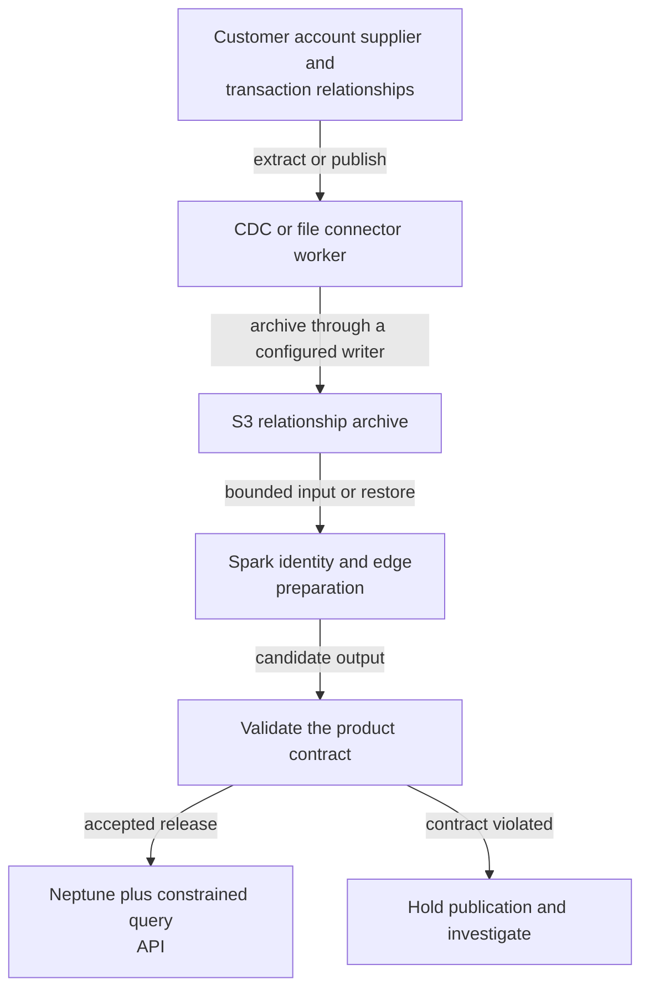
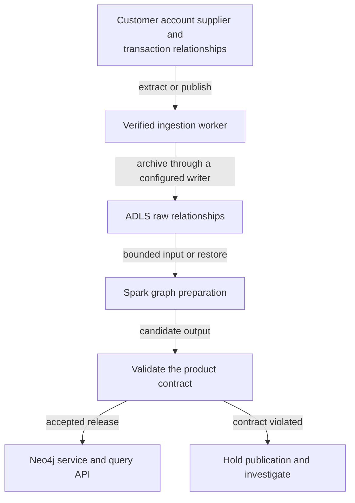
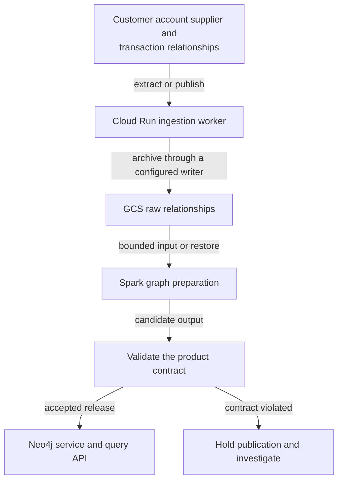
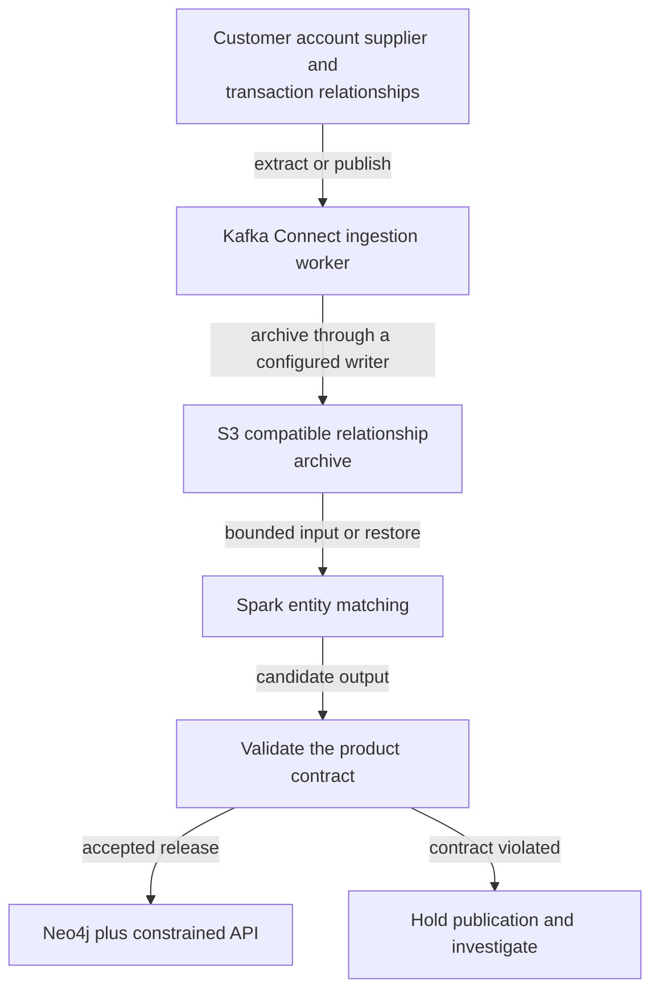
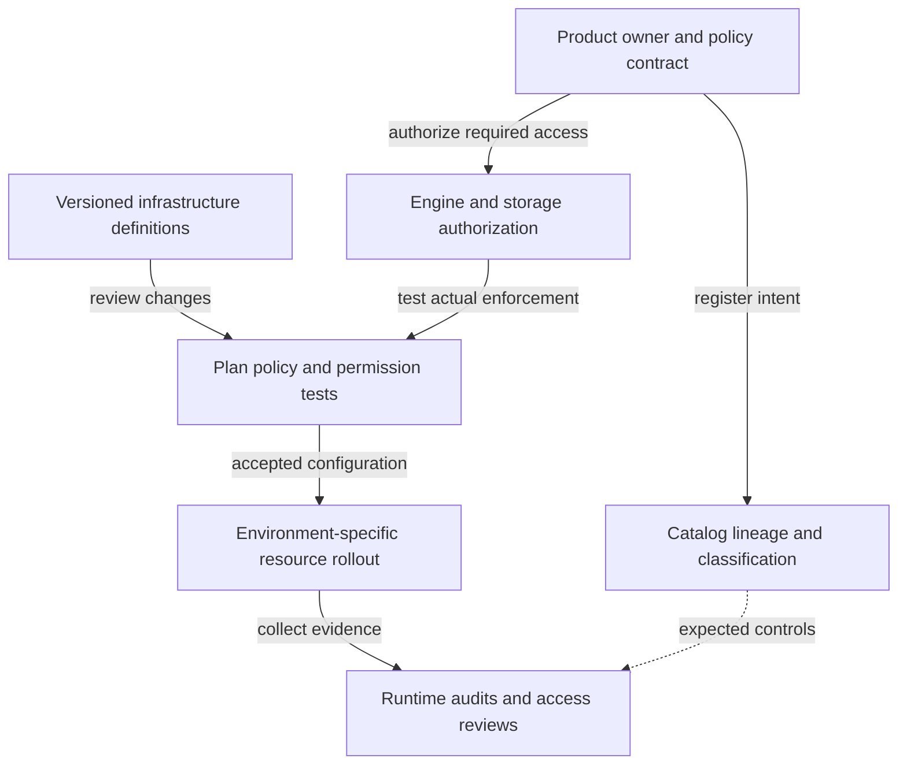
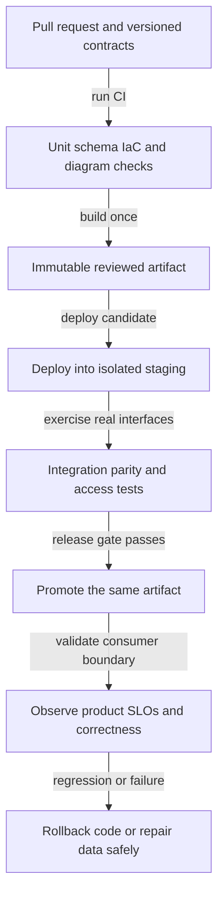

# S36 Build graph analytics and relationship serving

[Scenario index](../../DATA_SYSTEM_DESIGN_INDEX.md) · **Family:** Serving · **Mode:** graph

Explore paths and shared relationships that are awkward in repeated relational joins. Illustrative use: investigate fraud rings or supplier dependencies with bounded traversal latency.

## Requirements to clarify

Confirm source versions and access, daily and peak volume, read versus write freshness, consumer query patterns, error tolerance, budget, operating skills, residency, retention, and recovery objectives. The numeric targets in this scenario are exercise assumptions, not vendor guarantees.

**Data grain:** Entity node and directed relationship with validity and provenance.

**Identity and progress:** Stable node ID edge identity source version and relationship type.

## Data design

1. Resolve entity identity and preserve source evidence for each relationship.
2. Load nodes and edges using a graph schema aligned to traversal queries.
3. Maintain versioned incremental updates and deletes from authoritative data.
4. Expose constrained graph queries and verify results against known small graphs.

### Correctness contract

- A repeated relationship event is not necessarily a new distinct edge.
- Direction and relationship type are part of graph meaning.
- Traversal needs cycle guards or depth constraints and a query cost budget.

### Complete technology paths

These are proposed reference architectures, not exported vendor-certified deployments. Each path names concrete stages; when a worker or sink adapter is named, its connector configuration and code must be implemented and tested. The diagrams describe the data plane; operational deployment appears below.

#### AWS Neptune graph serving

Data moves through CDC or file connector worker, retains recoverable input in S3 relationship archive, and publishes through Neptune plus constrained query API after validation.



[Editable diagram source](../diagrams/S36-aws-neptune.mmd)

**Why this path helps:** Managed graph serving fits traversals over relationship data.

**What must be designed and verified:** Choose and validate graph model, query language, load format, deletion semantics, and query limits.

Technology references: [Amazon Neptune](https://docs.aws.amazon.com/neptune/latest/userguide/intro.html).

#### Neo4j on Azure

Data moves through Verified ingestion worker, retains recoverable input in ADLS raw relationships, and publishes through Neo4j service and query API after validation.



[Editable diagram source](../diagrams/S36-azure-neo4j.mmd)

**Why this path helps:** Keeps graph-specific modeling separate from the analytical archive.

**What must be designed and verified:** Choose licensed hosting or self-managed deployment and validate operational ownership.

Technology references: [Neo4j documentation](https://neo4j.com/docs/), [Azure Data Factory connectors](https://learn.microsoft.com/en-us/azure/data-factory/connector-overview).

#### Neo4j on Google Cloud

Data moves through Cloud Run ingestion worker, retains recoverable input in GCS raw relationships, and publishes through Neo4j service and query API after validation.



[Editable diagram source](../diagrams/S36-gcp-neo4j.mmd)

**Why this path helps:** Allows graph serving while retaining cloud storage and batch analytics.

**What must be designed and verified:** Deployment, licensing, availability, and query authorization are independently designed.

Technology references: [Neo4j documentation](https://neo4j.com/docs/), [Google Dataflow overview](https://docs.cloud.google.com/dataflow/docs/overview).

#### Open source oriented graph platform

Data moves through Kafka Connect ingestion worker, retains recoverable input in S3 compatible relationship archive, and publishes through Neo4j plus constrained API after validation.



[Editable diagram source](../diagrams/S36-oss-neo4j.mmd)

**Why this path helps:** Offers control of placement and connector behavior.

**What must be designed and verified:** Neo4j feature availability depends on edition; self-hosting requires backups and operations.

Technology references: [Neo4j documentation](https://neo4j.com/docs/), [Apache Kafka documentation](https://kafka.apache.org/documentation/).

### Replace each component deliberately

| Component | Alternatives | Why change it | What changes | Test before switching |
| --- | --- | --- | --- | --- |
| Source engine | PostgreSQL, MySQL, SQL Server, Oracle, MongoDB, DynamoDB, Cosmos DB, Cassandra, Bigtable | Match the operational workload or an existing estate. | Rework snapshot consistency, keys, delete capture, source ordering, and schema contracts. | Run source-specific bootstrap, mutation, delete, and retention tests. |
| Ingestion implementation | ADF, Glue workers, Airbyte, Fivetran, Informatica, Matillion, custom Python or Java workers | Trade connector maintenance against managed service cost and control. | Confirm endpoint support, network placement, source load, pagination or CDC envelopes, and acknowledgment rules. | Inject authentication, quota, partial-read, and retry failures. |
| Object storage | S3, ADLS Gen2, GCS, OCI Object Storage, IBM Cloud Object Storage, supported S3-compatible stores | Change placement, cost structure, or existing cloud integration. | Adjust IAM, encryption, filesystem assumptions, request costs, lifecycle and egress; verify table-writer support. | Resume multipart transfers, deny unauthorized access, and test recovery from actual retained versions. |
| Compute and transformation | Warehouse SQL with dbt, Spark, Flink, Beam on Dataflow, bounded Python with Polars or DuckDB | Fit relational, distributed, streaming, or bounded processing needs. | Rewrite runtime interfaces, date/type semantics, state handling, connector dependencies, and deployment artifacts. | Compare golden outputs plus load and restart behavior. |
| Orchestration | ADF or Fabric pipelines, Airflow, Dagster, Prefect, Lakeflow Jobs, cloud-native workflow services | Choose dependency handling, asset visibility, existing skills, and operations ownership. | Keep stable progress identities, timezones, backfill boundaries, concurrency controls, and external job submission. | Parse definitions, fail upstream work, and verify safe retries and recovery. |
| Serving | Snowflake, BigQuery, Redshift, Synapse, Fabric, Databricks SQL, Trino, ClickHouse, Pinot, Druid, purpose-built databases | Match consumer query shapes, freshness, concurrency, and operational read requirements. | Rework physical layout, query APIs, load adapters, tenant policies, mutations, and consumption models. | Benchmark actual consumer queries and reconcile output grain and precision. |
| BI and metric interface | Power BI, Tableau, Looker, Superset, Metabase, Cube, dbt Semantic Layer | Fit analyst workflow, semantic reuse, and existing licensing. | Translate semantic definitions, caching, refresh mode, identity propagation, and certified metrics. | Compare metric parity and denied-user behavior across interfaces. |
| Graph store | Neo4j, Neptune, relational recursive SQL for suitable bounded workloads | Fit traversal and relationship modeling rather than conventional aggregation. | Map property-graph or RDF semantics, query languages, identity, edge versioning, and authorization. | Compare known paths, cycles, deleted entities, and high-degree performance. |

A substitution is accepted only after the source protocol, input/output types, table format, catalog, region, identity, mutations, replay, and consumer API still meet the stated contract. Moving to a new cloud may also move network placement, keys, quotas, and cost ownership. A list of names alone is not a valid architecture.

## Governance and infrastructure automation

### Scenario governance rules

- Restrict relationship visibility because connectivity can reveal sensitive associations.
- Track evidence provenance and distinguish inferred from observed relationships.
- Propagate node erasure into edges and derived graph features.

Ownership and metadata describe the intended controls. Infrastructure automation deploys resources, and engine/storage permission tests prove enforcement at real access paths.



[Editable diagram source](../diagrams/S36-governance.mmd)

### Governance technology alternatives

| Platform | Catalog and ownership | Enforcement | Infrastructure controls | Boundary to test |
| --- | --- | --- | --- | --- |
| Azure | Microsoft Purview discovery plus actual engine grants | Entra identities, Azure RBAC, storage ACLs and query roles | Private routing, managed identities, source-safe runtimes | Catalog visibility is not a universal storage deny policy. |
| AWS | Glue Catalog and Lake Formation where integrated | IAM, supported Lake Formation grants, warehouse or service roles | VPC endpoints, KMS, workload IAM roles | Test direct S3 access and each engine integration separately. |
| Google Cloud | Knowledge Catalog formerly Dataplex Universal Catalog | IAM, BigQuery policies, storage permissions, service-specific enforcement | Service accounts, approved regions, private connectivity | Metadata policy intent must be verified at the actual execution and export paths. |
| Databricks | Unity Catalog plus product ownership and lineage | Unity Catalog grants and workspace or storage identities | Separate environments, locations, compute policies and progress state | Cataloged access can still be undermined by ungoverned direct storage credentials. |
| Snowflake | Horizon catalog capabilities and versioned products | Roles, grants, policies and secure sharing contracts | Account location, integrations, workload sizing and resource budgets | Validate feature availability and distinguish native, shared, and open-table access paths. |
| Open source or hybrid | OpenMetadata or DataHub plus a table catalog | Engine RBAC, cloud IAM, and supported policy integrations | Vault or cloud secrets, TLS, private endpoints and operational backup | Discovery tools do not automatically enforce permissions in every connector or engine. |

Discovery can be replaced with OpenMetadata or DataHub while keeping the same engine and storage enforcement. Source systems, object stores, query engines, exported copies, and caches are separate authorization surfaces. Instrument OpenLineage or native lineage where compatible; verify gaps instead of treating a catalog scan as complete operational lineage.

### Infrastructure automation alternatives

| Approach | Benefit | Implementation requirements | Important boundary |
| --- | --- | --- | --- |
| Terraform | Broad provider ecosystem and declarative plans | Separate remote state by ownership and environment; secure and lock it; validate provider coverage. | Providers and resource APIs differ, so shared language does not mean identical modules. |
| OpenTofu | Open-source-oriented declarative infrastructure workflow | Use explicit versions, tested providers, isolated state and encryption where configured. | Review migration and provider compatibility rather than assuming state interchange is universally safe. |
| Pulumi | General-purpose language infrastructure definitions | Test programs, preview changes, protect state and secrets, and scope automation identities. | Language-level power needs disciplined reproducibility and resource ownership. |
| Native cloud IaC | Bicep/ARM on Azure, CDK/CloudFormation on AWS, provider-specific declarative tools elsewhere | Keep environment parameters and identity controls explicit; import or manage existing resources carefully. | Native templates stay within their platform contract; job code and table data need separate lifecycle management. |
| Configuration and GitOps | Ansible/Packer for hosts; Helm and Argo CD for supported Kubernetes workloads | Bake versioned images, apply least privilege, and keep cloud resources under a separately declared owner. | GitOps reconciliation of manifests is not an automatic warehouse schema or historical data migration. |

Provision network paths, storage, catalogs, workload identities, secrets references, logging, backup, compute limits, and budgets before deploying jobs. Separate environments and remote state; do not commit state or credentials. Use explicit providers and versions, prevent two tools from owning the same resource, and test an isolated rebuild. For private sources, place a trusted runner or ingestion runtime on the reachable network; a CI runner location is a real architectural dependency.

## Code delivery and runtime automation

CI builds and tests a release. CD deploys the same artifact, runtime orchestration controls execution, and consumer-level checks detect regressions after promotion.



[Editable diagram source](../diagrams/S36-delivery.mmd)

### Delivery alternatives and compatible scope

| Delivery choice | Benefit | Scope for this scenario | Deployment and identity implications |
| --- | --- | --- | --- |
| GitHub Actions | Hosted or private runners with PR checks and environment-specific release jobs. | AWS Neptune graph serving, Neo4j on Azure, Neo4j on Google Cloud, Open source oriented graph platform | Provider CLI or API deploys the reviewed immutable job artifact; production gate records the artifact digest. Use environment-bound short-lived cloud identity where supported; restrict token claims and trusted branches. |
| Jenkins | Private-network runners and shared libraries suit existing enterprise delivery estates. | AWS Neptune graph serving, Neo4j on Azure, Neo4j on Google Cloud, Open source oriented graph platform | A Jenkinsfile builds and tests once; a shared deploy library applies the reviewed artifact and records evidence. Isolate agents, pin plugins and dependencies, and scope credentials to a job and environment. |
| GitLab CI | Merge-request tests, protected environments, and configurable runners keep delivery close to source control. | AWS Neptune graph serving, Neo4j on Azure, Neo4j on Google Cloud, Open source oriented graph platform | Stage-specific jobs publish an immutable artifact and invoke the chosen platform deployment adapter. Use protected runners and environment permissions; identity federation depends on the target provider. |
| Azure DevOps Pipelines | Native Azure delivery and enterprise service connections suit Azure-centered teams. | Neo4j on Azure | For ADF use validated factory artifacts and environment parameterization; for Databricks use bundles or the supported API. ADF factory resource deployment and pipeline definition publishing are separate lifecycle steps. |
| AWS CodePipeline and CodeBuild | Native AWS build roles and pipeline stages reduce cross-service identity plumbing. | AWS Neptune graph serving | Publish job artifacts and apply the chosen AWS or warehouse deployment adapter; CDK synthesizes CloudFormation. Build VPC access, source connection, artifact encryption, and least-privilege deploy roles must be provisioned. |
| Google Cloud Build | Containerized build steps integrate with Google service accounts and artifact storage. | Neo4j on Google Cloud | Build a job image or template and deploy through Dataflow, Composer, Cloud Run, or warehouse-specific interfaces. Cloud Deploy has supported workload targets; data jobs require their actual job APIs rather than assumed generic support. |
| GitHub or GitLab build with Argo CD | A reconciler promotes declared Kubernetes manifests and makes drift visible. | Open source oriented graph platform | CI updates the reviewed image digest or Helm values in Git; Argo CD reconciles the selected namespace. Argo CD reconciles Kubernetes resources; cloud infrastructure and managed warehouse DDL remain separately owned. |
| Tekton pipelines on Kubernetes | Kubernetes-native task execution can fit a self-managed platform engineering estate. | Open source oriented graph platform | Pipeline tasks execute tests and platform-specific deploy steps; cloud resource state stays in the chosen IaC backend. Operators must manage cluster availability, runner permissions, artifact provenance, and secrets. |

### Runtime and platform deployment differences

SQL/dbt releases deploy model code plus controlled DDL and grants. Spark releases publish a tested wheel, JAR, container, or job definition. Flink releases must coordinate compatible state or savepoints before changing a job. ADF releases publish validated factory definitions with environment parameters and deliberate trigger handling. Databricks uses Declarative Automation Bundles or supported APIs; Fabric requires supported Git and deployment behavior per item. Kubernetes services use versioned manifests and image digests. The same CI tool can call these interfaces, but the interfaces are not interchangeable.

Runtime choices: Platform-native bounded schedule, Apache Airflow, Dagster, Prefect. For a continuous stream, an orchestrator manages lifecycle and repair; it should not start a fresh consumer for every arriving message.

### Safe promotion and rollback

Build once, record the code and dependency versions, test an isolated deployment with realistic interfaces, then promote the same artifact. Use expand-and-contract schema changes and avoid coupling destructive data changes to an ordinary code rollback. A failed publication retains the last accepted product version and clearly exposes stale or partial status. Graph engines do not solve inaccurate entity matching by themselves.

## Tests to run and automate

| Test | Automation and cadence | Evidence and failure action |
| --- | --- | --- |
| Test cycles, multiple paths, duplicate edges, orphan nodes, and deleted entities. | Deterministic fixture in CI; expensive restore or full-load variants before cutover | Persist inputs, artifact version, expected result and actual result. Block publication or promotion when the declared contract fails. |
| Compare reachable-node sets with an independent graph oracle. | Isolated integration test before promotion and on connector upgrades | Persist inputs, artifact version, expected result and actual result. Block publication or promotion when the declared contract fails. |
| Load a high-degree node and measure query and update behavior. | Failure or replay drill in an isolated environment on a scheduled cadence | Persist inputs, artifact version, expected result and actual result. Block publication or promotion when the declared contract fails. |
| Verify restricted nodes cannot be inferred through an unauthorized traversal API. | End-to-end or representative workload exercise before major releases | Persist inputs, artifact version, expected result and actual result. Block publication or promotion when the declared contract fails. |
| Permissions and tenant boundary | Automate authorized and denied reads on staging; rerun after policy changes | Test engine query, direct object access, exports and caches. A metadata-only permissions check is insufficient. |
| Infrastructure and supply chain | Automate syntax, plan, policy, secret scanning and dependency checks on each PR | Reject unapproved region, broad IAM, exposed storage, overlapping ownership, or unexpected destructive changes. |
| Data freshness and completeness | Continuously measure at the consumer boundary; compare periodic source manifests | Alert the owner and show stale or partial status. Job exit status is not the SLO. |
| Recovery and business acceptance | Automate restore/replay evidence; schedule a supervised drill and business review | Record actual RPO/RTO, reconciled business totals and remaining exceptions. Full production drills need the operational change process. |

### What needs human judgment

Automate repeatable fixtures, contracts, type/schema compatibility, data reconciliation, permission denial, infrastructure policy, load probes, and recovery evidence. Business owners still approve changed metric meaning, reconciliation tolerances, retention exceptions, and consumer acceptance. Security and operations review the intended policy and the consequences of a cutover; scripts produce evidence rather than defining policy by themselves.

## Failure recovery and tradeoffs

- Neo4j and Neptune use different graph models and query languages.
- Relational recursive SQL may be enough for occasional bounded traversals.
- Graph engines do not solve inaccurate entity matching by themselves.

Preserve the exact input and output release manifests, progress positions, job versions, and validation evidence. Recovery starts from the last durable accepted boundary and uses a compatible source and sink. Coordinate live and repair writers; if a sink has changed after the saved checkpoint, reconcile or rebuild rather than assuming connection switching restores correctness.

## Explore the documented combinations

```sh
python3 data_system_design/tools/enumerate_designs.py --scenario S36 --count
python3 data_system_design/tools/enumerate_designs.py --scenario S36 --limit 12
```

The enumerator expands the documented data bundles, runtime orchestration, metadata alternatives, eligible delivery systems, and their infrastructure tools. It rejects native-cloud delivery outside its cloud and Kubernetes delivery without a Kubernetes runtime. These are design candidates requiring the stated integration checks, not generated deployable infrastructure or proof that arbitrary products interoperate.

## Source references

- [Neo4j documentation](https://neo4j.com/docs/)
- [Amazon Neptune](https://docs.aws.amazon.com/neptune/latest/userguide/intro.html)
- [GitHub Actions OIDC](https://docs.github.com/en/actions/concepts/security/openid-connect)
- [Terraform state](https://developer.hashicorp.com/terraform/language/state)
- [dbt data tests](https://docs.getdbt.com/docs/build/data-tests)

[Technology roles](../TECHNOLOGY_CHOICES.md) · [Automation recipes](../AUTOMATION_PLAYBOOK.md) · [Test patterns](../TESTING_PLAYBOOK.md) · [Compatibility rules](../COMPATIBILITY.md)
